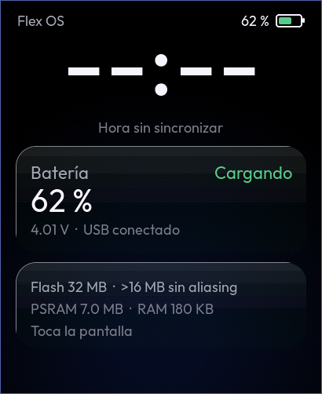

# B1 — Arranque verificable

Pantalla CO5300, táctil FT3168, LVGL 9.5.0, primera pantalla con la identidad
de Flex OS Ultra y lectura **de solo lectura** del AXP2101.

## 1. Contenido

| Componente | Función | Origen |
|---|---|---|
| BSP `waveshare/esp32_s3_touch_amoled_2_06` 2.0.0 | Bus I2C, inicialización del CO5300 (desfase 0x16), FT3168, brillo DCS 0x51 | oficial, sin modificar (componente gestionado) |
| `watch_display` | LVGL 9 sobre el panel del BSP: buffers parciales elegidos según la RAM DMA medida, *rounder* par/impar, tarea en el núcleo 1, brillo inicial al 70 % | propio |
| `watch_touch` | `bsp_touch_new` → entrada de LVGL | propio (driver oficial) |
| `watch_power` | Driver del AXP2101 de **solo lectura** + modelo puro (decodificación, estados, filtros, histéresis) | propio; mapa de registros contrastado con XPowersLib (MIT) y el ejemplo oficial `01_AXP2101` |
| `watch_theme` | Tokens de Flex OS Ultra, fondo Onyx, material de vidrio, fuentes Outfit | transcrito de la referencia 5dbc949 |
| `watch_diag` | Memoria y sonda de flash de solo lectura (docs/FLASH-32MB.md) | propio |
| `watch_ui` | Pantalla de inicio de B1 | propio |

**Por qué no se usa XPowersLib:** `XPowersAXP2101::begin()` llama a `disableTSPinMeasure()`, que **escribe** el registro 0x30. En B1 no se escribe ningún registro, así que el driver lee directamente los mismos registros que usa el código oficial.

## 2. Dependencias y versión de LVGL (resuelto)

**Discrepancia del repositorio oficial** (`waveshareteam/ESP32-S3-Touch-AMOLED-2.06`):
- `examples/esp-idf/02_lvgl_demo_v9/main/idf_component.yml` declara `lvgl/lvgl: "9.5.0"` y el BSP `^2.0.0`.
- Su `dependencies.lock` dice lvgl 9.2.0, BSP 1.0.3 e idf 5.5.0.
- El historial lo explica: el *lock* se subió una vez (commit a360158) y no se regeneró al actualizar el manifiesto (a3bcac7).
- El `manifest_hash` del *lock* no coincide con el manifiesto actual, así que el gestor de componentes vuelve a resolver en cada compilación limpia. Es lo que hace su CI (`.github/workflows/examples.yml`: `IDF_VERSIONS: "v5.5.5,v6.0.2"`).

**Decisión:** LVGL **9.5.0** (fijado), la misma versión que el manifiesto oficial compila con ESP-IDF v5.5.5.

**Restricciones del BSP 2.0.0** (su `idf_component.yml`):

| Dependencia | Restricción | Versión compilada en B1 (*) |
|---|---|---|
| idf | ≥ 5.3 | 5.5.5 |
| lvgl/lvgl | ≥ 8, < 10 | 9.5.0 (fijada en nuestro manifiesto) |
| espressif/esp_lvgl_port | ^2 | 2.9.0 |
| waveshare/esp_lcd_sh8601 | * | 2.0.0 |
| esp_lcd_touch_ft5x06 | * | 1.1.1 (requiere esp_lcd_touch ^1.2.0 → 1.2.1) |
| esp_codec_dev | ~1.5 | 1.5.11 |
| esp_lcd_panel_io_additions | ^1 | 1.0.1~1 (requiere cmake_utilities 0.* → 0.5.3 y esp_io_expander ^1 → 1.2.1) |
| usb | solo con idf ≥ 6.0 | no aplica en 5.5.5 (se usa el componente usb de IDF) |

(*) El entorno donde se desarrolló B1 no puede acceder al Registro de Componentes de Espressif (el proxy bloquea `components.espressif.com` y `dl.espressif.com`). Por eso se compiló con copias **de las mismas versiones** obtenidas de sus repositorios de GitHub (`tools/offline/build_offline.sh`).
- En tu PC el gestor resolverá contra el registro y escribirá `dependencies.lock`. **Ese archivo es la resolución real: súbelo al repositorio** o envíamelo.
- Si alguna versión difiere de esta tabla (sobre todo `esp_lvgl_port`), avísame.

## 3. Compilar y flashear en tu PC (ESP-IDF 5.5.5)

El proyecto ESP-IDF está en la carpeta **`Flex OS Ultra Watch/`**. Se compila y se flashea desde dentro. La guía completa, con los archivos que genera la compilación, está en `Flex OS Ultra Watch/README.md`.

### Con terminal ESP-IDF (o "ESP-IDF Terminal" en VS Code)

```bash
git clone https://github.com/AccountDev-Design/Flex-OS-Watch-Ultra.git
cd Flex-OS-Watch-Ultra
git checkout ccr-b6cde864-7hvm3w
cd "Flex OS Ultra Watch"           # comillas: el nombre tiene espacios
idf.py set-target esp32s3          # solo la primera vez: genera sdkconfig desde sdkconfig.defaults
idf.py build
idf.py -p COM5 flash monitor       # Windows: COMx · Linux: /dev/ttyACM0 · macOS: /dev/cu.usbmodem*
```

### Con la extensión de VS Code

1. Abre la carpeta **`Flex OS Ultra Watch`**, no la raíz del repositorio.
2. Elige "Set Espressif Device Target" → `esp32s3` (puerto USB Serial/JTAG).
3. Ejecuta "Build", luego "Flash" (método UART/USB) y luego "Monitor".

### Si ya compilaste B1 en la raíz antes de la reorganización

Tu copia local tiene, en la raíz y sin versionar, lo que generó aquella compilación:
- `build/`, `managed_components/` y `sdkconfig` (ignorados por Git);
- `dependencies.lock`, que no está ignorado y es la resolución exacta con la que B1 funcionó en tu reloj.

Para conservar esa misma configuración:

```bash
git pull
mv dependencies.lock "Flex OS Ultra Watch/"     # Windows: move dependencies.lock "Flex OS Ultra Watch\"
mv sdkconfig "Flex OS Ultra Watch/"             # opcional: tu sdkconfig de B1
cd "Flex OS Ultra Watch"
idf.py build                                    # sin set-target si moviste sdkconfig (set-target lo regenera)
```

- Después puedes borrar los antiguos `build/` y `managed_components/` de la raíz: son regenerables y ya no se usan.
- Sube `Flex OS Ultra Watch/dependencies.lock` al repositorio.

### Notas

- **No ejecutes `idf.py erase-flash`.** El flasheo solo escribe bootloader (0x0), tabla (0x8000), `otadata` (0xE000) y la app (0x10000) — ver `Flex OS Ultra Watch/build/flash_args`.
- **Espacios en la ruta:** ESP-IDF 5.5.5 los declara no soportados. Este proyecto compila y genera el flasheo correctamente en una ruta con espacios (comprobado en Linux), pero no en Windows ni con la extensión de VS Code. Si falla, renombra la carpeta sin espacios (`git mv "Flex OS Ultra Watch" Flex-OS-Ultra-Watch`).
- Si no entra en modo de descarga, mantén **BOOT** (GPIO0) mientras conectas o reinicias.
- El reloj usa el USB nativo del ESP32-S3 (USB Serial/JTAG). La consola sale por él como consola secundaria, igual que en los ejemplos oficiales.
- Para volver al firmware de fábrica está la imagen oficial `FirmWare/ESP32-S3-Touch-AMOLED-2.06-xiaozhi-251104.bin` del repositorio de Waveshare: 28 MB desde 0x0, sustituye todo. No forma parte de este proyecto.
- Sin acceso al registro (como en el entorno de desarrollo), desde la raíz del repositorio:

  ```bash
  FLEX_DEPS_DIR=/ruta/deps tools/offline/build_offline.sh build
  ```

## 4. Resultados verificados (sin hardware)

| Comprobación | Resultado |
|---|---|
| Compilación ESP-IDF 5.5.5 + BSP 2.0.0 + LVGL 9.5.0 (esp32s3) | **OK**, 0 avisos en el código del proyecto |
| Tamaño de la app | 818 688 B (0,78 MiB) en una ranura de 6 MB |
| RAM interna estática (DIRAM) | 86 KB usados, 255 KB libres. Con `LV_ATTRIBUTE_FAST_MEM_USE_IRAM`: 194 KB usados, solo 148 KB libres, por eso se desactiva |
| Tabla de particiones | válida con 32 MB; rechazada con 16 MB |
| Pruebas de PC (`make -C tests/host` desde la raíz, con ASan y UBSan) | **87/87**: decodificación AXP2101, estados, confirmación de carga, filtros, histéresis, sonda de flash, tinte del vidrio y fondo |
| Vista previa LVGL en el PC (`tools/sim`) | 4 escenarios renderizados: `docs/img/b1_*.png` (datos **simulados**) |

**Nada de lo anterior prueba el hardware.**



## 5. Pruebas físicas que debes hacer en el reloj

Copia el **registro serie completo** de cada prueba y envíamelo. Marca cada prueba como OK, FALLO o NO REALIZADA.

| # | Prueba | Cómo | Resultado esperado |
|---|---|---|---|
| T1 | Arranque | flashear y abrir el monitor | `Flex OS Watch Ultra 0.1.0-b1 (ESP-IDF v5.5.5)` sin reinicios. Anota la línea `watch_display: RAM interna DMA libre ... -> buffers 2 x N lineas` |
| T2 | Imagen y desfase | mirar la pantalla | Fondo negro con halo azul tenue abajo. **Marco azul de 1 px visible en los 4 bordes** (las esquinas pueden quedar ocultas por el redondeo físico: indica cuántos píxeles aproximadamente). Sin franjas de basura ni imagen desplazada |
| T3 | Táctil | tocar las 4 esquinas y el centro; arrastrar | El anillo sigue al dedo. Coordenadas cerca de (0,0), (409,0), (0,501), (409,501) y (205,251). Ejes no invertidos |
| T4 | Batería sin USB | desconectar el USB (el monitor se cortará: haz la foto de la pantalla) | "Descargando". % y V plausibles. Si tienes multímetro, compara la V |
| T5 | Inicio de carga | conectar el USB con la batería no llena | En ≤ 4 s pasa a "Cargando" (verde) y el registro muestra `transicion CONFIRMADA a 'cargando'` |
| T6 | Carga completa | dejar cargando hasta el final (puede tardar horas) | "Carga completa"; el registro `01=` termina en etapa 4 |
| T7 | Externa sin carga | si en algún momento hay USB y no carga (p. ej. batería llena) | "Externa sin carga", **sin** estado "Cargando" |
| T8 | Registros del PMIC | en T4, T5 y T6 copiar `AXP2101 regs 00=.. 01=.. 03=.. 18=.. 30=.. 34=.. 35=.. A4=..` | `03=4A`. Indica si `30` tiene el bit 0 (ADC de VBAT) y `18` el bit 3 (gauge). Si no lo tienen, VBAT o % salen como "no disponible": es lo esperado en solo lectura |
| T9 | Rendimiento | mirar el medidor de LVGL abajo, en reposo y arrastrando el dedo | Anota FPS y % de CPU de los dos casos |
| T10 | Flash > 16 MB | líneas `watch_diag` del registro | `JEDEC 0xC84019, fisica 32768 KB, declarada 32768 KB` y `veredicto >16 MB: lectura >16 MB distinta (sin aliasing)` |
| T11 | Memoria | líneas `[inicio]`, `[tras pantalla y LVGL]` y `[tras crear la interfaz]` | enviarlas |
| T12 | Estabilidad | dejarlo encendido 30 min con y sin USB | Sin reinicios (ningún `rst:` nuevo en el registro) |
| T13 | Brillo y legibilidad | uso normal | ¿se lee bien al 70 %? ¿algún tamaño de letra demasiado pequeño? |

## 6. Lo que B1 NO hace (a propósito)

- **Sin hora real:** la esfera muestra "--:--" (el RTC PCF85063 llega en la Fase 4).
  - **Actualización (B3-2):** el RTC ya se lee en solo lectura y la pantalla de inicio es la esfera.
  - Esta pantalla de B1 pasa a ser la de diagnóstico, que vuelve a ser accesible desde Ajustes en B3-5.
  - Las pruebas T2 y T3 se hacen en **Ajustes > Diagnóstico > Prueba de pantalla** (prueba T40 de `docs/B3-INTERFAZ.md`).
- **Sin escrituras en el AXP2101:** ni ADC, ni pin TS, ni parámetros de carga. Activar el ADC de VBAT y desactivar el pin TS, como hace el código oficial, se decidirá en B2 con los registros de T8.
- **Sin animación de carga:** es B2, y se disparará con la transición CONFIRMADA ya implementada (`charging_started`).
- **Sin escrituras ni montaje** en las particiones `storage` o `assets`.
- **Sin Wi-Fi, BLE, NVS, OTA ni apps.**
- **Sin desenfoque:** el vidrio de B1 es tinte adaptativo + brillo + sombra + bordes sobre el fondo Onyx. Sobre un fondo casi negro, un desenfoque no cambiaría la imagen.

## 7. Diferencias con el ejemplo oficial 02_lvgl_demo_v9

| Opción | Oficial | B1 | Motivo |
|---|---|---|---|
| Tamaño de flash | 16 MB | 32 MB | físico 32 MB (docs/FLASH-32MB.md) |
| `LV_ATTRIBUTE_FAST_MEM_USE_IRAM` | sí | no | +108 KB de RAM interna libre (medido) |
| Buffers de LVGL | según el BSP | 2 parciales en RAM DMA, dimensionados al arrancar | sin PSRAM en el envío por DMA |
| Medidor de FPS | sí | sí (solo en B1) | medir T9 |
| Brillo inicial | 100 % | 70 % | consumo del AMOLED |
