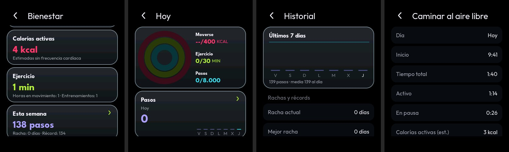
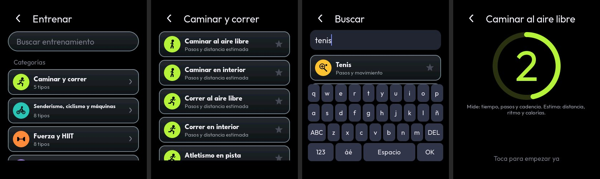
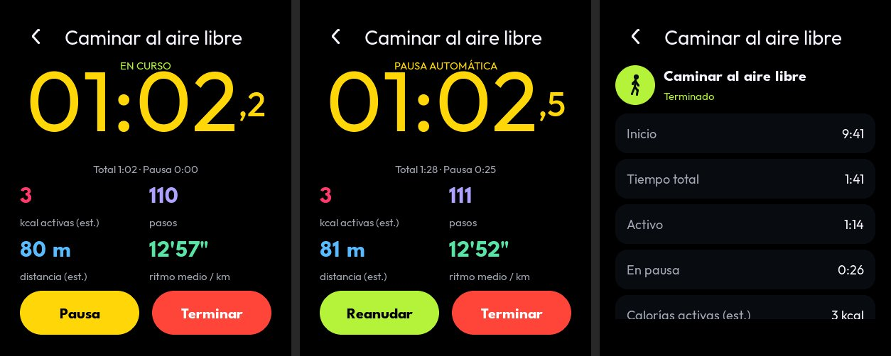
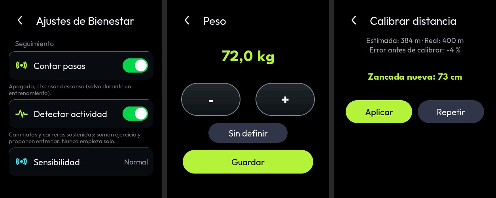

# Bienestar — Flex OS Watch Ultra

App nueva e independiente de actividad y entrenamiento, pedida el 2026-10-25 ("IMPLEMENTACIÓN PROFESIONAL DE LA NUEVA
APP BIENESTAR", con cinco imágenes de referencia del Apple Watch usadas solo como inspiración del comportamiento).
Firmware real: ESP32-S3R8, AMOLED 410x502, ESP-IDF 5.5.5, LVGL 9.5.0, IMU QMI8658. Sin motor de vibración, sin
frecuencia cardíaca, SpO2, GPS ni barómetro.

**Nada de este documento está probado en el reloj.** Lo comprobado: el firmware compila con ESP-IDF 5.5.5 sin
avisos, las pruebas de PC pasan (con ASan y UBSan) y la vista previa de LVGL en el PC funciona (con datos simulados).
Las pruebas físicas son T185-T204 (`PRUEBAS-RELOJ.md` §16). La precisión de los pasos, de la distancia y de las
calorías **solo** la dicen esas pruebas.

## 1. Qué hay

| Parte | Archivos | Estado |
|---|---|---|
| Servicio de actividad (una tarea, una instancia) | `components/watch_activity/watch_activity.c` | compila; vista previa con la lógica real |
| Señal y detector de pasos | `act_steps.c` (lógica pura) | pruebas de PC con señales sintéticas |
| Máquina de estados del entrenamiento | `act_session.c` (lógica pura) | pruebas de PC |
| Métricas, zancada, energía, anillos, ajustes | `act_metrics.c` (lógica pura) | pruebas de PC |
| Día en curso, cambio de día, detección automática | `act_engine.c` (lógica pura) | pruebas de PC |
| Historial, estadísticas, rachas y logros | `act_store.c` (POSIX: LittleFS en el reloj, carpeta en el PC) | pruebas de PC |
| Catálogo de 84 entrenamientos en 10 categorías | `act_catalog.c` | pruebas de PC |
| Flujo de muestras del IMU | `watch_imu/watch_imu.c` (`watch_imu_stream_*`) | compila; el lector sigue siendo la tarea del IMU |
| Interfaz | `watch_ui/ui_wb_*.c`, `ui_wb.h`, `ui_wb_logic.c` | vista previa y pruebas de PC |
| Gesto desde el borde derecho | `ui_gesture.c` (`ui_edge_swipe_*`), `ui_nav.c` | pruebas de PC y vista previa |
| Icono de la app | `tools/icons/gen_app_icons.c`, `assets/icons/app_bienestar.bin` | los demás iconos no cambian ni un byte |

Bienestar aparece en el cajón (hueco 8, que estaba vacío: 15 apps en 16 huecos) y por el gesto de la esfera.

## 2. Arquitectura

```
 tarea del IMU (watch_imu, prio 2)          tarea "watch_act" (prio 1, núcleo 0)             tarea de LVGL (núcleo 1)
 ┌──────────────────────────────┐  anillo  ┌───────────────────────────────────────┐  copia  ┌────────────────────────┐
 │ ráfaga de 19 B por I2C       │ 64 mues. │ drain(): tandas de 16 → act_engine    │ (cerro- │ ui_wb_*: solo lee       │
 │ cada 20 ms (40 ms en reposo) │ ───────► │   act_steps   (señal y pasos)         │  jo     │ watch_activity_get() y  │
 │ contador de 24 bits del chip │ notifica │   act_session (entrenamiento)         │  breve) │ la caché del historial; │
 │ descarta lecturas repetidas  │ a la     │   act_metrics (zancada, energía)      │ ◄────── │ manda comandos          │
 └──────────────────────────────┘ mitad    │ act_store  → LittleFS (por lotes)     │         └────────────────────────┘
                                           │ watch_settings → NVS (ajustes)        │
                                           └───────────────────────────────────────┘
```

- **Una sola instancia.** `watch_activity_start()` se llama una vez en `app_main` (después del IMU, la hora y el
  almacenamiento) y las llamadas repetidas no hacen nada. La interfaz, las tarjetas y la app usan la misma; ninguna
  pantalla crea tareas, temporizadores de servicio ni otro detector.
- **Independiente de la interfaz.** Sigue contando con la app cerrada, en otra pantalla o con la pantalla apagada. La
  interfaz no hace E/S ni I2C: copia una instantánea (`watch_activity_get`) y la caché del historial bajo un cerrojo
  que la tarea nunca retiene durante la E/S.
- **Sin sondeo rápido.** La tarea duerme en `xTaskNotifyWait` y despierta cuando el anillo va por la mitad, con un
  comando de la interfaz o cada segundo (tick de la máquina de estados). Con el seguimiento apagado y sin
  entrenamiento cierra el flujo y el IMU vuelve al reposo.
- **Separación.** Adquisición (`watch_imu`), procesamiento y métricas (`act_steps`, `act_session`, `act_metrics`,
  `act_engine`: C puro sin ESP-IDF, el mismo código en el reloj y en el PC), persistencia (`act_store`,
  `watch_settings`) e interfaz (`ui_wb_*`).
- **Reutiliza** la hora (`watch_time`: fecha local para el cambio de día y UTC para los registros), los ajustes
  (`watch_settings`: bloques con versión y CRC, escritor único, guardado por lotes), el almacenamiento
  (`watch_storage`: LittleFS en `/storage`, nunca se formatea) y la navegación (`ui_nav`, `ui_page_timer`).

## 3. IMU

Modelo real: **QMI8658C** (dirección 0x6B, WHO_AM_I 0x05), controlador propio `watch_imu` (F4.4). Configuración que
ya tenía y que Bienestar usa sin cambiarla: acelerómetro ±4 g, giroscopio ±512 °/s, ODR código 7 = 56,05 Hz con los
dos sensores, ráfaga de 19 bytes (temperatura, 6 ejes y contador de muestras de 24 bits). El chip no tiene FIFO ni
podómetro en este controlador ni interrupción de dato listo cableada: se lee por sondeo.

Lo que se añadió a `watch_imu` (`watch_imu_stream_open/read/set_period/close/stats`):

- Un anillo de muestras para un lector (Bienestar). Cada muestra lleva el contador del chip desplegado a 32 bits, la
  marca del reloj monótono (`esp_timer`), mili-g y la marca `restart` tras encender o recuperar el sensor.
- Una lectura repetida (mismo contador) no se mete en el anillo. Si el anillo se llena se cuentan las perdidas
  (`dropped`) y el motor lo trata como discontinuidad, sin inventar lo que faltó.
- Recuperación: tras 25 fallos de I2C seguidos (con al menos 2 s entre intentos) reinicia el sensor; la primera
  muestra lleva `restart`.
- Periodo de lectura: 20 ms (unas 49 lecturas por segundo de un ODR de 56 Hz; el contador del chip dice cuántas se
  saltan) y 40 ms cuando el reloj lleva 30 s quieto sin entrenamiento. Mientras Bienestar cuenta, los sensores
  están encendidos todo el tiempo (antes solo con la app Sensores abierta).
- Ejes: **no verificados** frente a la esfera (T61). Por eso el detector usa el módulo |a|, que no depende de la
  orientación.

## 4. Señal y detector de pasos (`act_steps.c`)

Por muestra, sin reservar memoria (todo el estado cabe en `act_steps_t`, 304 B):

1. **Validación.** Contador repetido = misma muestra (se descarta). Salto de más de 12 muestras (214 ms) o un reloj
   que no cuadra con el contador = discontinuidad: los filtros y el tren de pasos empiezan de nuevo. Ejes saturados
   (±3990 mg) o un módulo por debajo de 50 mg (caída libre, ceros) se cuentan como inválidos y se ignoran.
2. **Tiempo** del contador del sensor (periodo real de 17,84 ms), ajustado suavemente al reloj monótono para seguir
   la deriva del oscilador; nunca de cuánto tardó el bucle.
3. **Gravedad:** media lenta del módulo (tau 1,5 s) con la entrada acotada a ±250 mg, para que un golpe no la
   arrastre. Queda la parte dinámica.
4. **Paso bajo** de 2.º orden (dos polos a 4 Hz, coeficiente según el dt real): deja la cadencia de caminar y correr
   (0,5-3,5 Hz) y quita golpes y vibraciones.
5. **Picos y valles** con histéresis. La amplitud pico-valle tiene que superar un umbral mínimo (160, 110 o 75 mg
   según la sensibilidad baja, normal o alta) y otro que se adapta a la intensidad de los pasos ya aceptados. El
   valle tiene que bajar de la gravedad al menos un 18 % de la amplitud: un paso oscila a los dos lados; un golpe o
   un aplauso es un pico aislado.
6. **Intervalo** entre 250 y 2000 ms (30-240 pasos/min). Un pico demasiado pronto es parte del mismo paso: nunca
   cuenta dos veces.
7. **Confirmación por regularidad:** un tren empieza a contar con 6 candidatos seguidos con intervalos dentro de
   ±35 % de su mediana, y entonces suma esos 6 de golpe (no se pierden los primeros). Gestos sueltos, golpes y
   cuatro pasos sueltos no llegan a confirmarse. El tren termina sin paso en 2,2 medianas.
8. **Clase de movimiento** por ventanas de 1 s con histéresis: quieto (< 8 mg RMS), ligero, caminar, correr (desde
   140 pasos/min, o desde 120 con amplitud de carrera de 900 mg).

Resultados de PC (señales sintéticas de muñeca con ruido, pérdidas, duplicados y retrasos de lectura; prueban el
algoritmo, no la precisión real):

| Caso | Resultado |
|---|---|
| Caminar 60 s a 110 pasos/min | 110 ± 4 % (cadencia 110 ± 6) |
| Caminar despacio, 85 pasos/min, poca amplitud | 85 ± 6 % |
| Correr 60 s a 165 pasos/min | 165 ± 4 %, clase "correr" |
| Caminar → correr | la clase cambia con histéresis, no cada segundo |
| Escribir, ir sentado, gestos sueltos, golpes, 4 pasos y parar, vibración de coche | 0 pasos |
| Una muestra de cada 8 perdida, lectura a 25 Hz | ± 6 % de la referencia |
| Muestras duplicadas | los mismos pasos que sin duplicados |
| Hueco de 400 ms, salto del reloj | una discontinuidad; se pierde a lo sumo el tren en curso |
| Barrido: caminar 60-130 pasos/min (300-900 mg) y correr 150-190 (≥ 900 mg) con pérdidas | dentro de ± 2 % |

**Límites conocidos** (el reloj va en la muñeca): movimientos rítmicos del brazo sin caminar durante varios segundos
(cepillarse los dientes, aplaudir seguido, agitar el reloj a 2-3 Hz) pueden contarse; empujar un carro, llevar la
mano en el bolsillo o apoyada pueden omitir pasos; empujar una silla de ruedas puede contarse como pasos fuera de un
entrenamiento. Amplitudes muy bajas a cadencia alta (correr muy suave) no se detectan con la sensibilidad normal.

## 5. Detección automática de actividad

- Caminar 3 min seguidos o correr 2 min seguidos propone empezar un entrenamiento (tarjeta en la app; sin vibración
  no hay aviso físico). Nunca empieza solo. Al aceptar, el entrenamiento empieza en el primer paso del tren y se lleva
  sus pasos; el día no cambia (solo cambia de fuente).
- Caminar a buen ritmo (≥ 100 pasos/min sostenido al menos 1 min) suma minutos de ejercicio sin entrenamiento. Con
  un entrenamiento en marcha no se suma dos veces.
- Se puede desactivar (Ajustes > Detectar actividad): no sugiere ni suma ejercicio automático. Los entrenamientos
  manuales están siempre disponibles.

## 6. Métricas: medido, estimado y no disponible

| | Qué | Cómo |
|---|---|---|
| **Medido** con el IMU | pasos, cadencia, movimiento de la muñeca, tiempo activo y en pausa | §4 y §7 |
| **Estimado** | distancia (nunca GPS) | pasos × zancada: la del usuario o calibrada; si no, 0,415 × altura caminando y 0,65 × altura corriendo; sin altura, 0,70 m y 1,00 m genéricos (se dice "genérica") |
| **Estimado** | calorías activas (netas, sin frecuencia cardíaca) | caminar/correr con pasos: ACSM, 0,1 y 0,2 ml O2/kg por metro, 5 kcal/l (0,0005 y 0,001 kcal/kg/m). Otros entrenamientos: (MET − 1) × horas **activas** (MET del Compendio). Nunca un valor fijo por minuto |
| **Estimado** | ritmo | tiempo activo / distancia estimada |
| **No disponible** | frecuencia cardíaca, SpO2, GPS, pisos (sin barómetro), brazadas, largos | la interfaz no los enseña |

- La energía se acumula **por kg** y se multiplica por el peso al enseñarla: sin peso no hay calorías (la interfaz
  pide el peso, no inventa uno) y al añadirlo el día de hoy ya sale bien.
- **Nunca dos fuentes a la vez:** con un entrenamiento en marcha el gasto es el de la sesión; si no, el de los pasos.
  Al terminar no se suma otra vez. Las pausas no gastan ni son ejercicio.
- Fuera de un entrenamiento solo suman los pasos confirmados: no hay un modelo fiable para el "movimiento ligero".
- **Objetivos** (mover en kcal, ejercicio en min, pasos) con rangos (50-3000 kcal, 5-240 min, 500-50 000 pasos) y
  anillos que pueden pasar del 100 %.
- **Historial:** un registro por día (pasos, distancia, energía por kg, ejercicio, horas en movimiento, objetivos
  cumplidos) y por entrenamiento. Semana, últimos 7 y 28 días, rachas (días seguidos con el objetivo de pasos),
  récords y logros (7 y 30 días seguidos, un día con los tres objetivos...).

### Calibración

- Datos personales (todos opcionales): peso, altura, edad, zancada al caminar y al correr. "Sin definir" es un valor
  válido: lo que dependa de él se marca como estimado o no se enseña.
- **Calibrar la distancia** con un recorrido conocido (por ejemplo, una pista de 400 m): empezar, caminar o correr el
  recorrido, terminar y escribir los metros reales. Zancada = metros reales / pasos (al menos 50 pasos y una zancada
  posible, 30-220 cm). Se enseña el error que tenía la estimación antes de calibrar.

## 7. Entrenamientos

### Catálogo

84 tipos en 10 categorías (Caminar y correr; Senderismo, ciclismo y máquinas; Fuerza y HIIT; Yoga, pilates y baile;
Pelota y raqueta; Combate; Natación y agua; Invierno, montaña y exterior; Otras; Adaptadas), con icono vectorial,
búsqueda (sin acentos ni mayúsculas), favoritos (8) y recientes (4). Cada tipo dice qué mide:

- Pasos y distancia estimada: caminar, correr, senderismo, cinta, atletismo...
- Pasos y movimiento: deportes de pelota y raqueta.
- **Solo duración** (y calorías estimadas por MET): golf, pesca, vela, tiro con arco, natación, yoga, silla de
  ruedas... No se inventa rendimiento que el reloj no puede medir. Los de agua avisan de que el reloj no declara
  resistencia al agua.

### Máquina de estados (`act_session.c`, en el servicio)

```
            empezar           pausa (manual o automática)
   IDLE ───────────► ACTIVE ◄──────────────────────────► PAUSED
                        │      reanudar (manual, o automática                │
                        │      si la pausa fue automática)                   │
                        │ terminar                         terminar, o fin   │
                        ▼                                  automático        │
                    COMPLETED ◄──────────────────────────────────────────────┘
```

- Cada transición se comprueba contra el estado actual: el mismo evento no pausa, reanuda ni termina dos veces.
- **Pausa automática** (activada, 20 s; 10-120 s): sin ningún paso durante ese tiempo. La pausa empieza en el último
  paso: los segundos de espera no cuentan como ejercicio.
- **Reanudación automática** (activada): solo de una pausa automática y solo con un tren de pasos confirmado que dura
  al menos 3 s; empieza en su primer paso y esos pasos son de la sesión. Los gestos de la muñeca no reanudan.
- **Finalización automática** (activada, 5 min; 1-60 min): pausada (por cualquier motivo) ese tiempo seguido desde
  que se vio la pausa. La pausa final no cuenta: la sesión termina donde empezó la pausa, con sus datos guardados.
- Cada función se desactiva por separado. Solo actúan en los tipos con pasos (caminar, correr...): un yoga con la
  muñeca quieta nunca se pausa solo, y sin datos del sensor tampoco (no hay evidencia).
- Tiempo total = activo + pausado; solo el activo es ejercicio.
- **Tras reiniciar el reloj** la sesión vuelve **pausada** con sus tiempos (no se sabe qué pasó mientras estuvo
  apagado). Si se sabe cuánto estuvo apagado (UTC válido) ese tiempo cuenta como pausa y puede terminarla al
  arrancar.

## 8. Interfaz

Negro AMOLED, tarjetas oscuras, anillos animados (`lv_arc` con `lv_anim`), colores propios de Flex OS (mover
`#FF3B6B`, ejercicio `#B6F33A`, pasos `#3ADDEB`) y widgets nativos de LVGL. Imágenes de la vista previa del PC (datos
simulados):









- **App:** anillos y cifras del día (con "est." donde es estimado), entrenar, semana, historial, ajustes.
- **Entrenar:** búsqueda, recientes, favoritos y categorías; cuenta atrás de 3 s (tocar para empezar ya; salir
  durante la cuenta atrás no empieza a escondidas).
- **En curso:** cronómetro grande con décimas, estado ("En curso", "Pausa automática"...), total y pausa, y solo las
  métricas que el tipo puede medir. Pausa/Reanudar y Terminar (el primer toque pide confirmación). Salir de la página
  no para el entrenamiento: sigue en el servicio y la tarjeta lo enseña.
- **Resumen e historial:** el resumen se conserva al terminar (también tras reiniciar); el historial de entrenamientos
  va por páginas de 10 leídas por la tarea de servicio, nunca por la interfaz.
- **Ajustes propios:** contar pasos (apagado, el sensor descansa salvo durante un entrenamiento), detectar actividad,
  sensibilidad, pausa/reanudación/finalización automáticas y sus tiempos, objetivos, datos personales, zancadas y
  calibración. Se guardan en NVS (bloque `bienestar` de `watch_settings`, versión 1, 32 bytes con CRC).
- Sin datos inventados: sin IMU, "Sensor de movimiento no disponible: no se cuentan pasos."; sin almacenamiento, "Sin
  almacenamiento: el historial no se guarda".
- Las páginas se crean al abrirlas y se borran al cerrarlas, con sus temporizadores (`ui_page_timer`). Al refrescar
  solo se reescribe lo que cambió. Un objeto nunca se borra dentro de su propio evento: las reconstrucciones se
  aplazan al temporizador de la página.

### Gesto desde el borde derecho (tarjetas)

En la esfera, una franja de 24 px junto al borde derecho (sin las zonas del panel rápido arriba y del cajón abajo)
abre las tarjetas de Bienestar siguiendo al dedo con la navegación global (`ui_nav_drag_open_begin_side`). Reglas
(`ui_edge_swipe_*`, `ui_gesture.c`):

- Tiene que empezar en la franja (no desde el centro) y moverse hacia la izquierda; un desvío vertical de más de
  48 px lo cancela.
- El dedo apoyado más de 400 ms antes de moverse no es el gesto.
- Completa con el 35 % del ancho, o con un lanzamiento de al menos el 25 % en menos de 600 ms; si no, vuelve.
- **Con un entrenamiento en marcha** es más estricto (50 % del ancho, 300 ms para empezar): un roce no lo abre.
- Solo en la esfera y sin otra operación en curso. Dentro de una app el borde derecho sigue siendo "atrás" como
  antes, y el resto de gestos (panel rápido, cajón, bordes) no cambian.
- Las tarjetas son una página más de la misma interfaz: leen el mismo servicio, no crean otra instancia.

## 9. Memoria y rendimiento

Medido con el firmware compilado (`idf.py size` y `nm`), frente a la misma rama sin Bienestar:

| | Sin Bienestar | Con Bienestar | Diferencia |
|---|---|---|---|
| Imagen (`flex_os_watch_ultra.bin`) | 3 356 736 B | 3 443 200 B | +86 464 B (la partición sigue con un 45 % libre) |
| RAM interna estática (DIRAM) | 170 779 B | 173 619 B | **+2 840 B**, todo `.bss` |

Desglose de la RAM interna: motor `s_eng` 824 B (se toca con cada muestra: en RAM interna), tanda de lectura 256 B,
punto de control y su copia 320 B, dos bloques nuevos de `watch_settings` 1088 B (el bloque y su copia para el
guardado), estado de la navegación +96 B, resto < 300 B. Además, del montón:

- Pila de la tarea `watch_act`: 6144 B de RAM interna (stdio y LittleFS al guardar). El mínimo libre se mide en
  funcionamiento ("Pila libre (mín.)" en Ajustes de Bienestar > Diagnóstico del sensor); hay que comprobarlo en el
  reloj (T201).
- PSRAM, una vez al arrancar: caché del historial 2 × 2120 B + página de 10 entrenamientos 640 B; anillo de muestras
  64 × 16 B (PSRAM, o interna si no hubiera).
- Nada por muestra ni por paso: ni `malloc` ni `printf` en el bucle de muestras. Todo lo demás es estático o de pila.
- LVGL: las páginas viven solo mientras están abiertas. Vista previa: abrir y cerrar Bienestar 30 veces deja 198 → 198
  bloques de LVGL y 6 → 6 temporizadores.
- Flash: el día se escribe una vez al día; el punto de control cada 5 min solo si cambió (como mucho 288 al día,
  muchas menos con el reloj quieto) y en cada evento de la sesión (empezar, pausa, fin...); un registro por
  entrenamiento. Escrituras pequeñas que LittleFS reparte. Sin LittleFS, a NVS cada 15 min.

**Batería** (sin medir): mantener el IMU encendido y leerlo cada 20-40 ms cuesta energía continua. Por eso "Contar
pasos" se puede apagar (el IMU vuelve al reposo salvo durante un entrenamiento) y la lectura baja a 25 Hz con el reloj
quieto. T204 mide la diferencia.

## 10. Persistencia y consistencia

- Carpeta `/storage/.sistema/bienestar` en LittleFS: `dias.bin` (registros de 56 B), `sesiones.bin` (64 B) y
  `estado.bin` (punto de control: día en curso y sesión en marcha, ≤ 160 B). Registros de tamaño fijo, little-endian,
  con tipo, versión y CRC-32: uno dañado se descarta, nunca se usa.
- `estado.bin` se escribe de forma atómica (temporal + `fsync` + `rename`). Los días y las sesiones se añaden.
- Al arrancar, `act_hist_repair` quita un registro a medio escribir (corte durante un añadido), los dañados y los
  duplicados (el mismo día o la misma sesión dos veces: id único por sesión), y recorta a 730 días y 800 sesiones.
  **Nunca formatea ni borra el resto.**
- Cambio de día con la fecha local de `watch_time`: el día se cierra, se guarda y el nuevo empieza de cero. Una
  sesión que cruza la medianoche conserva su fecha de inicio. Sin hora válida, los pasos van a un día sin fecha y se
  asignan al primer día válido.
- **Hora que retrocede.** Un día hacia atrás (SNTP corrige un RTC adelantado justo después de la medianoche, o se
  cambia a mano) no vuelve a abrir el día anterior: el día en curso sigue abierto con su fecha, sin perder ni
  duplicar pasos (como mucho, unos pasos quedan en el día siguiente). Más de un día hacia atrás se toma como una
  fecha que estaba mal: ese día se cierra y empieza el de la fecha buena.
- Dos registros del mismo día (un reinicio justo entre guardar el día y el punto de control lo cierra otra vez con
  el estado anterior): se queda el más completo (los contadores de un día solo crecen), al añadirlo, al leerlo y al
  reparar.
- Reinicio el mismo día: los pasos vuelven del punto de control. Se pierden a lo sumo los de los últimos 5 min
  (el servicio no guarda al apagar ni al reiniciar: no hay un aviso de apagado en el que escribir con seguridad).
  Al día siguiente: el día guardado se cierra y se añade al historial sin duplicarse.
- Antes de cada escritura se comprueba que LittleFS sigue montado (Almacenamiento puede desmontarlo). Si no, el
  punto de control pasa a NVS y el historial se pausa; el servicio sigue contando y la app lo dice.

## 11. Pruebas de PC

`make -C tests/host` (ASan + UBSan) — **133 894 comprobaciones, 0 fallos** en total; las de Bienestar están en
`tests/host/test_activity.c` y `test_gesture.c` (`test_edge_swipe`). Vista previa (`tools/sim`, LVGL 9.5.0 real):
batería `bienestar` (`sim_wb.c`, con el motor real alimentado por `sim_wellness.c`) y regresión completa de todas las
baterías: **TODO OK (0 fallos)**; con ASan + UBSan: `bienestar`, `nav`, `memoria` y `mono` sin errores.

| Prueba obligatoria | Dónde |
|---|---|
| 1. Pasos con señales sintéticas | `test_steps_walk_run`, barrido del detector |
| 2. Rechazo de movimientos que no son pasos | `test_steps_reject` |
| 3. Muestreo irregular | `test_steps_timing` (pérdidas, 25 Hz, retrasos, saltos del reloj) |
| 4. Muestras duplicadas | `test_steps_timing` |
| 5. Distancia y calibración | `test_distance` |
| 6. Objetivos y cambio de día | `test_day` (también la hora que retrocede y el día cerrado dos veces) |
| 7-9. Pausa a los 20 s, reanudación, fin a los 5 min | `test_auto`, `test_session_sm`; vista previa con la página abierta |
| 10. Desactivar cada función automática | `test_auto`, interruptor en la vista previa |
| 11. Resumen tras terminar y tras reiniciar | `test_state_restore`, `test_history` |
| 12. Sin duplicados en el historial | `test_history` |
| 13. Abrir y cerrar sin fugas | vista previa: 30 veces, bloques y temporizadores iguales; `memoria` con ASan |
| 14. Conflictos de navegación | `test_edge_swipe`; vista previa: borde, centro, dedo apoyado, gesto corto, dentro de una app, panel y cajón, entrenamiento en marcha |
| 15. Fallos del IMU y del almacenamiento | `test_auto` (sin datos), `test_state_restore` (carpeta que no existe); vista previa sin IMU ni almacenamiento |
| 16. Datos personales que faltan | `test_energy` (sin peso no hay kcal), `test_distance` (zancada genérica) |
| 17. Valores fuera de rango y memoria | `test_config_catalog` (rangos, ids que no existen), `test_history` (nunca fuera del búfer); sin PSRAM el servicio no arranca y el reloj sigue |

## 12. Limitaciones

- Ninguna cifra de precisión es del reloj: los umbrales salen de señales sintéticas y se ajustan con T187-T192.
- Falsos positivos de muñeca (§4) y pasos omitidos con la mano quieta.
- El giroscopio no se usa (se queda la configuración de 6 ejes de `watch_imu`); no hay FIFO ni interrupción.
- Los ejes no están verificados (T61): no se usan ejes sueltos.
- Calorías y distancia son estimaciones; sin peso no hay calorías.
- Las funciones automáticas solo actúan en los tipos con pasos; sin datos del sensor no hay pausa automática.
- Sin vibración: los avisos (pausa, reanudación, fin, sugerencia) son solo en pantalla.
- Un cuelgue, un reinicio o un apagado pierden los pasos desde el último punto de control (hasta 5 min).

## 13. Pruebas en el reloj

T185-T204 en [PRUEBAS-RELOJ.md](PRUEBAS-RELOJ.md) §16. Hasta tenerlas, todo lo de este documento está en "compila y
pasa las pruebas de PC".
