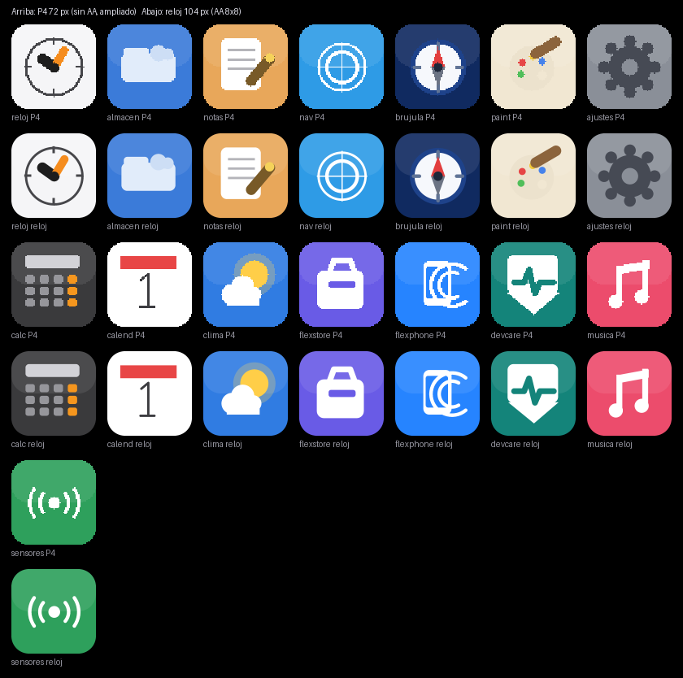
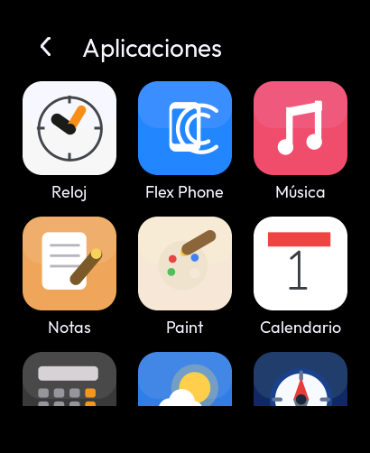
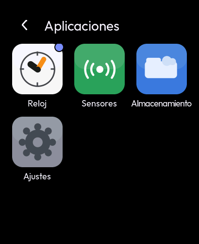
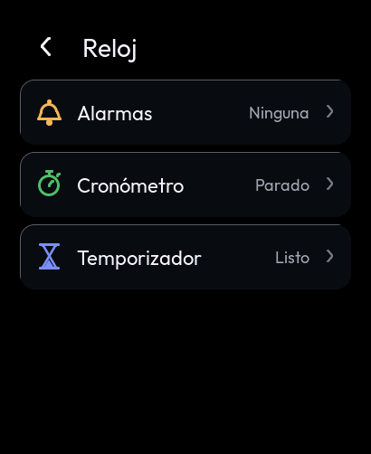
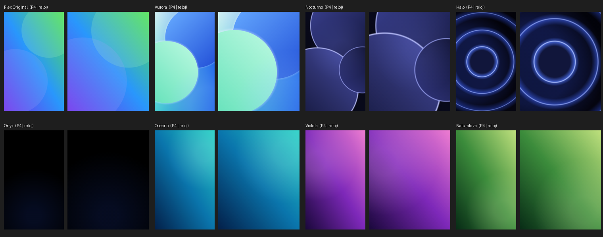
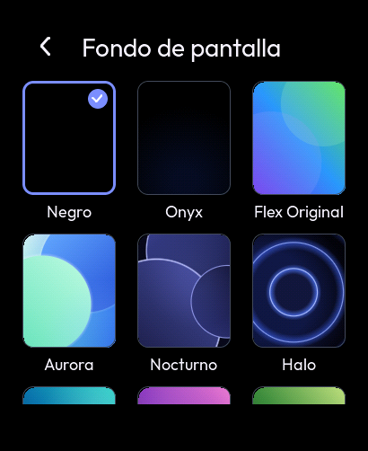
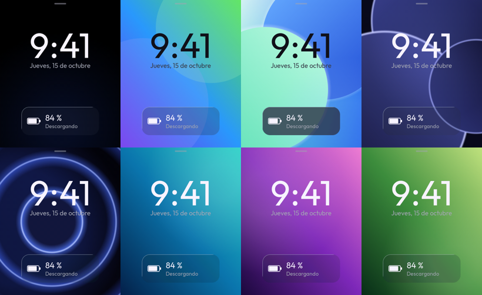

# F3.5-F3.6 — Identidad original de Flex OS Ultra en el reloj

Iconos originales de las apps, lanzador en rejilla (Caja de aplicaciones) y fondos de pantalla originales.
Referencia: `Flex-OS-Ecosistema` @ `5dbc949` (rama `claude/flexos-ota-system-blq9g9-2csacx`), solo lectura.

| Tarea | Contenido | Estado |
|---|---|---|
| F3.5 | Iconos originales (15) + lanzador en rejilla + app Reloj (F9.1) | 🟡 compila, pasa las pruebas de PC y la vista previa; falta T67-T70 |
| F3.6 | Fondos originales (8) + selector | 🟡 compila, pasa las pruebas de PC y la vista previa; falta T71-T73 |

## 1. Iconos originales

### 1.1 De dónde salen

Flex OS Ultra no tiene un solo mapa de bits: cada icono es código (`drawAppIcon()`, `FlexOS_Ultra_Icons.h:65-305`)
que pinta con las primitivas de su motor (`fillRoundRect`, `fillCircle`, `fillRing`, `strokeSeg`, `fillTriangle`...,
`FlexOS_Ultra_Gfx.h:534-800`). Por eso "reutilizar el icono original" significa **ejecutar ese mismo dibujo**:

- `Flex OS Ultra Watch/tools/icons/gen_app_icons.c` transcribe `drawAppIcon()` caso por caso (mismas figuras,
  proporciones, colores y conversiones a entero) en estilo "Plano" (`gIconStyle = 0`, el de la Caja de aplicaciones).
- Lo ejecuta en el PC y guarda el resultado en `assets/icons/app_*.bin`. `tools/icons/gen_icons.sh` los regenera.

### 1.2 Tamaño: el mismo tamaño físico

| | P4 | Reloj |
|---|---|---|
| Icono | 72 px (`HOME_ICON_S`, `DRW_ICON_S`) | **104 px** |
| Densidad | 4,3" 480×800 → 217 ppi | 2,06" 410×502 → 315 ppi |
| Tamaño físico | 8,4 mm | 8,4 mm |

El icono se dibuja en su espacio de diseño de 72 px y se rasteriza a 104. Así las medidas fijas de la referencia
(un anillo de 2 px, un trazo de radio 1) conservan su proporción respecto al icono.

### 1.3 Antialiasing por supermuestreo

El P4 pinta píxeles enteros (bordes en escalera). Cada primitiva se reproduce como la misma figura continua, con la
convención de la referencia (el píxel (x, y) es el punto (x, y)), y se muestrea 8×8 veces por píxel:

| Primitiva de la referencia | Figura equivalente |
|---|---|
| `fillRect(x,y,w,h)` | rectángulo [x−½, x+w−½] × [y−½, y+h−½] (mismo número de píxeles) |
| `fillRoundRect(…, r)` | ese rectángulo con esquinas de radio r |
| `fillCircle(cx,cy,r)` | disco de radio r (el disco de píxeles de `isqrt` tiene ≈ πr² píxeles) |
| `fillRing(cx,cy,R,t)` | corona entre R−t y R |
| `strokeSeg(…, rad)` | cápsula de radio rad+½ (sus discos apilados dan un trazo de 2·rad+1 px) |
| `strokeSegAA(…, rad)` | cápsula de radio rad (su cobertura es del 50 % a distancia rad) |
| `fillTriangle(…)` | el mismo triángulo (el de la referencia incluye el borde) |

La hoja `docs/img/f3_iconos_originales.png` compara, sobre negro, el render del P4 (72 px, una muestra por píxel en el
centro, ampliado al mismo tamaño) con el del reloj (104 px, 8×8). Se genera con `tools/icons/contact_sheet.py`.

### 1.4 Qué iconos y por qué

- **15 originales:** Reloj, Calendario, Calculadora, Clima, Música, Notas, Flex Phone, Navegador, Flex Compass,
  Device Care, Almacenamiento, Paint, Flex Store, Ajustes y Galería.
- **No se incluyen:** Modo PC (DeX: excluido por el proyecto), Juegos, Cámara y Multimedia (apps excluidas en el
  reloj, `INVENTARIO-APPS.md` §3). La **Galería** se añadió el 2026-10-23 con su icono original (`app_galeria.bin`,
  `docs/GALERIA.md`); al regenerar, los demás iconos salieron idénticos byte a byte.
- **1 nuevo, Sensores:** existe solo en el reloj (F4.4). Se dibuja con el mismo lenguaje: `iconBase` con brillo
  superior, glifo blanco hecho con `arcStroke` y `fillCircle`, sobre verde. No se presenta como original.
- **Flex Phone, tal cual:** su comentario dice "dos arcos de enlace a la derecha del aparato", pero
  `arcStroke(…, 300, 60, …)` barre de 300° a 60° pasando por 180° y dibuja dos "C" que abrazan el teléfono. El P4 lo
  muestra así y así se conserva. Corregirlo cambiaría el icono que el usuario conoce.

### 1.5 Formato, memoria y alineación

- **Formato:** RGB565A8 de LVGL 9 (plano RGB565 little-endian de 104×104×2 B + alfa de 104×104 B = 32 448 B). LVGL lo
  dibuja directamente desde flash: sin decodificar, sin escalar y sin pedir memoria.
- **Coste medido (compilación ESP-IDF 5.5.5):**
  - `.rodata` pasa de 287 524 B a 774 900 B (+487 KB, 15 × 32 448).
  - La RAM interna (DIRAM) no cambia: 90 763 B.
  - Imagen de 1,48 MB en una ranura de 6 MB.
  - Con `CONFIG_SPIRAM_XIP_FROM_PSRAM` la rodata se copia a PSRAM al arrancar: los iconos ocupan ~475 KB de los 8 MB.
    Queda anotado para F8.4 (se podría comprimir con RLE si la PSRAM llega a faltar).
- **Alineación:**
  - La plantilla de `EMBED_FILES` de ESP-IDF 5.5.5 (`tools/cmake/scripts/data_file_embed_asm.cmake`) no alinea los
    datos, y LVGL lee el plano RGB565 en palabras de 16 bits. Una dirección impar haría saltar `LoadStoreAlignment` en
    el Xtensa.
  - Por eso `components/watch_theme/CMakeLists.txt` genera un `.S` con `.balign 4` + `.incbin`.
  - Comprobado en el ELF: los 15 símbolos `_binary_app_*_bin_start` están en `0x3c0d…-0x3c14…` (flash) y son múltiplos
    de 4. La vista previa comprueba lo mismo en el PC.

## 2. Lanzador (Caja de aplicaciones)

Se abre deslizando la esfera hacia la izquierda (como antes). **Actualizado en F10:** ahora se abre deslizando la esfera hacia abajo y es un panal de iconos circulares sin nombres (`docs/F10-EXPERIENCIA.md` §3).

| Referencia (`AppDrawer.h`) | Reloj |
|---|---|
| Rejilla de 4 columnas, paso 120 px, icono 72 px | **3 columnas**, paso 128 px, icono 104 px (mismo tamaño físico) |
| Nombre centrado bajo el icono; si no cabe, encoge la letra (`uiFontFit`) y recorta (`uiLabelFit`) | Nombre centrado en Outfit 18. Si no cabe, se aprieta el espaciado 1 px y, como último recurso, "…". Medido con LVGL: "Almacenamiento" 138 → 125 px en una celda de 128 |
| Punto de estado sobre el icono (`AppDrawer.h:690`, radio 7 px) | Punto de 20 px en el acento sobre Reloj mientras el cronómetro o el temporizador cuentan |
| Buscador con teclado propio | Sin buscador: con 4-14 apps no hace falta y el teclado no cabe junto a la rejilla |
| Cabecera de estado (hora, batería) | Cabecera estándar del reloj con "volver" (misma que el resto de páginas) |
| Iconos planos a propósito en la rejilla (sin vidrio, AppDrawer.h:651) | Igual |

Al pulsar, el icono se oscurece (tinte negro al 40 %) mientras el dedo está encima; al soltar se abre la app con la
animación del sistema (210 ms).

**Solo aparecen las apps que funcionan de verdad:** Reloj, Sensores, Almacenamiento y Ajustes. Cada app del
inventario se añade a la tabla `kApps` de `ui_apps.c` cuando tiene función real (F9).

 

## 3. App Reloj (F9.1)

En la referencia, Reloj tiene pestañas Hora / Cronómetro / Temporizador, y el temporizador es un rótulo
"próximamente" (`AppFramework.h:600-630`). En el reloj las tres funciones tienen motor propio (F4.3). La app las
agrupa en una lista con su estado en vivo (próxima alarma, tiempo del cronómetro, tiempo restante).

## 4. Fondos de pantalla originales (F3.6)

### 4.1 Los 8 fondos, con el mismo código

Los fondos de Flex OS Ultra también son código (`FlexOS_Ultra_Wallpaper.h:42-315`). Cada uno es una lista de capas:

- degradados de 3 paradas (`wallDiag3`) o de 4 esquinas (`wallCorners4`);
- discos opacos con degradado (`wallDisc`);
- halos y anillos con una tabla de alfa por distancia (`wlutDisc`, `wlutRing` + `wallRadial`);
- las dos manchas del escritorio (`fillCircleA`).

`components/watch_theme/flex_wallpaper.c` contiene **las mismas capas, en el mismo orden, con los mismos colores, alfas,
posiciones y radios** (cada tabla cita su línea de origen).

| Adaptación a 410×502 | Por qué |
|---|---|
| Posiciones en proporción a la pantalla (x·410/480, y·502/800) | Toda la composición sigue a la vista. Con un recorte se perdería un 27 % del fondo |
| Radios por 410/480 | Los círculos siguen siendo círculos. En Halo y Nocturno los anillos exteriores quedan más grandes respecto a la pantalla, que es más baja |
| Cada píxel en coma flotante + tramado ordenado 4×4 al final | La referencia mezcla en RGB565 capa a capa: en un AMOLED se verían escalones en los degradados oscuros |
| Tabla de alfa por d² con su propio paso por capa (≤ 0,2 px en el anillo mayor de Halo) | Es la idea de `wlut` (Wallpaper.h:60), cuyo paso fijo de 2048 en d² da saltos de ~8 px en los anillos de radio 120. Aquí se evita la raíz y la división por píxel, que en el S3 no tienen instrucción directa |

La versión con tabla se ha comparado con la exacta (raíz por píxel). Difiere como mucho en un nivel de cuantización
(el tramado cae a un lado u otro), en menos del 4,6 % de los píxeles. En el PC tarda de 2 a 5 ms por fondo. En el S3
no se ha medido: la línea `fondo "…" generado en PSRAM … en N ms` del registro lo dirá (T71).

### 4.2 Memoria

- **Un solo fondo en PSRAM** (410×502×2 = 402 KB), el de la esfera. Al cambiar de fondo se reescribe en el mismo
  búfer; al elegir Negro se libera.
- En cada cambio se descarta su entrada de la caché de imágenes de LVGL (`lv_image_cache_drop`). La configuración
  actual no usa caché (`LV_CACHE_DEF_SIZE=0`), pero así sigue siendo correcto si se activa.
- El búfer se reescribe o se libera solo mientras se construye la esfera nueva: la vieja, que aún apunta a él, se
  borra en la misma llamada sin dibujarse (`ui_nav_replace_root`).
- El selector genera sus 9 miniaturas (104×127) en un bloque de 232 KB de PSRAM y lo libera al cerrarse.

### 4.3 Selector (Ajustes > Pantalla > Fondo)

Es la vista "Fondo de pantalla" de la referencia (`HomeCfg.h:557-575`): rejilla de miniaturas redondeadas con borde
fino; la elegida lleva doble borde del acento y la insignia con la marca arriba a la derecha.

- Tiene 3 columnas en vez de 4, con miniaturas en la proporción del reloj.
- Añade **Negro** delante: es la opción por defecto y la que menos gasta.
- Se aplica al tocar, porque el reloj solo tiene la esfera (no hay "Inicio / Bloqueo / Ambos").

### 4.4 Legibilidad sobre fondos claros

Es `onColor()` de la referencia (`Wallpaper.h:468`): se mide la luma real (Rec.601) del fondo bajo cada texto.

- **Por encima de 140**, la hora y la fecha pasan a texto oscuro (`TC(16,18,26)`).
- La tarjeta de batería sube su tinte de vidrio a 200 para que su texto claro se lea.

## 5. Pruebas

### En el PC (hechas)

| Prueba | Resultado |
|---|---|
| Firmware completo ESP-IDF 5.5.5 (esp32s3) | OK, sin avisos en el código del proyecto |
| Símbolos de iconos en flash y alineados a 4 | OK (15/15) |
| `make -C tests/host` (ASan + UBSan) | 978 comprobaciones, 0 fallos |
| Vista previa completa (`tools/sim`) | TODO OK, incluida la prueba mono de 600 acciones |
| Vista previa con ASan + UBSan, semilla 7 | TODO OK |
| Lanzador: cada app con su icono RGB565A8 de 104 px alineado; ninguna app sin función; punto de Reloj apagado en reposo y encendido con el cronómetro en marcha | OK |
| Reloj: estado en vivo de alarmas, cronómetro y temporizador | OK |
| Revisión adversarial (3 enfoques + verificación independiente) | 1 defecto confirmado y corregido: el punto de Reloj salía recortado 3 px por arriba (LVGL recorta los hijos a su celda). Ahora se ve entero (filas 89-104, simétrico) |
| Fondos (`tests/host`): colores de referencia en sus puntos (verde arriba a la derecha y violeta abajo a la izquierda en Flex Original, núcleo oscuro y anillo brillante en Halo, Onyx negro fuera del halo); por bandas = de una vez en los 8; id inválido = Flex Original; luma de región | OK (997 comprobaciones en total) |
| Selector en la vista previa: abre desde Pantalla, ofrece los 9, elegir Aurora la guarda y rehace la esfera debajo (oculta), volver a Negro; esfera con cada fondo sin recortes; la hora pasa a oscuro sobre Aurora; sin fugas tras abrir el selector 5 veces | OK |

### En el reloj (pendientes)

| # | Prueba | Cómo | Resultado esperado |
|---|---|---|---|
| T67 | Iconos | Deslizar la esfera a la izquierda | Los 4 iconos se ven nítidos, sin franjas, colores invertidos ni bordes negros alrededor; el registro no muestra `LoadStoreAlignment` |
| T68 | Nombres | Mirar la rejilla | "Almacenamiento" se lee entero; ningún nombre se corta por la esquina redondeada al desplazar |
| T69 | Punto de Reloj | Iniciar el cronómetro, volver al lanzador | Punto azul arriba a la derecha del icono de Reloj; desaparece al pausar |
| T70 | Fluidez | Desplazar la rejilla y abrir apps | FPS del medidor de LVGL al desplazar (anotar); la apertura no se nota más lenta que la de Ajustes |
| T71 | Fondos: tiempo | Ajustes > Pantalla > Fondo: elegir Halo, luego Nocturno | Copiar las líneas `fondo "…" generado en PSRAM … en N ms` y `fondo liberado` al volver a Negro. Esperado: menos de ~300 ms, sin reinicios |
| T72 | Fondos: imagen | Elegir cada fondo y volver a la esfera | Sin franjas ni bandas visibles en los degradados oscuros (Onyx, Halo, Nocturno); colores como en `docs/img/f3_fondos_comparacion.png` |
| T73 | Fondos: lectura | Esfera con Aurora y con Naturaleza | Hora y fecha legibles (oscuras sobre Aurora); la tarjeta de batería se lee |
