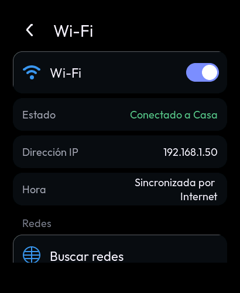
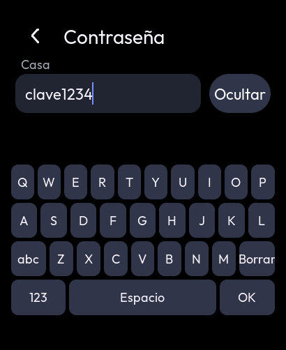
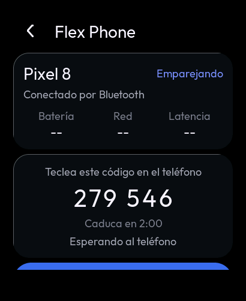
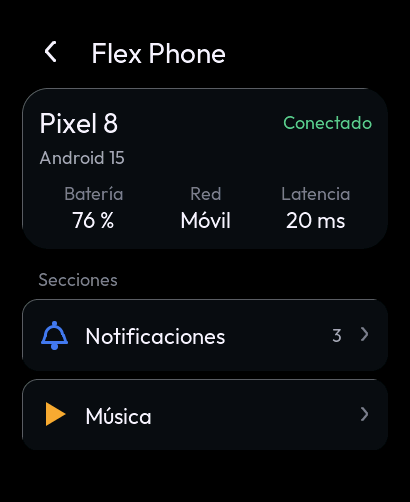
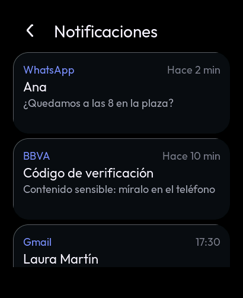
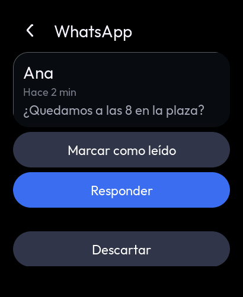
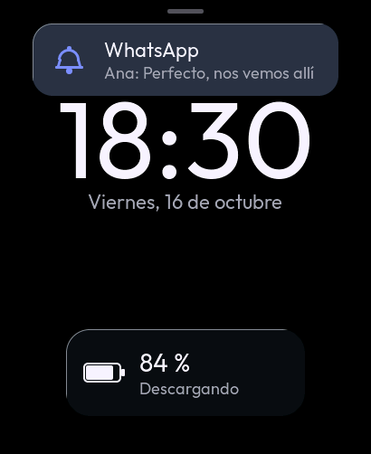
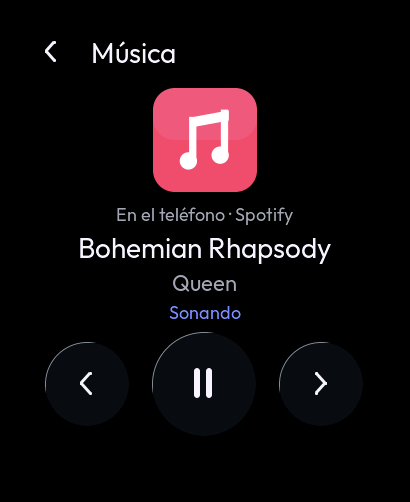
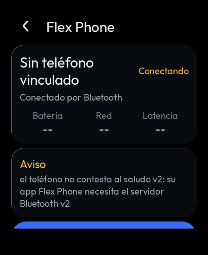

# F5 — Conectividad: Wi-Fi y Flex Phone

| Tarea | Contenido | Estado |
|---|---|---|
| F5.1 | Wi-Fi (estación): encendido bajo demanda, escaneo, contraseña, redes guardadas, reconexión, hora por SNTP | 🟡 compila, pasa las pruebas de PC y la vista previa; faltan T78-T83 |
| F5.2-F5.6 | Flex Link v2, notificaciones, BLE con Flex Phone, seguridad | ⬜ (especificación extraída de la referencia; ver §3) |

## 1. Wi-Fi (F5.1): componente `watch_net`

### 1.1 Arquitectura

- **Una sola tarea dueña del estado** (`watch_net`, prioridad 4, 4 KB de pila).
  - Las órdenes de la interfaz (encender, buscar, conectar, olvidar) y los eventos de ESP-IDF (Wi-Fi, IP y SNTP)
    llegan a su cola.
  - Los manejadores de eventos solo envían mensajes: nunca bloquean ni cambian el estado.
- **La interfaz lee una instantánea** (`watch_net_get`) desde su temporizador de LVGL. Ninguna tarea de red toca LVGL.
  Nada se queda congelado mientras conecta.
- **Lógica pura en `net_logic.c`**, probada en el PC: redes guardadas, espera entre reintentos, motivos de desconexión
  en palabras, barras de señal y orden de la lista.

### 1.2 Comportamiento

| Situación | Qué hace |
|---|---|
| Arranque | La radio sigue apagada salvo que el usuario la dejara encendida (NVS, espacio `wifi`, clave `on`) |
| Encender | `esp_wifi_start` → escaneo. Si hay una red guardada a la vista, conecta sola a la mejor |
| Red nueva | Se pide la contraseña. **Solo se guarda cuando la conexión funciona** (con IP) |
| Contraseña incorrecta (`AUTH_FAIL`, `4WAY_HANDSHAKE_TIMEOUT`, `HANDSHAKE_TIMEOUT`, `MIC_FAILURE`, `AUTH_EXPIRE`) | "Contraseña incorrecta" y **no se reintenta** |
| Señal perdida u otro fallo | Reintento con espera exponencial: 1, 2, 4, 8, 16, 32 s y después cada 60 s. La interfaz muestra la cuenta atrás |
| Con IP | Arranca SNTP (`pool.ntp.org`). Si la hora es válida (≥ 2025), pone el RTC en hora (`watch_time_set_utc`) |
| Apagar | `esp_wifi_stop`, SNTP parado, sin reintentos |
| Olvidar | Dos toques, como Formatear. Si era la red actual, se desconecta |

Las redes guardadas son como mucho 4, la más reciente primero. Se guardan en NVS dentro del bloque con versión y CRC
de `watch_settings` (`ws_blob_pack`): datos dañados no se usan.

> **Seguridad:** las contraseñas se guardan sin cifrar en la NVS. El cifrado de flash y NVS es la decisión pendiente
> D12 (F8.3). Hasta entonces, cualquiera con acceso físico y un cable puede leerlas.

### 1.3 Memoria (compilación ESP-IDF 5.5.5)

| | Antes | Con Wi-Fi |
|---|---|---|
| Imagen | 1,49 MB | 2,04 MB (ranura de 6 MB) |
| RAM interna estática (DIRAM) | 90,7 KB | 141,8 KB (+51 KB: pila Wi-Fi y lwIP); quedan 199,9 KB |

Con `CONFIG_SPIRAM_TRY_ALLOCATE_WIFI_LWIP=y`, los búferes dinámicos de Wi-Fi y lwIP van a la PSRAM cuando se puede. La
RAM interna queda para los búferes DMA de la pantalla y, después, el BLE. El consumo real con el Wi-Fi encendido se
medirá en el reloj (T81, Device Care > Memoria).

### 1.4 Interfaz

- **Ajustes > Wi-Fi** (fila arriba del todo, con la red o el estado):
  - interruptor, estado real, IP y hora sincronizada;
  - "Buscar redes";
  - redes del escaneo (guardadas primero y después por señal; el color del icono indica la señal);
  - redes guardadas, con "Olvidar".
- **Contraseña:**
  - campo con "Ver/Ocultar" y teclado propio en 4 páginas (minúsculas, mayúsculas de una letra, números y símbolos):
    todo el ASCII imprimible;
  - teclas de texto ("DEL", "OK"), porque los símbolos de LVGL no existen en Outfit;
  - el cursor no parpadea y cada carácter se oculta al momento: ninguna animación sin fin redibuja la pantalla.
- **Panel rápido:** el mosaico Wi-Fi deja de estar "Pendiente".
  - Tocarlo enciende o apaga la radio (`QSID_WIFI` es `QT_TOGGLE` en la referencia).
  - Responde en el mismo toque y debajo muestra la red o el estado.

 

### 1.5 Pruebas

**En el PC:**

- `tests/host` (1116 comprobaciones con ASan y UBSan):
  - redes guardadas: orden, actualizar, lleno, borrar, ida y vuelta por el bloque con CRC, y datos dañados o truncados;
  - espera entre reintentos;
  - motivos con los códigos reales de ESP-IDF 5.5.5;
  - barras de señal, y escaneo sin ocultas ni repetidas con las guardadas primero.
- **Vista previa** (`SIM_ONLY=wifi`, servicio simulado en `tools/sim/sim_net.c`):
  - Ajustes muestra "Apagado"; encender, buscar y listar;
  - contraseña incorrecta, y la buena escrita con el teclado (DEL, cambio de página, Ver/Ocultar);
  - "Conectado a Casa" con IP, la red guardada y la hora sincronizada;
  - señal perdida con cuenta atrás y reconexión;
  - olvidar con dos toques y apagar;
  - mosaico del panel rápido (respuesta inmediata y estado real);
  - sin fugas ni temporizadores sueltos; prueba "mono" con las páginas de Wi-Fi y ASan/UBSan con 3 semillas.
- **Firmware completo:** compila sin avisos.

**En el reloj (pendientes):**

| # | Prueba | Resultado esperado |
|---|---|---|
| T78 | Ajustes > Wi-Fi > encender | Lista las redes de alrededor en 2-3 s; el registro dice `Wi-Fi encendido` |
| T79 | Conectar a tu red con contraseña | "Conectado a …", IP de tu router; reinicia el reloj: con el Wi-Fi encendido vuelve a conectar sola |
| T80 | Contraseña mal escrita | "Contraseña incorrecta" sin reintentos en el registro |
| T81 | Hora por Internet | Con la hora del reloj desajustada: al conectar, "Hora: Sincronizada" y la esfera corrige la hora. Device Care > Memoria con el Wi-Fi encendido (anotar) |
| T82 | Alejarse del router o apagarlo | "Señal perdida · N s" y reconexión sola al volver; la interfaz sigue respondiendo |
| T83 | Panel rápido | El mosaico enciende y apaga; el consumo (horas de batería) con el Wi-Fi apagado no cambia respecto a antes |

## 2. Independencia del Wi-Fi y el BLE

- El Wi-Fi solo sirve para Internet (navegador, clima, hora) y está apagado si no se usa.
- El enlace con el teléfono va por BLE (F5.5, decisión D5). Perder Internet no corta el BLE y viceversa: son dos
  servicios (`watch_net` y `watch_phone`) sin estado compartido, cada uno con su tarea.
- En el ESP32-S3 los dos comparten la antena con la coexistencia de ESP-IDF (activa por defecto con los dos).

## 3. Flex Phone (F5.2, F5.3, F5.4, F5.5)

### 3.1 Arquitectura

```
 interfaz (LVGL)  ──órdenes──▶  watch_phone (tarea, 100 ms + despertar por RX)
   ui_flexphone.c                 phone_core.c   ← C puro: órdenes, instantánea, lista
   ui_notifs.c       ◀─instantánea──   │
   ui_music.c                          ▼
                              flexlink (C puro, port de Flex OS Ultra)
                              flex_phone_link.c  máquina del enlace v2
                              flex_phone.c       modelo y códecs
                              flex_auth.c        SHA-256, HMAC, código, pruebas
                              flex_link.c        trama, CRC, fragmentos, anti-repetición
                                       │ FlexPhoneTransport
                                       ▼
                              ble_link.c (NimBLE, el reloj es CENTRAL)
                                       │ GATT f1580001-…  (RX escribe, TX notifica)
                                       ▼
                              GattServer.kt de la app Flex Phone (periférico)
```

- **`components/flexlink`**: los cinco núcleos de la referencia (`FlexOS_FlexLink`, `FlexOS_FlexAuth`,
  `FlexOS_FlexPhone`, `FlexOS_FlexPhone_Link`, `FlexOS_FlexPhone_Transport`) ya eran C puro sin Arduino, sin
  reservas dinámicas y sin radio. Se portan a C11 conservando nombres, disposición en el aire y comportamiento, de
  modo que se pueden comparar línea a línea con la referencia. Cada cambio propio del reloj lleva un comentario
  `RELOJ:` (lista en §3.3).
- **`components/watch_phone`**:
  - `phone_core.c` (C puro): aplica las órdenes de la interfaz, hace la instantánea y ordena las notificaciones. Lo
    usan el firmware y el simulador de PC, así que la vista previa enseña la lógica real.
  - `watch_phone.c`: la tarea (pila 6 KB en RAM interna), el mutex, la cola y la NVS. Enlace y modelo (~30 KB) en
    PSRAM.
  - `ble_link.c`: el transporte BLE.
- **NVS**: espacio `flexphone` con las MISMAS claves que la referencia (`BR.h:110-114`): `bondkey` (32 B), `bondpeer`,
  `bondname`, `selfid` (`flexos-` + 16 hex, generado una vez) y `autolink`. La clave del vínculo nunca se enseña ni
  se registra. Los vínculos BLE los guarda NimBLE en la NVS (`CONFIG_BT_NIMBLE_NVS_PERSIST`, hasta 3).

### 3.2 Transporte BLE (`ble_link.c`)

1. **Búsqueda**: escaneo pasivo del UUID de servicio `f1580001-4c65-4f53-8f6c-6578f1584c4b` en el anuncio (el teléfono
   anuncia solo ese UUID, `GattServer.kt:174-191`). 30 s rápidos (60 ms / 30 ms) y luego de fondo con un 3,5 % de
   ciclo (1,28 s / 45 ms) hasta que aparece.
2. **Conexión**: a la vez, intercambio de MTU (se pide 247) y cifrado. Las características del teléfono son
   `*_ENCRYPTED` (`GattServer.kt:138-156`), así que hace falta emparejar a nivel BLE: Just Works con vínculo (el reloj
   no tiene teclado numérico para BLE). Android pregunta una vez, con el nombre "Flex OS Watch" que lee del servicio
   GAP del reloj. La autenticación de verdad la pone el código de 6 cifras de v2.
3. **Montaje con el enlace cifrado**: servicio → características RX (`f1580002`) y TX (`f1580003`) → CCCD de TX →
   avisos activados ANTES del HELLO (el servidor no mira el CCCD, `flexphone-messages.md` §7.3.22).
4. **MTU ≥ 247 obligatorio**: los dos reensambladores exigen fragmentos intermedios de 226 B (trama de 244 B). Con
   menos, el canal se declara inservible y se dice ("MTU 185: el teléfono no admite tramas de 244 B"), en vez de
   perder mensajes en silencio.
5. **Una trama = una escritura ATT (Write Request) en RX**, de una en una, y una notificación de TX = una trama. El
   enlace consulta el hueco del anillo de salida (`room`) antes de trocear un mensaje: nunca sale medio mensaje.
6. **Fallos con motivo y espera**: cifrado rechazado, servicio ausente ("¿app cerrada?"), MTU corto, escritura
   rechazada... Se reintenta con espera de 1, 2, 4, 8, 16, 30 y 60 s. Una caída normal (fuera de alcance) vuelve a
   buscar al segundo. Si el teléfono borró el emparejamiento BLE, el reloj borra el suyo y empareja de nuevo.
7. **Pila perezosa**: NimBLE no se inicia hasta que el usuario enciende el enlace. Apagado no cuesta ni RAM ni radio.

### 3.3 Cambios respecto a la referencia (`RELOJ:` en el código)

| Cambio | Por qué |
|---|---|
| Capacidad = BLE del propio chip (`FLP_LINK_CAP_BLE_LOCAL`) | La referencia es un P4 sin Bluetooth y usaba TCP 47820. En el reloj el canal es BLE (D5) |
| Al caer la sesión se borra el estado instantáneo, NO el historial de notificaciones si `keepHistory` | Es lo que dice el ajuste "conservar historial al desconectar" de la referencia, que su enlace no aplicaba: un reloj que pierde todas las notificaciones en cada corte BLE no sirve |
| Saludo sin respuesta: tras 10 s se explica el motivo y se vuelve a saludar a los 10, 20, 40 y 60 s | Por TCP el teléfono siempre contesta. Una app Flex Phone antigua (sin v2 por BLE) no contesta, y el reloj se quedaría "conectando" sin decir por qué |
| `room` en el transporte | Un mensaje de varios fragmentos no se empieza si no caben todos |
| Emparejar bien borra el motivo de un intento fallido anterior | En la referencia el "no coincide" del primer intento seguía en pantalla con la sesión ya abierta (visto en la vista previa) |
| Códecs `flexPhoneEncNotifRemove` y `flexPhoneEncAction` | No existían en el firmware C de referencia (`flexphone-messages.md` §8) |
| `lastPutId`/`putSeq` en el modelo | El aviso emergente necesita saber qué notificación entró o se actualizó |
| Textos visibles con tildes | El reloj pinta español completo |

### 3.4 Interfaz

- **App Flex Phone** (icono original `IC_FLEXPHONE`, en el lanzador): estructura de la portada de la referencia
  (`FlexOS_FlexPhone_Bridge.h:550-700`): tarjeta del teléfono con estado y Batería/Red/Latencia (`--` sin dato real),
  tarjeta del código ("Teclea este código en el teléfono", plazo, "Confirmar aquí", "Cancelar"), aviso con el motivo
  real y secciones Notificaciones, Música, Estado del teléfono y Conexión. Servidor y Navegador llegan con F6.
- **Notificaciones**: la más reciente primero (hora del teléfono); lo sensible nunca se enseña; vacío con el motivo;
  detalle con las acciones de Android en su orden; "Responder" solo con RemoteInput y con el resultado REAL de
  `REPLY_RESULT`; "Descartar" la quita también del teléfono. Los caracteres sin glifo en la fuente (emoji, otros
  alfabetos) se sustituyen por "(emoji)" o "?" en vez de dejar huecos.
- **Aviso emergente**: misma tarjeta que el de batería; con la pantalla apagada cuenta como bloqueo (solo app y
  remitente); enciende la pantalla; tocarlo abre el detalle.
- **Música** (icono `IC_MUSICA`): lo que suena en el teléfono y sus controles (`T_MEDIA_STATE`/`T_MEDIA_CMD`).
- **Panel rápido**: el mosaico Bluetooth enciende y apaga el enlace.

Capturas de la vista previa (el enlace real contra el teléfono simulado):

| Código | Conectado | Notificaciones | Detalle | Aviso | Música | App Android sin v2 |
|---|---|---|---|---|---|---|
|  |  |  |  |  |  |  |

Más: `img/f5_responder.png`, `img/f5_conexion.png`, `img/f5_estado_telefono.png`, `img/f5_panel_bluetooth.png`.

### 3.5 Memoria (compilación ESP-IDF 5.5.5 con NimBLE)

| | Antes (F5.1) | Ahora | Nota |
|---|---|---|---|
| Imagen | 2,04 MB | 2,19 MB | de 6 MB de partición |
| DIRAM estática usada | 141,8 KB | 163,3 KB | 178,4 KB libres; ~15,6 KB son del controlador BT |
| Enlace + modelo | — | ~30 KB en PSRAM | `heap_caps_calloc(MALLOC_CAP_SPIRAM)` |
| Pila de host NimBLE | — | en PSRAM | `CONFIG_BT_NIMBLE_MEM_ALLOC_MODE_EXTERNAL` |
| RAM interna al iniciar el BLE | — | **sin medir** | el registro `ble_link` la da al encender el enlace (T85) |

### 3.6 Pruebas

En el PC (sin teléfono ni radio):

- `tests/host/test_flexlink.c` (228 comprobaciones):
  - vectores DORADOS de la referencia: trama PING y NOTIF_ADD, CRC, carga de notificación, CAPS, SHA-256 (cuatro),
    HMAC RFC 4231 (casos 1, 2 y 6), clave del vínculo y pruebas del teléfono y de Flex OS;
  - las pruebas de comportamiento de `FlexLinkTest.kt`/`FlexAuthTest.kt` (rechazos, fragmentación de 700 B,
    repetidos, caducidad, límites, anti-repetición, UTF-8, campos, reintentos, propiedades);
  - vectores DERIVADOS (calculados con una reimplementación independiente, `flexlink-v2.md` §4.5): HELLO, WELCOME,
    PAIR_CODE y PAIR_CONFIRM byte a byte, CRC de los fragmentos, mensajes de §6.2;
  - apretón de manos completo contra un teléfono simulado que sigue el lado Android de v2: emparejar (código malo,
    código bueno, confirmar), sesión, notificación de dos fragmentos, respuesta con ACK y resultado real, latido y
    latencia, caída y reconexión con reto, BYE, teléfono que deja de contestar, caducidad y cancelación del código,
    teléfono sin clave, prueba que no cuadra, olvidar, saludo sin respuesta y entrega que no cabe.
  - Una mutación de la etiqueta `flexphone-host-v2` la detecta el vector dorado.
- Vista previa (`SIM_ONLY=telefono`): el enlace REAL contra el teléfono simulado de `tools/sim/sim_phone.c`, con
  capturas (`docs/img/f5_*.png`, `f9_musica.png`), verificador visual y fugas.

En el reloj (pendiente; necesita la app Android con el servidor v2, [FLEX-PHONE-ANDROID.md](FLEX-PHONE-ANDROID.md)):

| Prueba | Qué hacer | Resultado esperado |
|---|---|---|
| T84 | Flex Phone > "Activar el enlace" con la app de HOY | "Conectado sin sesión" y el aviso "el teléfono no contesta al saludo v2…". El registro `ble_link` dice `canal abierto … (MTU 247)` |
| T85 | Igual: anotar la línea `NimBLE iniciado en … ms; RAM interna usada: … B` y Device Care > Memoria | Cifras reales del coste del BLE |
| T86 | Con la app actualizada: "Emparejar teléfono", teclear el código en el teléfono, "Confirmar aquí" | Android pide el emparejamiento Bluetooth una vez (nombre "Flex OS Watch"); "Conectado" con batería, red y latencia reales |
| T87 | Código equivocado en el teléfono | "El código tecleado en el teléfono no coincide"; el código del reloj NO cambia |
| T88 | Recibir un WhatsApp con la pantalla apagada | Se enciende; aviso con app y remitente (sin el texto) |
| T89 | Responder "Vale" desde el reloj | "Entregada a la app del teléfono" y el mensaje sale en el chat |
| T90 | Descartar en el reloj | Desaparece también del teléfono |
| T91 | Alejarse del teléfono y volver; reiniciar el reloj | Reconecta solo, sin código; las notificaciones siguen en el historial |
| T92 | Apagar el Wi-Fi del reloj y del teléfono | El enlace sigue (BLE independiente de Internet) |
| T93 | Música: poner algo en el teléfono, pausar y pasar desde el reloj | Título real y controles que funcionan |

### 3.7 Lo que no se puede probar todavía

- **Actualizado el 2026-10-20:** la app Flex Phone ya sirve v2 por BLE. Está en [`FlexPhone/`](../FlexPhone), dentro
  de este repositorio; detalle en [FLEX-PHONE-INTEGRACION.md](FLEX-PHONE-INTEGRACION.md). El motor C del reloj y el
  motor Kotlin del teléfono se prueban juntos en el PC (`WatchPeerInteropTest`). Falta la prueba física con el reloj
  y un teléfono, y construir el APK fuera de este entorno.
- Por eso F5.2, F5.3 y F5.5 siguen al 50 %: compilan y pasan las pruebas de PC, pero no hay prueba física de extremo
  a extremo.
- F5.6 (cifrado de aplicación v3) sigue pendiente de D7/D8. Hoy la carga va cifrada por el enlace BLE (emparejamiento
  Just Works, que no protege frente a un atacante presente durante ese primer emparejamiento) y autenticada por v2.
