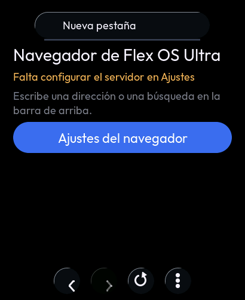
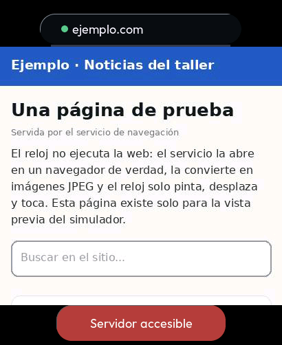
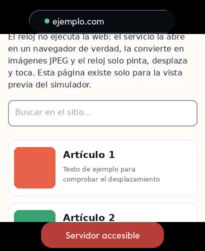
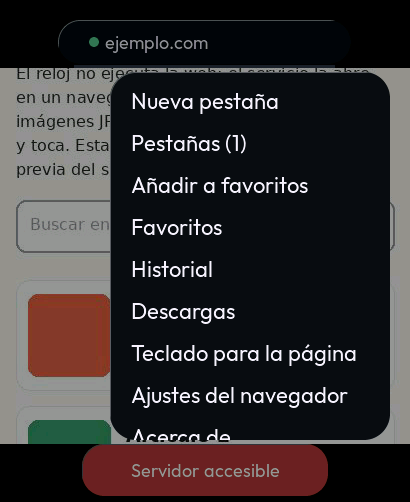
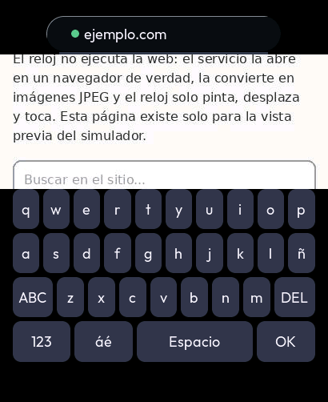
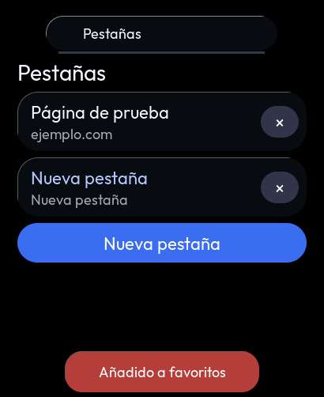
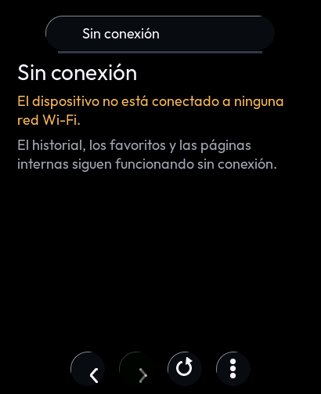
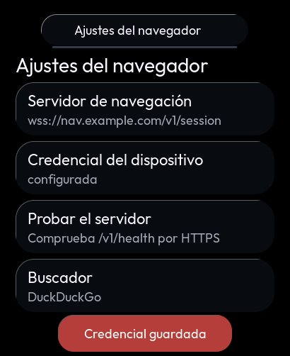

# F6 · Navegador (renderizado remoto FBP/1)

El navegador de Flex OS Ultra (`FlexOS_Browser.h/.cpp`, `FlexOS_BrowserApp.cpp`, build 6) en el reloj.

**El reloj no ejecuta la web.** La abre un servicio (el `server/` de Flex OS Ultra: Node.js con Playwright y un
Chromium real, en un PC o en un servidor). El servicio la manda ya convertida en imágenes JPEG por un WebSocket
con el protocolo FBP/1. El reloj pinta las imágenes, envía los toques, el desplazamiento y las teclas, y lleva
el omnibox, las pestañas, el historial, los favoritos y las páginas internas `flex://`.

**Sin servicio no hay web.** Nunca habrá un motor HTML en el reloj.

**Origen del servicio** (2026-10-20, `watch_browser/br_backend.c`). Se elige en `flex://settings` > «Origen de la
web»:

- **Automático:** Flex Phone si está conectado, si no la nube y por último el PC. Es el valor de fábrica.
- **Flex Phone:** solo el teléfono.
- **Nube** y **PC/Ubuntu:** solo esa fuente.

Con el teléfono no hay nada que configurar. El reloj le pide su Browser Relay por BLE, se conecta por el Wi-Fi local
con la credencial derivada del vínculo, y la página se actualiza sola porque el relay empuja las imágenes. Flujo,
casos y pruebas: [FLEX-PHONE-INTEGRACION.md](FLEX-PHONE-INTEGRACION.md) §3.

## Piezas

| Pieza | Qué es | Pruebas |
|---|---|---|
| `watch_browser/br_logic.c` | Núcleo de la referencia pasado a C11 tal cual, con el perfil S3. Incluye: omnibox y su política anti-SSRF (bloquea esquemas, IP en todas sus formas, nombres locales y usuario incrustado), códec FBP/1, SHA-1, Base64, `Sec-WebSocket-Accept` y troceo de URL `ws(s)://` | `test_browser.c`: las comprobaciones de `test_browser.cpp` sin tocar ni un vector, más los 15 vectores dorados del perfil S3 |
| `watch_browser/br_net.c` | La tarea de red de la referencia como un paso no bloqueante sobre un transporte abstracto. Incluye: WebSocket propio, apretón, HELLO/WELCOME, una ranura de FRAME con contrapresión, ACK cada 250 ms, PING cada 15 s y plazos (40 ms, 9 s, 10 s, 12 s, 5 s). Backoff 1→16 s, mismas frases | `test_br_net.c` contra `fbp_fake`, un servicio a nivel de bytes con reloj virtual |
| `watch_browser/br_lists.c` | Historial (sin duplicados, con visitas) y favoritos en `/.sistema` de LittleFS | `test_br_net.c` |
| `watch_browser/watch_browser.c` | El servicio. Tarea `watch_br` (pila de 8 KB) solo con la app abierta, `esp_transport` TCP o TLS, ajustes en NVS `flexos_br` (las claves de la referencia) y "Probar el servidor" | Solo en el reloj |
| `watch_ui/ui_jpeg.c` | JPEG baseline con el TJpgDec de LVGL al lienzo RGB565, escalado al vecino más próximo y recortado a la zona de página | Vista previa |
| `watch_ui/ui_browser.c` | La app | Suite "navegador" |

## Cambios del reloj (marcados `RELOJ:`)

- **TLS verificado** (F6.3) con el paquete de CA de ESP-IDF.
  - La referencia aceptaba cualquier certificado (`setInsecure`).
  - Un certificado que no verifica se dice: «El certificado del servidor no es válido».
  - Consecuencia: el servidor necesita un certificado de una CA pública, por ejemplo con un proxy inverso y
    Let's Encrypt, como recomienda `server/README.md`.
  - Para una prueba en la red de casa sin certificado existe el ajuste de desarrollo «Permitir ws:// sin TLS».
- **Pantalla redonda.** La esquina de la pantalla (radio 124) solo deja x 58..351 en la fila de arriba. Por eso:
  - el omnibox va solo arriba;
  - atrás, adelante, recargar y menú van abajo, dentro del arco;
  - la página queda entre las dos barras (410 × 376);
  - los avisos ocupan durante 6 s el sitio de la barra de abajo y se cierran al tocarlos.
- **Sin tira de pestañas.** Hasta 4 pestañas, que se eligen en «Pestañas» desde el menú. Al llegar al tope se
  cierra la menos usada, como en la referencia.
- **Sin caché JPEG.** Al volver a la página o cambiar de pestaña se pide de nuevo (REQ_FRAME).
- **Sin reproductor de vídeo.** No se anuncia la capacidad MEDIA y «Acerca de» lo dice.
- **Ambigüedades de la referencia resueltas:**
  - se manda VIEWPORT tras el WELCOME, para que la escala y la calidad valgan desde el principio;
  - un FRAME de otra pestaña no se pinta;
  - se aplica backoff tras ERROR 1 y ERROR 9;
  - el texto de una tecla nunca se corta a mitad de un carácter;
  - la calidad cicla como mucho hasta 90;
  - el historial y los favoritos se guardan campo a campo, con escritura atómica.
- **Fuente:** el servidor de Ajustes.
  - El Browser Relay del teléfono necesita Flex Link por TCP (puerto 47820), y el reloj habla con Flex Phone
    por BLE. Esa ruta no existe en el reloj.
  - «Acerca de» reconoce y nombra un relay si el servidor configurado lo es.

## Memoria (medida)

| Qué | Dónde | Tamaño |
|---|---|---|
| Sesión (`br_net_t`) | PSRAM | 11,6 KB |
| Búfer de recepción (`FBP_PAYLOAD_MAX` + cabeceras), solo con la app abierta | PSRAM | 135 244 B |
| Historial y favoritos (`br_lists_t`) | PSRAM | ≈ 72 KB |
| Lienzo de la página 410 × 376 RGB565, solo con la app abierta | PSRAM | 308 KB |
| Trabajo de TJpgDec, mientras decodifica | montón | 8 KB |
| Pila de la tarea `watch_br` | RAM interna | 8 KB |

mbedTLS reserva en PSRAM (`CONFIG_MBEDTLS_EXTERNAL_MEM_ALLOC`). Firmware medido con `idf.py size`:
- la imagen pasa a 0x277850 B (2,47 MB de la partición de 6 MB; +51 KB por el navegador y TJpgDec);
- la DIRAM estática a 166,4 kB (+0,8 kB; quedan 175,3 kB).

## Cómo probarlo con el servidor de Flex OS Ultra

1. **Arrancar el servicio** en un PC:
   - `cd server && npm install && npx playwright install chromium`;
   - generar una credencial con
     `node -e "console.log(require('crypto').randomBytes(24).toString('base64url'))"`;
   - registrarla en `config.json` (`devices[]`) y ejecutar `npm start`.
2. **Con certificado público** (proxy con Let's Encrypt): en el reloj, Navegador → ⋮ → Ajustes del navegador →
   Servidor de navegación `wss://tu-dominio/v1/session`, y después la credencial.
3. **En la red de casa sin certificado:**
   - activar «Permitir ws:// sin TLS» y usar `ws://IP-del-PC:8443/v1/session`;
   - para abrir direcciones de la propia red, activar también «Permitir red local»;
   - el tráfico viaja en claro: solo para desarrollo.

## Capturas (vista previa: sesión real contra el servicio falso, JPEG reales)

| Sin servidor | Página | Desplazada | Menú |
|---|---|---|---|
|  |  |  |  |

| Teclado de la página | Pestañas | Sin Wi-Fi | Ajustes |
|---|---|---|---|
|  |  |  |  |

La página de las capturas la genera `tools/sim/gen_br_pages.py`: es inventada, no una web real.

## Pruebas

### En el PC

- `tests/host/test_browser.c`: omnibox, utilidades de URL, códec FBP/1 con todos los truncamientos,
  SHA-1/Base64/WebSocket, ajustes y fuente, y los vectores dorados del perfil S3.
- `tests/host/test_br_net.c`, contra un servicio que habla bytes de verdad: HTTP Upgrade y tramas enmascaradas.
  - **Camino feliz:** sesión, navegar, desplazar, tocar, escribir, VIEWPORT agrupado, PING/PONG.
  - **Transporte:** entrega de 7 en 7 bytes, bandas, contrapresión (no se lee el socket con un FRAME sin
    consumir; corte a los 5 s).
  - **Errores con su frase:** `ws://` sin permiso, URL inválida, sin servidor, sin Wi-Fi, credencial mala con
    backoff, servidor que rechaza (1-2-4-8-16-16 s), certificado, Upgrade con clave mala, sin WELCOME en 10 s,
    sin imágenes en 12 s.
  - **Sesión:** relay antiguo, redirección a un destino interno, FRAME de otra pestaña, mensaje que no cabe,
    ERROR con texto propio, corte y reconexión sin perder lo encolado, cambio de servidor.
  - **Listas:** historial y favoritos, fichero roto.
- **Vista previa** (`SIM_ONLY=navegador`):
  - sin servidor; Ajustes (servidor inválido rechazado, servidor y credencial, que nunca se ve); Probar el
    servidor; HELLO con la credencial y el User-Agent;
  - omnibox a `flex://history` y a `ejemplo.com` (→ `https://ejemplo.com`); la imagen decodificada en su sitio
    (comprobado en el píxel);
  - SCROLL con el signo invertido y TAP en coordenadas de página; teclado de la página (teclas al servicio,
    viewport renegociado y de vuelta);
  - IP privada bloqueada; favoritos; historial con el título real; volver desde el historial; pestañas;
    recargar;
  - JPEG progresivo rechazado y vuelta a pedir;
  - sin Wi-Fi; al salir, la sesión cerrada sin fugas ni temporizadores.

### En el reloj (pendientes)

| # | Prueba | Resultado esperado |
|---|---|---|
| T104 | Servidor `wss://` con certificado público y la credencial; abrir una web | «Sesión activa»; la página llega en segundos; el registro `watch_browser` sin errores TLS |
| T105 | Desplazar y tocar enlaces; escribir en un buscador de la página | El desplazamiento sigue al dedo (anotar la latencia); el toque cae donde se tocó; el teclado de la página se abre solo |
| T106 | Servidor con certificado autofirmado | «El certificado del servidor no es válido»; no hay sesión |
| T107 | Apagar el Wi-Fi con una página abierta y volver a encenderlo | «Sin Wi-Fi»; al volver, reconecta solo; el BLE de Flex Phone no se corta |
| T108 | Abrir y cerrar el navegador 10 veces | La memoria libre (Device Care) vuelve al mismo valor |
