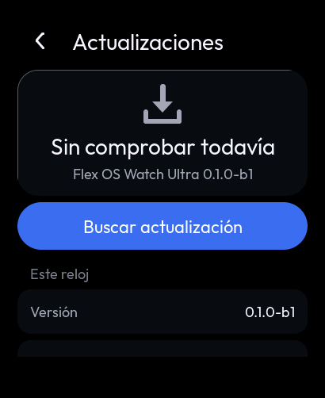
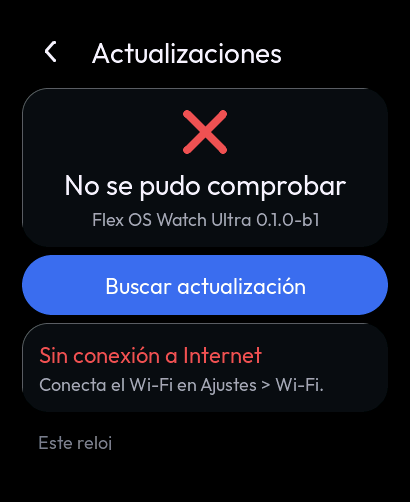
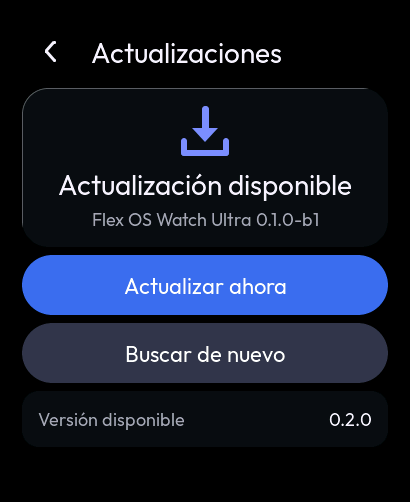
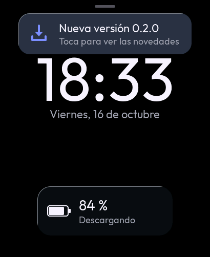
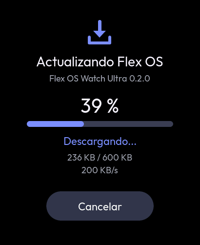
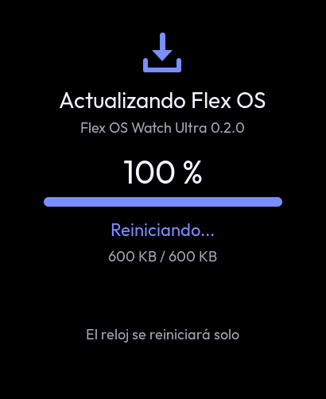
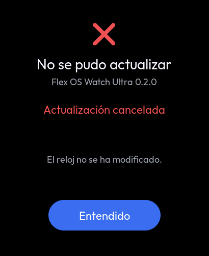
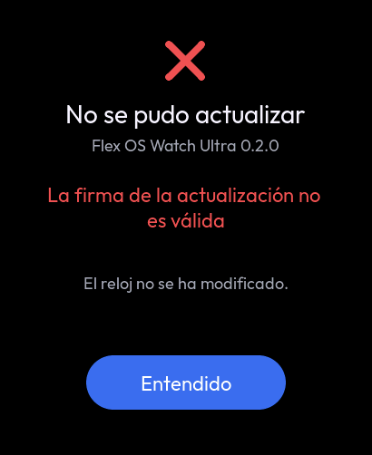
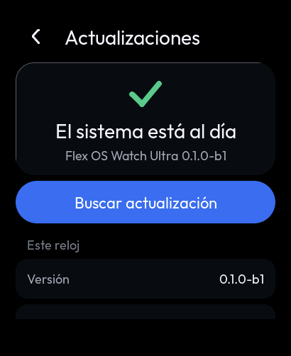
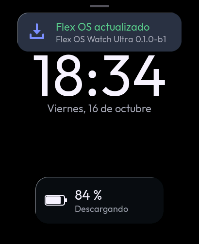

# F7 · Actualizaciones OTA

El OTA de Flex OS Ultra (`FlexOS_OTA.h/.cpp`) llevado al reloj. El reloj descarga su firmware por Wi-Fi a la ranura
OTA libre, comprueba que es suyo y que viene firmado, y arranca con él. Si la versión nueva no llega a funcionar
60 s, vuelve sola a la anterior.

**Instalar lo decide siempre el usuario.** El reloj solo comprueba y avisa.

## Piezas

| Pieza | Qué es | Pruebas |
|---|---|---|
| `watch_ota/ota_core.c` | El motor en C puro: versiones, lector del manifiesto, textos, estados, la instalación paso a paso de `otaInstall()` sobre un transporte y una flash abstractos (`ota_io_t`), el aviso tras reiniciar y la cadencia | `test_ota.c` |
| `watch_ota/ota_sig.c` | SHA-256, MD5 y verificación ECDSA P-256 con mbedTLS. El mismo código en el reloj y en el PC: las pruebas enlazan el mbedTLS de ESP-IDF compilado para el PC (`tests/host/mbedtls_host.mk`) | `test_ota.c` |
| `watch_ota/watch_ota.c` | El servicio. Tarea `watch_ota` (pila de 10 KB, prioridad 2) con `esp_http_client` sobre TLS verificado y `esp_ota_*`. NVS `flexota/pend`, como la referencia | Solo en el reloj |
| `watch_ota/include/ota_trusted_key.h` | La clave **pública** de confianza. Vacía: ver «Sin clave no se instala» | — |
| `watch_ui/ui_ota.c` | Ajustes > Actualizaciones, la pantalla de instalación y los avisos | Suite "ota" |
| `tools/ota/ota_sign.py` | Genera la clave (fuera del repositorio), da la cabecera C, firma la imagen y escribe el manifiesto | Vector cruzado en `test_ota.c` |
| `tests/host/ota_fake.c` | Servidor HTTPS y flash falsos con reloj virtual, imágenes ESP32-S3 de prueba y una clave generada al ejecutar | — |

## Cómo funciona

1. **Comprobar.**
   - Solo con el Wi-Fi conectado: el OTA no lo enciende.
   - Se comprueba 20 s después de conectar y luego cada 24 h, o al tocar «Buscar actualización».
   - Descarga el manifiesto, `WATCH_OTA_MANIFEST_URL` en `watch_ota.h`: `ota/manifest.json` de la rama `main` de este
     repositorio.
   - Lee el bloque `flex_os_watch_ultra`.
2. **Avisar.** Con una versión mayor que la instalada aparece «Nueva versión X» en la esfera, una vez por versión.
   Tocar el aviso abre Ajustes > Actualizaciones con la versión, el tamaño y las novedades.
3. **Instalar** («Actualizar ahora»). El orden importa: cada paso puede fallar antes de tocar nada.
   1. Clave de confianza.
   2. Batería: al menos 30 % o con el cargador puesto.
   3. Ranura libre.
   4. Wi-Fi y memoria.
   5. Tamaño: el `Content-Length` tiene que estar entre 64 KiB y el tamaño de la ranura, y ser igual al `size` del
      manifiesto.
   6. Descarga. Va de 4 KB en 4 KB del socket a la flash (`esp_ota_write`, borrando por partes) y calcula SHA-256 al
      vuelo.
      - Con los primeros 112 B se comprueba la cabecera: ESP32-S3, `project_name` = `flex_os_watch_ultra` y
        `version` = la del manifiesto. Si no casan, se para ahí.
      - Se aborta si la batería baja al 10 % sin cargador, si pasan 15 s sin datos o si el usuario cancela.
   7. Verificación: el MD5 si viene y la **firma** ECDSA P-256.
   8. `esp_ota_end` valida la imagen (cabecera, chip y el SHA-256 que añade IDF) y `esp_ota_set_boot_partition` fija
      el arranque.
   9. Se guarda `flexota/pend`, se espera 2 s («Reiniciando...») y el reloj reinicia.
4. **Después de reiniciar.**
   - La imagen nueva arranca «pendiente» y `watch_ota` la confirma a los 60 s
     (`esp_ota_mark_app_valid_cancel_rollback`).
   - Si el reloj se reinicia antes (fallo, bucle, watchdog), el cargador de arranque vuelve a la ranura anterior.
   - En la esfera aparece «Flex OS actualizado» o, si se revirtió, «No se pudo actualizar · Vuelve la versión
     anterior».

Cualquier fallo antes del paso 8 llama a `esp_ota_abort` y **deja la ranura en marcha intacta**: «El reloj no se ha
modificado.»

### Manifiesto

```json
{
  "flex_os_watch_ultra": {
    "version": "0.2.0",
    "url": "https://…/flex_os_watch_ultra.bin",
    "size": 2614768,
    "md5": "…32 hex…",
    "sha256": "…64 hex (informativo)…",
    "changelog": "Línea 1.\nLínea 2.",
    "sig": "…128 hex: r||s…",
    "sigalg": "ecdsa-p256-sha256"
  }
}
```

### Qué se firma

La firma es ECDSA P-256 sobre SHA-256 de este mensaje, sin salto final. Es la que hace `ota_sign_message()` y la misma
de `ota_sign.py`:

```
flexos-ota-v1
flex_os_watch_ultra
<versión>
<tamaño en bytes>
<sha256 de la imagen en hex minúsculas>
```

- Una firma vieja no sirve para otra versión, otro tamaño ni otro producto.
- La clave pública es SEC1 sin comprimir, de 65 B, y la firma r‖s de 64 B. Es el formato de `verifyP256` en el resto
  del ecosistema.
- La referencia planeaba Ed25519, que el mbedTLS de IDF 5.5 no tiene (ambigüedad A5).

## Cambios del reloj (marcados `RELOJ:`)

| Tema | Referencia | Reloj |
|---|---|---|
| Versión | `X.Y.Z` estricto: `0.1.0-b1` (el `version.txt` actual) daba siempre «Versión no válida» | SemVer con preliberación: `0.1.0-b1` < `0.1.0`. Los vectores V1-V20 siguen iguales salvo V4 |
| Manifiesto | Buscaba `"clave":` en cualquier nivel y recortaba en silencio | JSON leído de verdad: el campo se busca en su nivel y un fichero inválido no se da por bueno. Una URL que no cabe es un error, no una descarga de una URL cortada. Un manifiesto de más de 4095 B se rechaza |
| Firma | `sig` se leía y nunca se verificaba | Obligatoria, ECDSA P-256 sobre el mensaje de arriba. Sin `sig`: «La actualización no viene firmada». Si no verifica: «La firma de la actualización no es válida» |
| Imagen | Sin comprobar producto ni versión (A20) | Cabecera ESP32-S3 + `esp_app_desc_t`: producto y versión iguales a los del manifiesto. Si no: «La imagen no es para este reloj» |
| Tamaño | Entre 64 KiB y 8 MiB; `size` solo informativo (A2, A19) | Entre 64 KiB y la ranura (6 MiB), e igual al `size` del manifiesto |
| TLS | Sin CA definida no funcionaba (A23) | Paquete de CA de ESP-IDF, como el Clima y el navegador. Las redirecciones solo se siguen a `https://`. Un fallo de DNS o TCP es «No se pudo conectar (HTTPS)»; solo un certificado que no verifica es «Certificado no válido» (A10) |
| Memoria | Miraba el montón total, que con PSRAM no protege (A11) | RAM interna ≥ 20 KB y PSRAM ≥ 128 KB |
| Reversión | No había (A12) | Automática con `CONFIG_BOOTLOADER_APP_ROLLBACK_ENABLE` y confirmación a los 60 s |
| Aviso tras reiniciar | Solo en el puerto serie (A14) | En la esfera, también si se revirtió |
| Batería | Sin condiciones (A22) | No empieza por debajo del 30 % sin cargador; aborta al 10 % |
| Cancelar | Un «Cancelar» temprano se perdía (A9) | La orden se limpia al pedir la instalación, no en la tarea |
| Cadencia | Una vez a los 20 s del arranque y nunca más (A15) | A los 20 s de conectar el Wi-Fi y cada 24 h |
| Ajustes sin comprobar | Decía «El sistema está al día» (A8) | «Sin comprobar todavía» |
| Ajustes tras un fallo | No se veía el error (A24) | Tarjeta «Último intento» con el motivo |
| Textos | ASCII sin tildes (A16) | Con tildes, como el resto del reloj. Códigos nuevos al final (22-24), sin mover los de la referencia |
| Modal de novedades | Capa aparte | Es Ajustes > Actualizaciones, que tiene lo mismo y desplaza |
| Aviso flotante | «Nueva actualizacion disponible» | «Nueva versión X» y «Toca para ver las novedades»: el texto de la referencia no cabe en la tarjeta |

Se conservan:
- los números de estado y de error;
- el orden de decisiones de `otaCheck()`;
- los bloques de 4 KB y los 15 s sin datos;
- la velocidad como media 3:1 cada 500 ms;
- `fmtBytes` y `md5Usable` con sus vectores;
- «Cancelar» solo al conectar y descargar;
- sin gesto «volver» durante la instalación;
- la pantalla que no se apaga mientras se instala;
- `flexota/pend`.

Códigos nuevos:

| # | Código | Texto |
|---|---|---|
| 22 | `OTA_ERR_NO_KEY` | «Este reloj no tiene clave para verificar actualizaciones» |
| 23 | `OTA_ERR_WRONG_IMAGE` | «La imagen no es para este reloj» |
| 24 | `OTA_ERR_BATTERY` | «Batería baja: pon el reloj a cargar» |

## Sin clave no se instala (estado actual)

`ota_trusted_key.h` está **vacío a propósito**: todavía no existe la clave de publicación y ninguna clave privada
puede entrar en el repositorio. Con este firmware el reloj comprueba, avisa y enseña las novedades, pero al tocar
«Actualizar ahora» contesta «Este reloj no tiene clave para verificar actualizaciones» sin descargar nada.

Además, **el manifiesto no está publicado todavía**: una comprobación de hoy termina en «Archivo no encontrado»
(HTTP 404).

### Publicar una versión

1. **Una sola vez**, en un equipo de confianza y **fuera** del repositorio:

   ```
   tools/ota/ota_sign.py keygen --out ~/flexota/priv.pem
   ```

   La herramienta se niega a escribir dentro de un árbol de git. El `.gitignore` ignora `*.pem`, `*.key`, `*.p8` y
   `keys/`.
2. `tools/ota/ota_sign.py pubkey --key ~/flexota/priv.pem` imprime la cabecera C. Pegarla en
   `ota_trusted_key.h`, compilar y grabar ese firmware **por USB** (`idf.py flash`).
   - Ese paso graba también el cargador de arranque con la reversión automática, que el OTA no actualiza.
3. Por cada versión:
   1. subir `version.txt`;
   2. compilar;
   3. firmar:

      ```
      tools/ota/ota_sign.py sign --key ~/flexota/priv.pem \
          --bin "Flex OS Ultra Watch/build/flex_os_watch_ultra.bin" \
          --url https://…/flex_os_watch_ultra.bin --changelog notas.txt --manifest ota/manifest.json
      ```

      La herramienta comprueba chip, producto, versión y tamaño, y rechaza un manifiesto de más de 4095 B.
   4. Publicar el `.bin` en la URL y `ota/manifest.json`.
4. `tools/ota/ota_sign.py verify --pub <hex> --bin … --manifest …` comprueba una firma antes de publicar.

Perder la clave privada obliga a grabar por USB un firmware con una clave nueva.

## Memoria y tamaño (medidos)

| Qué | Dónde | Tamaño |
|---|---|---|
| Motor (`ota_t`, con el manifiesto y el bloque de 4 KB) | PSRAM | 10 632 B |
| Instantánea de la interfaz (`watch_ota_status_t`) | pila de LVGL, al consultarla | 608 B |
| Resúmenes SHA-256 + MD5, durante la instalación | montón | < 300 B |
| Pila de la tarea `watch_ota` | RAM interna | 10 KB (se registra la marca de agua tras cada operación) |
| mbedTLS (TLS) | PSRAM | `CONFIG_MBEDTLS_EXTERNAL_MEM_ALLOC` |

El firmware nunca está entero en RAM.

Firmware medido con `idf.py size`:
- la imagen pasa de 0x277850 a 0x27e770 B (+27,8 KB: motor, servicio, interfaz y verificación ECDSA), el 42 % de la
  ranura de 6 MiB;
- la DIRAM estática pasa a 166,7 kB (+0,3 kB; quedan 175,0 kB).

## Capturas (vista previa: motor y firma reales, servidor y flash falsos)

| Sin comprobar | Sin Wi-Fi | Disponible | Aviso en la esfera |
|---|---|---|---|
|  |  |  |  |

| Descargando | Reiniciando | Cancelada | Firma mala |
|---|---|---|---|
|  |  |  |  |

| Sin clave | Al día | Tras actualizar |
|---|---|---|
|  |  |  |

## Pruebas

### En el PC

**`tests/host/test_ota.c`, 492 comprobaciones:**
- §5.1-§5.4 de la especificación: V1-V20, C1-C8, H1-H8 y `fmtBytes`, con V4 cambiada y explicada.
- El orden de SemVer 2.0.0.
- Los manifiestos de §5.5 con los interruptores de la referencia y los estrictos, más 16 casos nuevos (JSON roto,
  URL, versión y firma mal formadas).
- Escapes, UTF-8 sin cortar un carácter y bordes de URL y novedades.
- Firma:
  - un vector hecho con `ota_sign.py` y una clave de usar y tirar (la privada nunca estuvo en el repositorio);
  - otra versión, otro tamaño, un bit cambiado o un punto fuera de la curva: rechazados.
- La cabecera de la imagen y el aviso tras reiniciar (E13, E14 y la reversión).
- La cadencia (E15 cambiada).
- El motor entero contra `ota_fake`:
  - camino feliz con la flash comparada byte a byte;
  - E1-E3 y E5-E12, más sin clave, firma de otra versión, imagen de otra versión o de otro chip (se para en la
    cabecera), batería al empezar y descargando, cancelar antes de empezar, reintento y los bordes de 64 KiB y
    6 MiB.
  - En cada fallo: ni arranque fijado, ni `pend`, ni conexión abierta.

**Comprobación cruzada con la imagen real** (2026-10-20, fuera del repositorio):
- `ota_sign.py sign` firmó el `flex_os_watch_ultra.bin` compilado (2 614 768 B) con una clave de usar y tirar.
- El código del reloj compilado en el PC leyó ese manifiesto y aceptó la cabecera de la imagen real (ESP32-S3,
  `flex_os_watch_ultra`, `0.1.0-b1`).
- La firma verificó.

**Vista previa (`SIM_ONLY=ota`):**
- fila de Ajustes; sin comprobar; sin Wi-Fi sin tocar la red; 404;
- versión nueva con novedades línea a línea;
- aviso en la esfera una sola vez, que se cierra a los 9 s;
- descarga con %, bytes y velocidad; el gesto «volver» no la cierra;
- reinicio con la imagen escrita entera y `pend` guardado;
- cancelar con la flash abortada;
- la pantalla no se apaga en la instalación y sí después;
- sin clave, firma mala y batería baja (y con cargador sí);
- al día; los dos avisos tras reiniciar; sin fugas.

### En el reloj (pendientes)

| # | Prueba | Resultado esperado |
|---|---|---|
| T109 | Grabar por USB, abrir Ajustes > Actualizaciones con Wi-Fi y «Buscar actualización» | «Archivo no encontrado» mientras no haya manifiesto publicado; registro `watch_ota` sin errores TLS |
| T110 | Con un firmware de prueba con clave (no publicar la privada): publicar una versión mayor y firmada en un servidor `https://` propio, apuntar `WATCH_OTA_MANIFEST_URL` a él e instalar | Aviso en la esfera; descarga con progreso; reinicio; «Flex OS actualizado»; `Acerca de` con la versión nueva. Anotar tiempo y velocidad |
| T111 | Durante la descarga: tocar la pantalla, abrir el panel, BLE de Flex Phone conectado | Sin artefactos en la pantalla por la escritura en flash; el BLE no se corta |
| T112 | Cancelar a media descarga; apagar el Wi-Fi a media descarga | «Actualización cancelada» / «Se agotó el tiempo de espera»; el reloj sigue con la versión anterior |
| T113 | Instalar una imagen que se reinicia sola antes de 60 s (prueba con un fallo provocado) | Tras el reinicio, el cargador vuelve a la anterior y aparece «No se pudo actualizar · Vuelve la versión anterior» |
| T114 | Batería por debajo del 30 % sin cargador | «Batería baja: pon el reloj a cargar» sin descargar |
| T115 | Pila mínima de `watch_ota` en el registro | Ajustar `TASK_STACK` si queda menos de 1,5 KB |

## Límites conocidos

- Sin clave publicada, ningún reloj instala nada. Es una decisión de seguridad, no un fallo.
- La reversión necesita el cargador de arranque nuevo, que solo se graba por USB.
- Cualquier reinicio en los primeros 60 s de una versión nueva la revierte (también uno pedido por el usuario).
- La anti-reversión es solo por software y está apagada, como en la referencia. Los eFuses no se tocan: son
  irreversibles (D12).
- Sin canales (beta o estable) ni despliegue por fases (A21).
- Sin mosaico de actualizaciones en el panel rápido.
- No hay restablecimiento de fábrica que bloquear.
- Si escribir en la flash durante el volcado de LVGL produce artefactos, solo se verá en el reloj (T111). La
  referencia necesitó un candado por el P4; aquí no se añade sin medirlo.
