# F9 — Apps de Flex OS Ultra en el reloj

Inventario completo y estado: [INVENTARIO-APPS.md](INVENTARIO-APPS.md). Aquí está el detalle de las apps migradas.
La app Reloj (F9.1) está en [F3-IDENTIDAD-ORIGINAL.md](F3-IDENTIDAD-ORIGINAL.md) §3.

Todas aparecen en el lanzador con su icono original y solo cuando hacen algo real.

| Tarea | App | Estado |
|---|---|---|
| F9.1 | Reloj | 🟡 falta T69 |
| F9.2 | Calculadora | 🟡 falta T74 |
| F9.3 | Calendario | 🟡 falta T75 |
| F9.4 | Flex Compass | 🟡 falta T76 |
| F9.5 | Device Care | 🟡 falta T77 |

## Calculadora (F9.2)

**Lógica:** `components/watch_ui/apps_logic.c` transcribe `calcKey()`, `calcLine()`, `calcCompute()` y `calcFmt()`
(`FlexOS_Ultra_AppsBasic.h:30-151`) con el mismo estado (acumulador + operador pendiente + entrada).

- La línea muestra la operación tal como se escribe ("25 + 10").
- "2 + 3 + 4" da 9.
- Cambiar de operador no pierde el acumulador.
- 5/0 da "Error" (no un 0 falso), y con "Error" los operadores se ignoran.
- Los números tienen como mucho 16 cifras y se muestran con `%g` (6 cifras significativas), nunca "-0".

**Diseño** (`calcRender`, AppsBasic.h:220-265):

- Rejilla 5×4 a todo el ancho. La columna de operadores y "=" conservan su naranja de marca `rgb565(245,150,40)`; el
  resto son superficies.
- El display baja la letra (40 → 28 → 22) si la línea no cabe.
- La operación se conserva al salir y volver (en RAM hasta reiniciar; la referencia la guarda en un archivo de sesión).

**Adaptación:** el display ocupa la franja de la cabecera, a la derecha de "volver". Así las teclas miden 83×64 px
(la zona táctil mínima del reloj es 64) y la fila inferior queda dentro de las esquinas redondeadas.

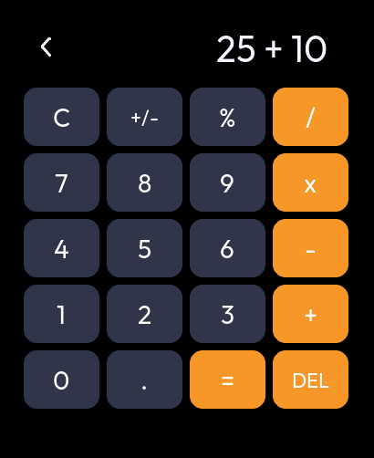

## Calendario (F9.3)

`calRender()` (AppsBasic.h:351-402):

- título "mes año" en minúscula ("octubre 2026", `MO_FULL`);
- fila "D L M M J V S" (la semana empieza en domingo);
- el día de hoy en un círculo del acento con el número en blanco; se repinta al cambiar el día.

Añadido en el reloj (la referencia solo enseña el mes actual):

- cambiar de mes con los botones o deslizando arriba y abajo;
- tocar el título vuelve al mes actual;
- sin hora fiable no se marca ningún día y una nota lo dice.

La lógica (`cal_month`, `cal_shift`, `cal_cell`) se prueba en el PC con meses de 4, 5 y 6 filas, bisiestos y paso de
año.

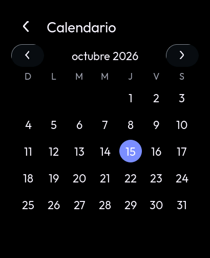

## Flex Compass (F9.4)

La referencia **no enseña un rumbo cuando no hay rumbo**: sin su IMU de 9 ejes (BNO085) muestra la pantalla de
requisito con el estado real del sensor (`AppCompass.h:683-709`). En "Datos técnicos" pone "No disponible", nunca un
cero (`AppCompass.h:834-870`).

El QMI8658 del reloj tiene acelerómetro y giroscopio pero **no magnetómetro**. La app muestra:

- el requisito, con los textos de la referencia adaptados;
- el estado real de cada sensor (el magnetómetro, "No presente");
- "Heading: No disponible";
- cabeceo y alabeo reales del acelerómetro.

El IMU solo mide con la página abierta (recuento de usuarios: no apaga el sensor a otra página).

⚠️ **Limitación de hardware:** no hay brújula. Una brújula real necesitaría un magnetómetro externo por I²C.

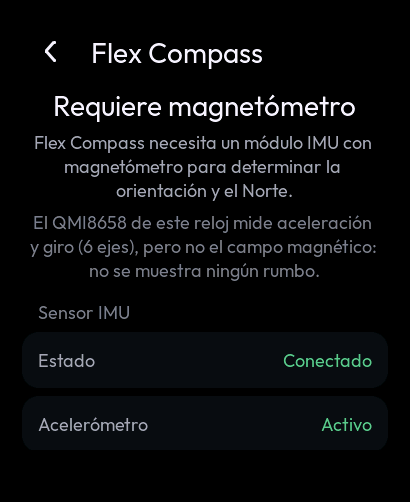

## Device Care (F9.5)

Es la pantalla "Salud de Flex OS" de la referencia (`DeviceCare.h:760-930`):

- **Puntuación 0-100 (`dcScoreFrom`, transcrita en `dc_score`):** sale solo de métricas medidas.
  - Una métrica con porcentaje vale su porcentaje, ×0,70 en aviso y ×0,35 en crítico.
  - Una sin porcentaje vale 100, 62 o 25.
  - Sin nada medido no se enseña número.
- **Anillo y palabra:** el anillo usa el color del nivel. La palabra es "Todo correcto" (≥ 80), "Necesita atención"
  (≥ 55) o "Estado crítico".
- **Filas con semáforo (`dcRowLed`)** y acceso a las pruebas: pantalla y táctil, sensores y diagnóstico completo.

| Métrica | Cómo se mide en el reloj | Umbrales |
|---|---|---|
| Memoria | RAM interna libre (`heap_caps`) | < 40 KB crítico, < 64 KB aviso (los de `FlexOS_Mem.h:117-118`) |
| PSRAM | libre y bloque mayor | el bloque mayor debe admitir el fondo (402 KB): < 402 KB o < 512 KB libres crítico; < 1 MB aviso |
| Estabilidad | motivo del último arranque (`esp_reset_reason`) y tiempo encendido | panic, watchdog o caída de tensión = aviso |
| Servicios | ajustes en NVS, hora fiable, LittleFS montado, IMU, AXP2101 | todos bien OK; falta uno aviso; más, crítico |
| Errores | subsistemas con fallos de bus I²C o de almacenamiento | 0 OK, 1 aviso, más crítico |
| Almacenamiento | LittleFS ocupado | ≥ 95 % crítico, ≥ 85 % aviso |
| Batería | nivel del AXP2101 | baja = aviso, crítica = crítico |

No se inventan las métricas del P4 sin equivalente aquí: el ritmo del bucle de Arduino, el contador persistente de
reinicios y la detección de caídas con BNO085.

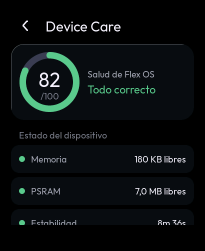

## Archivos y Notas (F9.6, F9.7)

**Capa de archivos (`components/watch_files`)**: `flexfs` con la semántica de `FlexOS_FS` de la referencia, en POSIX
sobre el LittleFS que monta `watch_storage` en `/storage` (en el PC, sobre una carpeta real):

- carpetas fijas `/Notas`, `/Documentos`, `/Paint` y `/Papelera`, creadas al usarse por primera vez;
- la papelera guarda la ruta original en el nombre (`/` → `@`, `FS.cpp:451-469`), sin índice aparte;
- nombres nuevos "Sin título 1.txt", "Sin título 2.txt"...; renombrar conserva la extensión y nunca pisa otro
  archivo; borrar una carpeta borra su contenido; el conteo de una carpeta sale de abrirla;
- escritura de texto **atómica** (temporal + renombrado): un corte de batería no deja una nota a medias.
- Cambios propios (`RELOJ:`): `@` prohibido en los nombres (era lo que rompía la restauración) y las colisiones en la
  papelera se numeran `@@N` en vez de `(N)`, que la referencia dejaba pegado al nombre al restaurar ("a.txt(2)").

**Notas** (`ui_notes.c`, icono `IC_NOTAS`): como `AppNotes.h`, cada tarjeta es un `.txt` real (título = nombre del
archivo, vista previa = sus primeros 96 bytes leídos del disco, "(vacía)" si no hay nada); "Nueva nota" crea y abre
"Sin título N"; el editor guarda 2 s después de la última tecla y al salir; mantener pulsada una nota abre sus
opciones. Tope de 4 KB por nota.

**Explorador** (`ui_files.c`, desde Almacenamiento > Explorar archivos / Papelera): carpetas con su número real de
elementos, archivos con su tamaño, ruta actual arriba; un `.txt` se abre en Notas y lo que el reloj no sabe abrir lo
dice. Opciones: Abrir, Renombrar, Mover a la papelera, Borrar definitivamente (con segundo toque); en la papelera,
cada elemento dice de dónde vino y se puede Restaurar (recrea la carpeta si ya no existe) o vaciar la papelera.

**Teclado compartido** (`ui_keyboard.c`): el de la contraseña Wi-Fi pasa a ser del sistema, con un modo de texto en
español (ñ/Ñ, página de tildes con ¿ ¡ ç º ª) e "Intro" para las notas.

Coste de escribir: las notas se guardan desde la tarea de la interfaz. Una escritura en la flash puede tardar decenas
de ms (borrado de un sector); con notas de hasta 4 KB y autoguardado cada 2 s como mínimo es un tirón ocasional
aceptable. Medirlo en el reloj (T95).

| Notas | Editor | Opciones | Papelera | Explorador |
|---|---|---|---|---|
| 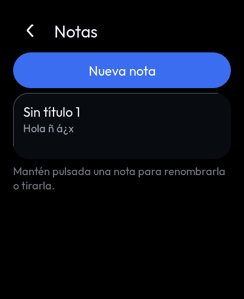 | 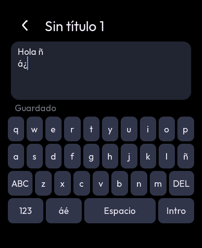 | 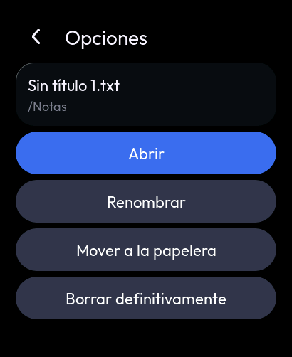 | 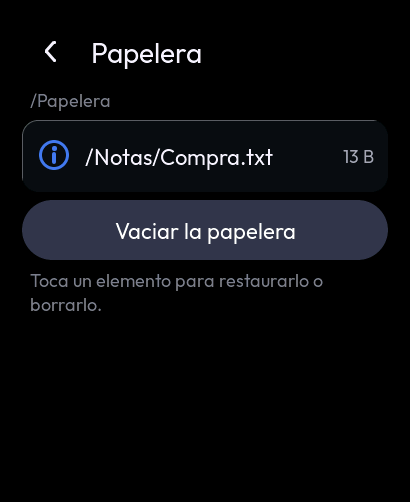 | 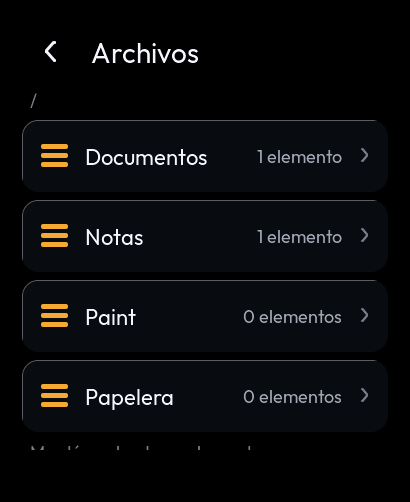 |

## Paint (F9.11)

`ui_paint.c` (icono `IC_PAINT`) con el formato **FXP1** de la referencia, escrito byte a byte por `watch_files/fxp.c`
(cabecera de 12 B "FXP1", ancho, alto, trazos; cada trazo con color RGB565, radio y puntos int16): un dibujo hecho en
Flex OS Ultra se abre en el reloj y al revés.

- Cada trazo se escribe al levantar el dedo (no hay botón "guardar"); un corte solo pierde el trazo en curso.
- El lienzo y las miniaturas de la galería se reconstruyen desde el ARCHIVO, a cualquier escala.
- 6 colores y 3 grosores de la referencia (`P_PAL`, `P_SIZES`); "Deshacer" real (quita el último trazo del archivo,
  con escritura atómica) y "Limpiar" (con segundo toque, `RELOJ:`; en la referencia era inmediato).
- Reducido al reloj: lienzo de 378 × 250 px (un dibujo de otro tamaño se encaja centrado y los trazos nuevos se
  guardan en sus coordenadas, radio incluido) y sin gesto de volver desde el borde, para poder dibujar hasta él.
- Memoria: el lienzo (189 KB) y las miniaturas (un bloque de 196 KB) van en PSRAM y se liberan al salir.

| Lienzo | Galería |
|---|---|
| 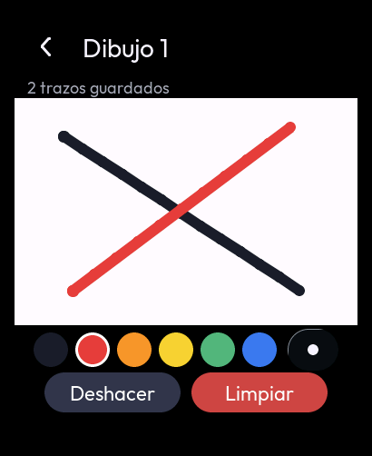 | 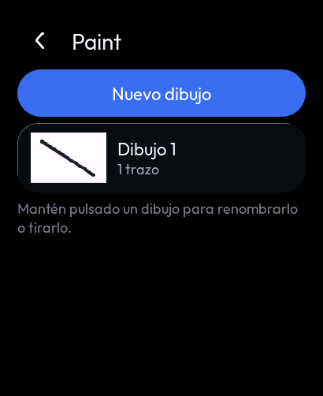 |

## Pruebas

### En el PC

- `tests/host/test_files.c`: nombres, rutas, papelera, tamaños y UTF-8 (lógica pura) y la capa `flexfs` sobre una
  carpeta temporal real: crear, leer, reescribir atómico, listar ordenado con conteos, renombrar, papelera con
  colisión, restaurar (también a una carpeta borrada), vaciar y borrar.
- Vista previa (`SIM_ONLY=notas`): sin almacenamiento, nota nueva, teclado (ñ, tildes, Intro), autoguardado y
  guardado al salir comprobados en el disco, vista previa real, renombrar (rechaza "/"), papelera y restaurar,
  explorador con conteos, archivo que no se abre, borrar con doble toque y abrir un .txt desde el explorador.
- `test_files.c` (FXP1): los bytes exactos de la cabecera y de un trazo, reproducción escalada, deshacer exacto,
  limpiar, archivo cortado y archivo que no es un dibujo. Vista previa: dibujo nuevo, dos trazos con el dedo
  simulado (guardados al levantarlo), cambio de color, deshacer, confirmación de limpiar y miniatura en la galería.

- `tests/host`: 1062 comprobaciones, entre ellas la calculadora, el calendario y la fórmula y los umbrales de Device
  Care (ASan + UBSan).
- Vista previa:
  - **Calculadora:** "25 + 10" en la línea, "35", "5/0" da "Error", y la operación se conserva al volver.
  - **Calendario:** octubre de 2026 con el 15 resaltado; pasa a noviembre sin marcar hoy, y el título vuelve a hoy.
  - **Flex Compass:** requisito y "No presente"; Heading "No disponible"; estado real; el IMU se apaga al salir.
  - **Device Care:** puntuación calculada, batería real y abre el diagnóstico.
  - Integridad visual de todas las páginas, prueba "mono" con las páginas nuevas y ASan/UBSan.

### En el reloj (pendientes)

| # | Prueba | Resultado esperado |
|---|---|---|
| T74 | Calculadora: "25 + 10 =", "5 / 0 =", salir y volver | 35; "Error" en rojo; se conserva la operación; teclas fáciles de acertar |
| T75 | Calendario: abrir, cambiar de mes con los botones y deslizando | Mes actual con hoy resaltado; el título vuelve a hoy |
| T76 | Flex Compass: inclinar el reloj | Pitch y Roll cambian; Heading "No disponible"; al salir el registro no muestra el IMU midiendo |
| T77 | Device Care | Puntuación y semáforos coherentes con Ajustes > Diagnóstico; "Estabilidad" con el tiempo encendido |
| T94 | Con el almacenamiento montado (F4.6): Notas > Nueva nota, escribir con ñ y tildes, salir | La nota aparece con su vista previa; tras reiniciar sigue ahí |
| T95 | Escribir sin parar 20 s en una nota | Sin tirones visibles al autoguardar; anotar si se nota alguno |
| T96 | Mover una nota a la papelera, restaurarla, renombrarla | Vuelve a /Notas con su contenido; el nombre cambia en la lista |
| T97 | Almacenamiento > Explorar archivos | Carpetas con su número de elementos; la papelera dice de dónde vino cada cosa |
| T98 | Paint: dibujar varios trazos rápidos, cambiar color y grosor, deshacer | El trazo sigue al dedo sin cortes; deshacer quita el último; tras reiniciar el dibujo sigue igual |
| T99 | Copiar un .fxp de Flex OS Ultra a /Paint del reloj (cuando haya forma de pasar archivos) | Se ve igual, encajado |
