# Flex Liquid Glass Engine — vidrio universal de Flex OS Watch Ultra

Petición del 2026-10-26 ("Flex Liquid Glass Engine — Sistema visual universal de Flex OS Watch Ultra", con cuatro
imágenes de referencia y el vídeo de presentación de Liquid Glass de Apple). Firmware real: ESP32-S3, AMOLED CO5300
de 410x502, LVGL 9.5.0 con dibujo por software en franjas, ESP-IDF 5.5.5.

**Nada de este documento está probado en el reloj.** Lo comprobado es la compilación del firmware, las pruebas de PC
y la vista previa de LVGL en el PC con las mismas condiciones de dibujo que el reloj (búferes parciales dobles y el
redondeo de áreas del CO5300). Las pruebas físicas están en `PRUEBAS-RELOJ.md` §17 (T205-T218).

Las imágenes de este documento son capturas de la vista previa (RGB565, como el panel): a la izquierda la versión de
partida (rama antes de este cambio) y a la derecha la nueva, con los mismos datos simulados.

## 1. Qué es

Un único motor de vidrio, en C, que usan todas las pantallas:

| Archivo | Qué hace |
|---|---|
| `watch_theme/include/flex_glass.h`, `watch_theme/flex_glass.c` | Estilos compartidos por función (rol), estados, tintes, componentes (botón, mosaico, control, interruptor, deslizador, lente de pestañas, lámina, velo) y la placa congelada de las esferas |
| `watch_theme/include/flex_glass_math.h`, `watch_theme/flex_glass_math.c` | Lógica pura, probada en el PC: receta de cada material por rol, estado, tinte y perfil; contraste WCAG; medidor del perfil automático |
| `watch_theme/include/flex_tokens.h` (sección "Flex Liquid Glass Engine") | Todos los valores: alfas, colores, borde, reflejo, tintes del sistema, tiempos de transición |
| `watch_ui/ui_glass.c` | Política: qué perfil se usa (ajuste del usuario, ahorro de energía, medida del rendimiento) |
| `watch_settings` (`ws.glass`, clave NVS `glass`) | Ajuste persistente: Automático, Premium, Estándar o Ligero |

No hay otra implementación de vidrio en el firmware: las anteriores se retiraron (§7). Las esferas son la única
excepción, a propósito: su placa está congelada (§3.5).

## 2. Referencias de Apple y cómo se traducen

Se estudiaron Human Interface Guidelines > Materials, la sesión WWDC25 219 "Meet Liquid Glass" y la documentación de
SwiftUI (`glassEffect(_:in:)`, `Glass`, `GlassEffectContainer`). Los principios se reproducen con lo que LVGL 9.5
dibuja de verdad en este hardware:

| Principio de Apple | Aquí | Límite |
|---|---|---|
| El vidrio es la capa de navegación y controles, por encima del contenido | Roles de control (`CONTROL`, `BAR`, `LENS`, `SHEET`) solo en controles, barras, avisos y menús. El contenido (tarjetas, filas) usa un material discreto (`CARD`, `ROW`). Las esferas, fotos, gráficas y datos no llevan vidrio | — |
| Nunca vidrio sobre vidrio | Un control va sobre un velo, una página o un ambiente; ningún componente del motor anida otra lámina | — |
| Variantes `regular` y `clear`; velo de atenuación para el vidrio claro sobre contenido rico | `SCRIM`: velo que atenúa la esfera bajo el panel rápido y la página web bajo el menú del navegador | — |
| Translucidez que deja ver lo de debajo | Cuerpo con alfa: LVGL compone la esfera o el fondo bajo el panel rápido | Lo de debajo se ve **nítido**: no hay desenfoque (§4) |
| Refracción y desenfoque en tiempo real | **No se hace.** | `blur_backdrop` de LVGL no sirve con búferes parciales (§4.1) |
| Reflejo especular y borde de luz | Degradado vertical en la parte alta del cuerpo (Premium) y borde de 1 px | Bandas RGB565 (§4.2) |
| `Glass.tint(_:)`: tinte selectivo | `flex_glass_set_tint`: tinte solo en lo activo (`LV_STATE_CHECKED`) y en la acción principal | Paleta fija de 12 tintes (memoria fija) |
| `Glass.interactive()`: el material responde al toque iluminándose | `flex_glass_interactive`: el estado pulsado ilumina el cuerpo y el borde con una transición de estilo (no una capa ni una escala) | — |
| `GlassEffectContainer`: formas de vidrio que se agrupan y se transforman | La lente de las pestañas (`LENS`) se desliza y cambia de ancho dentro de su barra; los mosaicos del panel comparten un único velo | No hay fusión de formas (metaball) |
| Contenido legible encima: texto "vibrante" | Texto principal `FLEX_GLASS_TXT`, secundario `FLEX_GLASS_TXT2`; texto oscuro sobre tintes claros. Contraste comprobado con la fórmula WCAG en el PC | — |

## 3. Arquitectura

### 3.1 Roles

| Rol | Para qué | Dónde |
|---|---|---|
| `CONTROL` | Botón, mosaico, píldora, tecla | Mosaicos del panel rápido, botones de todas las apps, teclas de los teclados, chips del temporizador |
| `BAR` | Barra de pestañas o de herramientas | Pestañas del Reloj |
| `LENS` | Lente de la pestaña o del elemento activo | Pestaña activa del Reloj, fila elegida de los rodillos (`ui_roller`: Fecha y hora, Alarmas) |
| `SHEET` | Lámina oscura flotante, legible sobre cualquier fondo | Aviso emergente, menú del navegador |
| `SCRIM` | Velo de atenuación | Panel rápido, fondo del menú del navegador |
| `AMBIENT` | Fondo ambiental opaco de una página que aloja vidrio | Notificaciones (lista y detalle) |
| `CARD` | Tarjeta de contenido | Notificaciones, Reloj (Hora y Alarmas), Almacenamiento, Bienestar, tarjetas de las apps |
| `ROW` | Fila de lista | Ajustes y todas las listas (`watch_theme_list_row`), campos de texto |
| `GHOST` | Invisible en reposo; vidrio solo mientras se toca | Zona "atrás" de la cabecera, opciones del menú del navegador, leyenda de Almacenamiento |

### 3.2 Estilos compartidos y cambio de perfil

`flex_glass_init` (desde `watch_theme_init`) crea **una vez** todos los estilos: 9 roles x 3 estados (normal,
pulsado, desactivado), los tintes de una paleta fija de 12 colores y los estilos de forma de los componentes. En total,
63 estilos vivos (`flex_glass_style_count`, comprobado en la vista previa). Los objetos solo guardan punteros a ellos:
crear un botón no reserva estilos nuevos.

`flex_glass_set_profile` reescribe esos mismos estilos con la receta del perfil y llama a
`lv_obj_report_style_change(NULL)`: LVGL redibuja **una vez** lo que los usa. No se recrea ni se reconstruye nada, no
hay parpadeo y no se pierde el estado de ninguna página (comprobado en `sim_glass.c`: mismo número de objetos antes y
después, sin restos en pantalla).

### 3.3 Perfiles

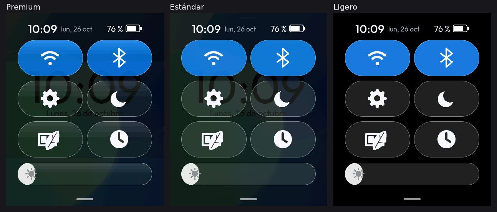

| | Premium | Estándar | Ligero |
|---|---|---|---|
| Cuerpo | Translúcido con reflejo: degradado vertical en el 45 % superior (`FLEX_GLASS_SHEEN_END`) y liso debajo | Translúcido liso (media de las dos alfas) | Opaco, precalculado sobre el negro de la página |
| Borde de luz | 1 px | 1 px, algo más suave | 1 px opaco precalculado |
| Velo del panel rápido | Translúcido (alfa 224 arriba, 208 abajo) | Translúcido liso | **Negro opaco**: LVGL ni dibuja la esfera debajo |
| Fondo ambiental | Degradado opaco | Degradado opaco | Negro |
| Transiciones de estado | 140 ms | 90 ms | Ninguna |
| Coste | El mayor: alfa por píxel y degradado | Alfa por píxel, sin degradado | Rellenos opacos; lo tapado no se dibuja |

Política (`ui_glass.c`):

- **Ajustes > Pantalla > Efectos > Vidrio** recorre Automático, Premium, Estándar y Ligero; se guarda en NVS.
  Durante el ahorro de energía la fila dice "Ligero (ahorro)".
- **Flex Ultra Power Saving** fuerza Ligero mientras está activo; al salir vuelve el perfil anterior.
- **Automático** empieza en Premium. Mide cada cuadro en la tarea de LVGL (de `LV_EVENT_REFR_START` a
  `LV_EVENT_REFR_READY`) y solo cuenta los pesados, los que redibujan al menos el 60 % de la pantalla (el panel
  rápido siguiendo al dedo, una transición de página). Tras **12 seguidos de más de 45 ms** baja a Estándar; un cuadro
  pesado de 30 ms o menos reinicia la cuenta; entre 30 y 45 ms ni suma ni reinicia. Nunca baja de Estándar por sí solo
  y no vuelve a subir durante la sesión (sin vaivenes). El cambio se aplica fuera del evento de dibujo
  (`lv_async_call`) y queda en el registro: `vidrio: cuadros de pantalla completa lentos; techo automático Estándar`.
  La fila de Ajustes enseña el resultado: "Auto (Premium)" o "Auto (Estándar)".

Los umbrales son una estimación: en el PC no se pueden medir los tiempos del ESP32-S3. T214 dice si hay que
cambiarlos.

### 3.4 Tintes y estados

- Tinte selectivo: solo lo activo (Wi-Fi y Bluetooth en azul, AOD en índigo, ahorro en ámbar en el panel rápido) y la
  acción principal (azul de Flex OS en "Optimizar", morado en Iniciar del cronómetro y del temporizador, rojo en las
  destructivas). Lo demás es vidrio sin tinte.
- Sobre un tinte claro (amarillo, lima) el texto pasa a oscuro (`FLEX_GLASS_TXT_ON_LIGHT`): la receta lo decide por
  la luminancia del tinte y las pruebas de PC comprueban el contraste.
- Pulsado: el cuerpo y el borde se iluminan. Desactivado: la mitad de cuerpo y de borde, texto apagado.

### 3.5 Esferas: sin cambios

Las esferas no se tocan: forma, cifras, tipografía, composición y método de dibujo son los de antes. Su placa de
vidrio (complicaciones, esfera "Liquid Glass") es `flex_glass_face_plate`, que reproduce **exactamente** la tarjeta
anterior (mismo color, borde superior e izquierdo, relleno y tinte adaptativo según la luma real del fondo) y no
cambia con el perfil. Comprobado píxel a píxel con las 41 capturas de esferas, AOD y selector: 38 son idénticas antes
y después; en las 3 del selector solo cambia el nombre que hay debajo de la vista previa ("Digital"), que es texto de
la interfaz y pasa de League Spartan Bold a Outfit. Las esferas y sus vistas previas, idénticas.

### 3.6 Reglas de dibujo

- Nada de sombras, contornos exteriores ni hijos flotantes de adorno: todo lo que dibuja una superficie cae dentro de
  sus coordenadas, así que la invalidación de LVGL al moverla, ocultarla o borrarla cubre siempre sus píxeles viejos y
  nuevos (§11).
- Nada de desenfoque ni de capas extra por cuadro.
- Un estilo nuevo solo se aplica si cambia de verdad (`flex_glass_set_tint`, `flex_glass_button_set`): cada cambio de
  estilo redibuja.

## 4. Límites del renderizador (lo que no se puede hacer bien aquí)

### 4.1 Desenfoque en tiempo real

LVGL 9.5 tiene `blur_backdrop`, pero no sirve en este reloj:

- Se dibuja por franjas (búferes parciales de pocas líneas en RAM interna con DMA): el desenfoque de cada franja solo
  ve sus propias líneas, así que salen costuras entre franjas.
- Solo se recalcula la zona invalidada: medido en la vista previa (`sim_glass.c`), dos dibujos completos de una
  tarjeta con `blur_backdrop` salen iguales (0 px distintos), pero redibujar solo una zona de 110x25 px dentro de ella
  (como un texto que cambia) deja **56 472 px** distintos del dibujo completo, con una diferencia de hasta 19 niveles.
  En el panel serían parches que aparecen y desaparecen.
- Cuesta varias pasadas por píxel en cada cuadro, justo en los cuadros más caros (el panel siguiendo al dedo).

Por eso el vidrio es translúcido pero **lo de debajo se ve nítido**. Para que la esfera no compita con los controles,
el velo del panel rápido la atenúa hasta dejar ver sus colores y su luz, no sus cifras.

### 4.2 Bandas en los degradados

El panel es RGB565 y LVGL 9.5 no trama los degradados: un degradado oscuro y largo se ve en franjas anchas (5 escalones
de 8 niveles en un mosaico de 94 px, medido). El reflejo se limita al 45 % superior del cuerpo y el salto de alfa del
control es pequeño (44 a 20): quedan 3 o 4 escalones estrechos arriba, que se leen como reflejo, y el resto es liso.
T215 dice cómo se ve en el panel físico.

### 4.3 Otros

- Sin sincronización con el TE del CO5300: en un movimiento rápido de pantalla completa puede verse un desgarro de un
  cuadro (transitorio; §11).
- Sin fusión de formas de vidrio (el "morph" de `GlassEffectContainer`): la lente se desliza, no se funde.

## 5. Tipografía

Escala única `FLEX_TYPE_*` (Outfit), ajustada al panel de 410x502:

| Nombre | Fuente | Uso |
|---|---|---|
| `FOOTNOTE` | Regular 15 | Notas al pie, chips |
| `CAPTION` | Regular 18 | Rótulos, metadatos, valores secundarios |
| `BODY` | Regular 22 | Texto |
| `LABEL` | Medium 20 | Botones, pestañas, título de una notificación o de una tarjeta |
| `HEADLINE` | Medium 24 | Valor destacado de una tarjeta |
| `TITLE` | Medium 30 | Título de pantalla |
| `NUMBER` | Regular 40 | Cifras grandes |
| `DISPLAY` | Regular 120 | La hora del Reloj (solo cifras y ':') |

- Regular para el texto y Medium para títulos y controles. Ya no hay negrita en la interfaz: League Spartan Bold
  (20, 22, 24, 32, 40 y 188 px) desaparece de las apps. Solo queda Spartan 16, que usa una esfera (las esferas no se
  tocan).
- Nuevas: Outfit Medium 20, 24 y 30 (`tools/gen_fonts.sh`, lv_font_conv 1.5.3, mismo rango de caracteres).
- Botones: margen lateral proporcional al ancho y puntos suspensivos si no cabe; el revisor visual de la vista previa
  comprueba en todas las capturas que nada quede truncado ni cortado por las esquinas.
- Resolución: todo se dibuja a 410x502 (`FLEX_SCREEN_W`/`FLEX_SCREEN_H`, las del panel); no se escala ni se estira
  nada.

## 6. Migración por app

| Pantalla | Antes | Ahora |
|---|---|---|
| Panel rápido (`ui_qp.c`, `ui_bright.c`) | Degradado turquesa-verde **opaco** (la esfera no se veía) con mosaicos de vidrio claro y brillo cian | Velo `SCRIM` translúcido sobre la esfera, seis cápsulas `CONTROL` con tinte solo si están activas, brillo con deslizador de vidrio y relleno blanco (§8) |
| Cajón (`ui_apps.c`, `ui_nav.c`) | Copia desenfocada del fondo (402 KB) arrastrada con la página | Velo y rejilla que siguen al dedo sobre la esfera quieta (§10) |
| Notificaciones (`ui_notifs.c`) y aviso (`ui_banner.c`) | Tarjetas sobre negro; aviso de vidrio claro | Fondo `AMBIENT`, tarjetas `CARD` separadas, aviso `SHEET` (§9) |
| Reloj: Hora, Cronómetro, Alarmas, Temporizador | Barra con resaltado azul brillante, tarjetas y botones con brillos y bordes gruesos, hora en League Spartan Bold 188 | Barra `BAR` con lente `LENS`, tarjetas `CARD`, botones del motor (principal en morado), hora en Outfit Regular 120 |
| Almacenamiento (`ui_storage.c`) | Tarjeta y botón propios con brillo y bordes gruesos | Tarjeta `CARD` "Memoria y sistema" con estado y "Optimizar" (botón principal), leyenda con filas `GHOST` |
| Ajustes y todas las listas | Filas de vidrio propias del tema | `ROW` del motor; zona "atrás" de la cabecera `GHOST` |
| Ajustes > Wi-Fi | Interruptor propio | `flex_glass_switch_style` |
| Navegador | Menú: tarjeta de vidrio claro sobre un negro al 40 % hecho a mano | Velo `SCRIM` y lámina `SHEET`; opciones `GHOST` |
| Galería | Botones y teclado con estilos propios | Botones, mosaicos y teclas del motor. El visor de fotos mantiene sus franjas negras (son el marco de la foto, contenido) |
| Bienestar (`ui_wb_*.c`) | Su propio vidrio ("lg") y League Spartan | Tarjetas, filas y botones del motor; escala `FLEX_TYPE_*`. Los anillos y las gráficas son datos y no llevan vidrio |
| Teclados, campos de texto, rodillos | Estilos propios | Teclas `CONTROL`, campos `ROW`, selección `LENS` |
| Calculadora, Calendario, Clima, Música, Notas, Paint, Archivos, Flex Phone, OTA, Device Care, Flex Compass, selector de esferas | Botones y mosaicos del tema anterior | Componentes del motor. La brújula y sus datos no llevan vidrio |
| Esferas y AOD | — | **Sin cambios** (§3.5) |

| | |
|---|---|
| 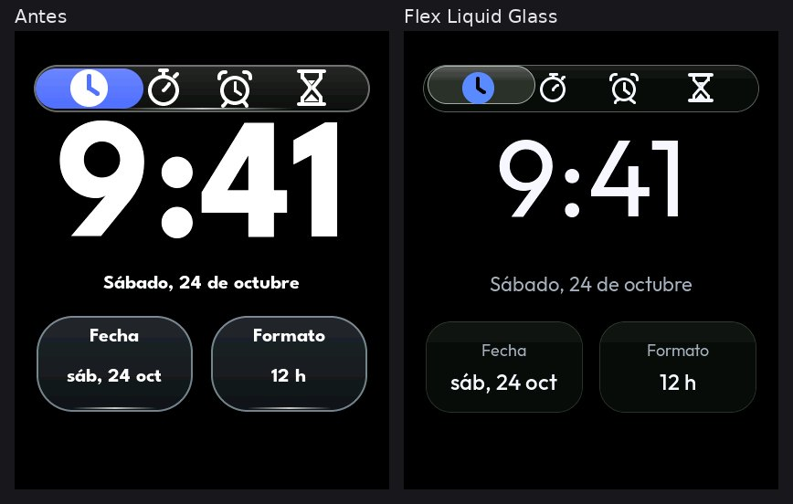 | 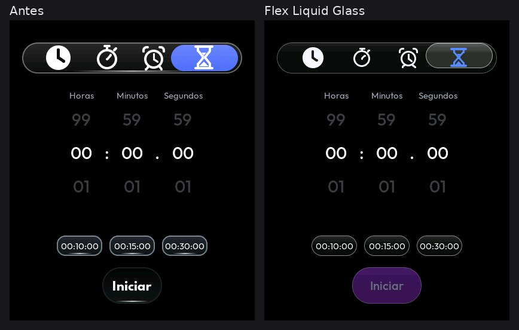 |
| 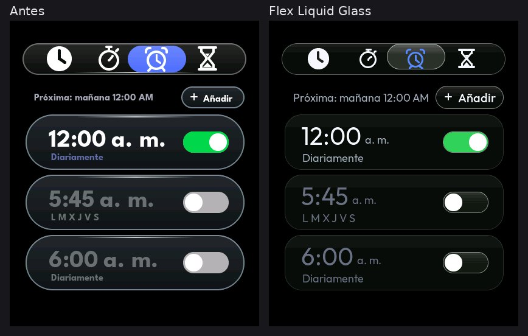 | 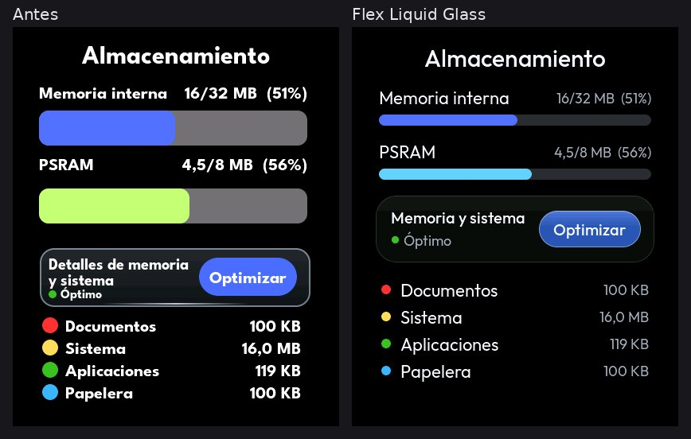 |

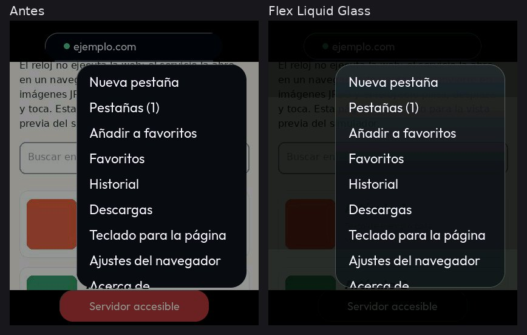

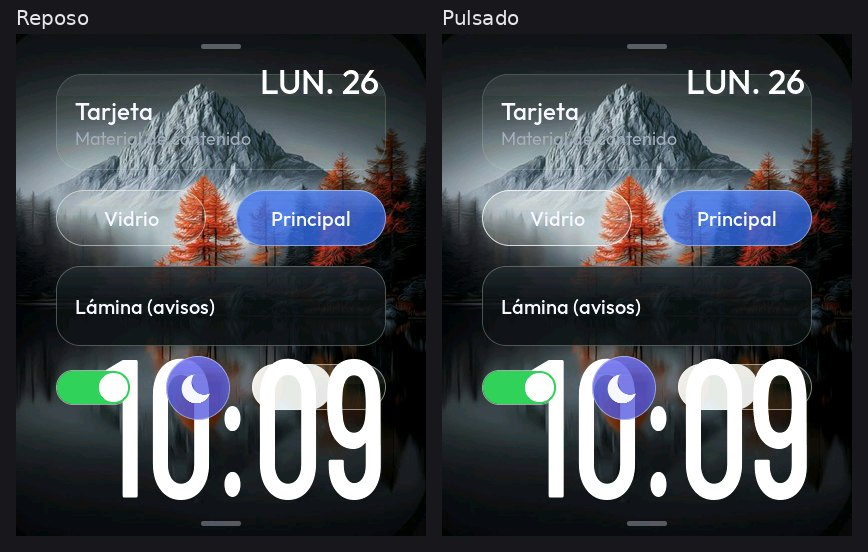

## 7. Implementaciones retiradas

- `watch_theme/flex_blur.c` y `flex_blur.h`: desenfoque por partes del fondo para el cajón.
- En `watch_theme.c`: la tarjeta de vidrio y sus estados (`s_card`, `s_pressed`, `s_checked`, `s_disabled`,
  `s_tile`), la maquinaria del fondo desenfocado (`s_blur` y sus búferes), `watch_theme_glass_card`,
  `watch_theme_set_min_tint`, `watch_theme_glass_button`, `watch_theme_button`, `watch_theme_button_set`,
  `watch_theme_tile`, `watch_theme_switch` y el bloque de estilos de las pantallas rediseñadas.
- El temporizador de la esfera que preparaba el fondo desenfocado (`ui_face.c`; no dibujaba nada).
- Tokens: `FLEX_LG_*`, `FLEX_QP_*` (degradado del panel), `FLEX_RD_TAB_*`, `FLEX_RD_START*`, `FLEX_RD_SWITCH_*`,
  `FLEX_RD_ALARM_*`, `FLEX_RD_FADED_BLUE`, `FLEX_ST_PSRAM`, `FLEX_ST_TRACK`, `FLEX_ST_BUTTON`, las mezclas de los
  estados del vidrio anterior y sus colores de brillo, sombra y borde. Quedan solo los de la placa de las esferas.
- Fuentes League Spartan Bold 20, 22, 24, 32, 40 y 188 px (`fonts/flex_spartan_*.c`) y sus macros.
- Los estilos propios de vidrio de las apps (Reloj, Almacenamiento, Bienestar, panel rápido, teclados, rodillos,
  interruptores, menú del navegador).

Una búsqueda en todo el código de las funciones, tokens y fuentes retirados no encuentra ningún uso.

## 8. Panel rápido

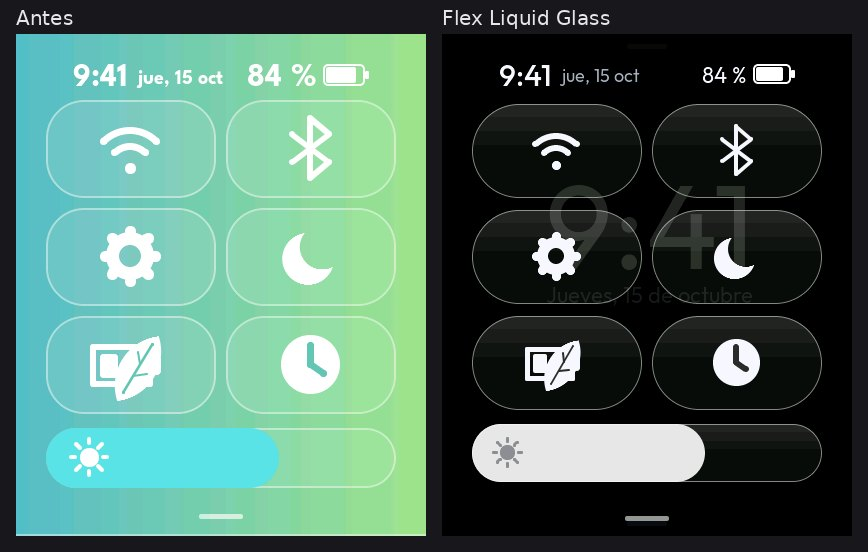

- Translúcido de verdad: velo `SCRIM` sobre la esfera, que se sigue viendo detrás (sus colores y su luz). Sin fondo
  verde ni turquesa.
- Seis cápsulas `CONTROL` (94 px de alto, radio completo) solo con icono, reflejo arriba y borde de luz de 1 px.
- Estados legibles: activo = tinte de su función (Wi-Fi y Bluetooth azul, AOD índigo, ahorro ámbar); Ajustes y Reloj
  nunca se tiñen; no disponible = apagado (AOD con el ahorro).
- Cabecera: hora en Medium 30, fecha en Regular 18 gris, porcentaje en Regular 22 y la batería.
- Brillo: deslizador de vidrio con relleno blanco y sol gris.
- Transiciones: el pulsado y el cambio de estado son transiciones de estilo del motor (140 ms en Premium). La cortina
  sigue al dedo como antes; los gestos no cambian.
- Ligero: velo negro opaco, así LVGL no compone la esfera mientras se arrastra.

## 9. Centro de notificaciones

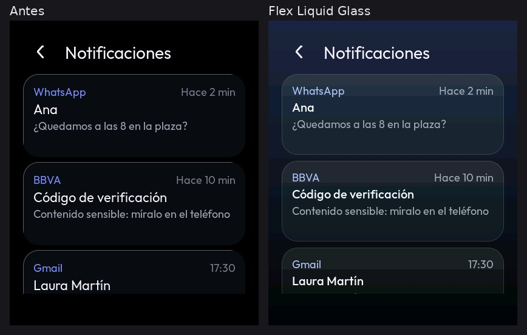

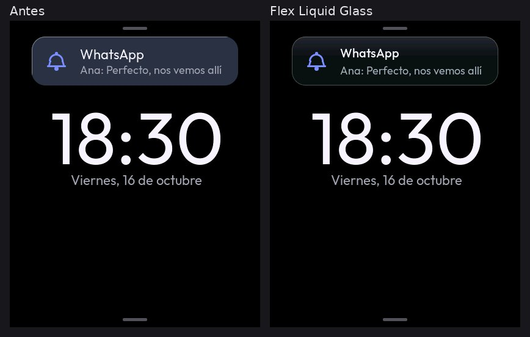

- Una sola superficie de fondo: el ambiente opaco del motor. La página ya no pinta su negro encima (antes había dos
  fondos superpuestos).
- Tarjetas `CARD` translúcidas sobre el ambiente, borde fino, 10 px entre tarjetas y 14 px de relleno vertical.
- Jerarquía: app en Regular 18 con color de acento, hora en Regular 18 gris, título en Medium 20, cuerpo en Regular 18
  gris. Detalle: título en Medium 24 y texto en Regular 22.
- El aviso emergente es una lámina `SHEET`, legible sobre cualquier esfera o app; título en Medium 20 y texto en
  Regular 18.

## 10. Cajón de aplicaciones

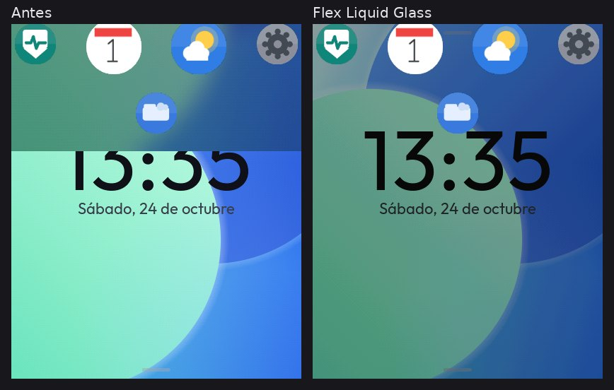

Antes, la página del cajón llevaba dentro una copia desenfocada del fondo de pantalla (411 640 B en PSRAM, más 39 312 B
de trabajo) y se arrastraba entera con el dedo: la esfera y esa copia se movían a la vez, la copia se generaba por
partes mientras se veía y al terminar entraba con un fundido.

Ahora (`ui_apps_transition`, llamada desde `ui_nav` en cada paso del gesto):

- La página no se desplaza: se queda en su sitio y la esfera de debajo, quieta.
- La rejilla de iconos sigue al dedo.
- El fondo de la página es un velo negro cuya opacidad sigue al recorrido (transparente al empezar, negro AMOLED con
  el cajón abierto). Es una propiedad de estilo, no una capa ni una imagen.
- Sin desenfoque, sin capas animadas y sin reconstruir nada por cuadro: solo cambian la `y` de la rejilla y la
  opacidad del fondo, y solo si cambian.
- Gestos, lupa, inercia y selección, como antes.

## 11. Imágenes fantasma (rastros)

### 11.1 Qué se buscó

El síntoma: al mover componentes de vidrio quedaban imágenes viejas en la pantalla. Se reprodujo en el PC el dibujo
del reloj **tal cual** (`tools/sim/sim_ghost.c`): búferes parciales dobles, el redondeo de áreas del CO5300 (inicio
par, final impar, como `watch_display.c`) y alturas de franja de 16, 40 y 54 líneas. Se movieron superficies
translúcidas sobre fondos complejos (el fondo Aurora y la esfera fotográfica Montaña) y, **después de cada cuadro**, se
comparó la pantalla con un redibujado completo: un píxel que el dibujo por partes no actualizó cuando debía haber
cambiado es un rastro.

Escenas: panel rápido (abrir, arrastrar, cerrar), aviso emergente, cajón, componentes del motor moviéndose y
cambiando de estado, pestañas del Reloj, desplazamiento y "atrás" en Ajustes, el gesto lateral de Bienestar y el zoom
del selector de esferas.

### 11.2 Resultado y causa

- La composición de LVGL es correcta en esas condiciones: **0 cuadros con rastros de 4098 comparados** (683 por cada
  combinación de fondo y altura de franja), tanto en la versión de partida como en la nueva. El zoom del selector
  remuestrea la imagen escalada desde el borde de cada franja y algún píxel sale con otro valor (20 px en total en la
  peor combinación): no es una imagen vieja; se cuenta aparte.
- `esp_lvgl_port` y el controlador del CO5300 esperan al final de cada transferencia DMA (`flush_ready` desde
  `on_color_trans_done`) antes de reutilizar un búfer: no se pisa un búfer que aún se envía.
- Lo que sí podía dejar imágenes viejas en el reloj, y se ha quitado:
  - el cajón movía una copia de pantalla completa del fondo, que además se escribía por partes **mientras se veía**
    (una imagen en pantalla modificada en su sitio; LVGL no sabe que sus píxeles cambiaron);
  - superficies que dibujaban fuera de sus coordenadas (sombras, contornos, brillos flotantes): al moverse, la zona
    invalidada no cubría esos píxeles. El motor no dibuja nada fuera del objeto (§3.6).
- Queda un factor de hardware: sin sincronización con el TE, un movimiento rápido de pantalla completa puede enseñar
  medio cuadro viejo durante un refresco (desgarro). Es transitorio; no deja restos.

No se limpia toda la pantalla en cada cuadro ni se fuerza un redibujado periódico. **La causa en el reloj no está
verificada:** no se pudo reproducir en el PC. T205-T207 dicen si ha desaparecido.

## 12. Memoria y tamaño

Firmware compilado con ESP-IDF 5.5.5 (xtensa-esp-elf 14.2.0) con la misma configuración antes y después
(`idf.py size`):

| | Antes | Ahora | Diferencia |
|---|---|---|---|
| Imagen | 3 450 919 B | 3 328 219 B | −122 700 B (fuentes Spartan Bold fuera, tres Outfit Medium dentro) |
| Ranura de 6 MB libre | 45 % | 47 % | |
| Datos en flash (.rodata) | 1 644 080 B | 1 522 176 B | −121 904 B |
| RAM interna estática (DIRAM) | 173 619 B | 174 291 B | +672 B (.bss: los estilos compartidos del motor) |

En marcha:

- PSRAM: **−450 952 B** con una esfera de fondo o fotográfica (el fondo desenfocado del cajón, 411 640 B, y sus búferes
  de trabajo, 38 934 B y 378 B). Con el fondo negro no había imagen y no cambia.
- Montón de LVGL (en PSRAM, `lv_mem_watch.c`), medido en la vista previa (punteros de 64 bits): entre 58 y 61
  bloques y unos 7,6 KB más, fijos, por los estilos del motor. No crece: diez cambios de perfil y los ciclos de abrir y cerrar de la batería
  `memoria` terminan con los mismos bloques que al empezar.
- Sin reservas por cuadro en el panel rápido, el cajón ni el motor.

## 13. Pruebas hechas (en el PC)

| Prueba | Orden | Resultado |
|---|---|---|
| Pruebas de lógica con ASan y UBSan (incluye `test_glass.c`: fórmula de contraste, recetas de cada perfil, legibilidad sobre página, lámina, velo, ambiente y tintes, medidor automático, ajuste) | `cd tests/host && IDF_PATH=… LVGL_DIR=… make` | 134 406 comprobaciones, 0 fallos; Galería 344, 0 fallos |
| Vista previa LVGL, todas las baterías (nuevas: `rastros` y `vidrio`) | `make -C tools/sim LVGL_DIR=… IDF_PATH=…` y `tools/sim/build/sim DIR` | TODO OK (0 fallos) |
| La misma con ASan y UBSan | `make -C tools/sim … SAN=1` y `tools/sim/build-san/sim DIR` | Con una carpeta de salida de ruta larga, 9 fallos, todos de la batería `galeria` (las rutas de su sistema de archivos simulado tienen límite; pasa igual sin este cambio); `galeria` con ruta corta: OK, sin errores de memoria. Pasada completa con ruta corta: **TODO OK (0 fallos)**, sin errores de memoria |
| Toques aleatorios ("mono") con ASan | `SIM_ONLY=mono SIM_SEED=n` con n = 1, 7, 42, 1234, 98765 | OK las cinco, sin errores de memoria |
| Esferas antes y después | comparación píxel a píxel de las 41 capturas de esferas, AOD y selector | esferas idénticas; solo cambia el nombre bajo la vista previa del selector (§3.5) |
| Compilación del firmware (ESP-IDF 5.5.5, esp32s3) | `FLEX_DEPS_DIR=… tools/offline/build_offline.sh build` | OK, 0 avisos del compilador |

La batería `vidrio` comprueba además: el cambio de perfil en caliente sin crear ni borrar objetos y sin restos; que el
velo del panel sea translúcido en Premium y Estándar y opaco en Ligero; que el ahorro ponga Ligero y al salir vuelva el
anterior; que la fila de Ajustes recorra los cuatro valores y se guarde; y que no quede memoria de LVGL. Las baterías
`rejilla` y `rediseno` se adaptaron al cajón nuevo (la rejilla sigue al dedo, la página no se mueve, el velo crece con
el recorrido, la esfera se ve quieta debajo) y a "Optimizar" (suelta la vista previa del selector).

## 14. Pendiente

- Todas las pruebas físicas (T205-T218): rastros, fluidez del panel y del cajón, bandas, perfil automático, consumo.
- Ajustar los umbrales del perfil automático con lo que mida el reloj (T214).
- Los cierres conocidos del editor de esferas, del navegador y de la configuración del Wi-Fi no se han reproducido en
  el PC (la vista previa con sanitizadores y los toques aleatorios no los encuentran); T217 los vuelve a buscar con el
  monitor abierto.

## 15. Desenfoque desde la fuente (fondos de vidrio de verdad)

`flex_glass_backdrop()` (en `flex_glass.c`) da a una pantalla un fondo desenfocado **de una imagen conocida** (hoy, la
portada en Reproduciendo), sin leer nunca la pantalla:

1. La imagen se reduce a un búfer propio de 1/4 (104 x 127 píxeles) con la media de cada celda, **en RGB888**.
2. Desenfoque de caja separable, radio 3, tres pasadas (casi gaussiano), en RGB888.
3. Tono: se oscurece y se acerca al gris para que el texto blanco se lea encima.
4. A RGB565 con **tramado ordenado Bayer 4x4**: conserva la media de cada tono; los escalones de 1 LSB, que en un
   degradado oscuro se veían como bloques al ampliar, quedan como grano fino.
5. Se dibuja como una imagen a escala **exacta x4** con el pivote en 0,0, sobresaliendo 2 píxeles por cada lado.

Por qué así:

- **Sin costuras, parches ni rastros.** El desenfoque de LVGL lee lo ya dibujado (§4.1); este no lee nada de la
  pantalla, así que un redibujado parcial no puede dejar la imagen vieja.
- **Escala exacta.** Con una escala no entera, LVGL calcula el paso del muestreo con el ancho de cada trozo que
  redibuja y el mismo píxel salía distinto según el trozo (840 píxeles distintos entre un redibujado completo y uno
  por partes). A x4 el paso es exacto; y como LVGL acota el muestreo al último píxel de la fuente, la imagen
  sobresale para que lo visible no llegue a ese límite.
- **Memoria acotada**: 26 KB por fondo mientras la pantalla está abierta y ~40 KB solo durante el cálculo (una vez
  por portada). En el perfil Ligero no se dibuja.

Pruebas: `tests/host/test_glass.c` (energía y simetría del desenfoque, recorte "cover", tono y que el empaquetado con
tramado conserve la media de cada nivel con grano de 1 LSB); simulador `medios` (un redibujado completo da los mismos
píxeles que el dibujado por partes) y `rastros` (Reproduciendo con el volumen arrastrado y la página yéndose tras el
dedo, en franjas de 54, 40 y 16 líneas: 0 rastros). En el reloj: `MULTIMEDIA.md` T233.

