# Rediseño 2026-10 — Flex OS Watch Ultra

Rediseño visual y funcional pedido el 2026-10-24 ("PROMPT MAESTRO — REDISEÑO VISUAL Y FUNCIONAL", con 15 imágenes de
referencia). Firmware real: ESP32-S3, AMOLED 410x502, LVGL 9.5.0, ESP-IDF 5.5.5. Todo está construido con
componentes reales de LVGL y con los datos reales de los servicios del reloj.

**Nada de este documento está probado en el reloj.** Lo comprobado es la compilación del firmware, las pruebas de PC
y la vista previa de LVGL en el PC (con datos simulados). Las pruebas físicas están en `PRUEBAS-RELOJ.md` §15
(T167-T184).

Referencias: `design/referencias/*.png` (pantallas) y `design/faces/*.png` (esferas), escaladas a 410x502. Las
comparaciones de este documento ponen la referencia a la izquierda y la vista previa a la derecha
(`tools/sim/compare.py`). Que se parezcan en la vista previa **no** demuestra la fidelidad en el panel físico (gama
del AMOLED, esquinas reales): eso lo dicen T167-T184.

## 1. Qué hay

| Pantalla | Archivos | Estado |
|---|---|---|
| Cajón en panal infinito con lente | `ui_grid_logic.c` (lógica pura), `ui_apps.c`, `flex_blur.c` | vista previa y pruebas de PC |
| Reloj: Hora, Cronómetro, Alarmas, Temporizador | `ui_reloj.c`, `ui_stopwatch.c`, `ui_alarms.c`, `ui_timer.c` | ídem |
| Almacenamiento | `ui_storage.c`, `watch_storage/stg_usage.c` | ídem |
| Seis esferas nuevas | `ui_face.c`, `assets/faces/`, `tools/faces/gen_faces.py` | ídem |
| Selector (editor) de esferas | `ui_face_editor.c`, `watch_theme/flex_thumb.c` | ídem |
| Flex Compass | `ui_compass.c` | ídem |
| Panel rápido | `ui_qp.c`, `ui_bright.c` | ídem |
| Tema: Liquid Glass oscuro y claro, iconos nuevos, fuentes | `watch_theme.c`, `flex_icons.c`, `flex_tokens.h`, `tools/gen_fonts.sh` | ídem |

## 2. Cajón de aplicaciones (Grid View)

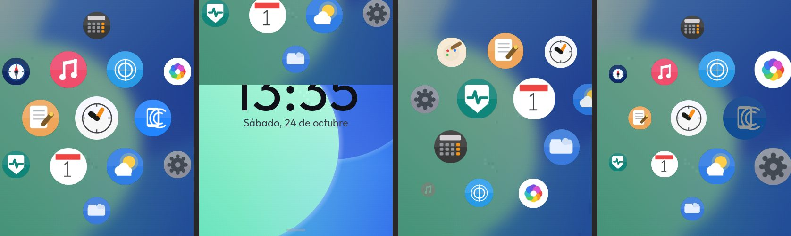

- Se abre **deslizando hacia abajo desde la esfera** (también hacia arriba desde el borde inferior, como antes); se
  cierra con el gesto contrario. La página sigue al dedo y al soltar se completa o se cancela.
- Panal **infinito** en 2D: celdas en coordenadas axiales sobre un toro de periodo 4 (16 posiciones). El periodo
  mínimo entre copias es 4 × 108 px y solo se dibuja lo que está a menos de 1,95 × 108 px del centro, así que **nunca
  se ven dos copias de la misma app** (comprobado en `tests/host/test_grid.c` con barridos de desplazamiento).
- 20 imágenes reutilizadas para todas las celdas: al desplazarse no se crean ni se borran objetos; solo cambian la
  posición, la escala y la opacidad de las que cambian.
- Lente (*fisheye*) con caída en coseno, empuje suave hacia fuera alrededor del dedo, inercia exponencial y ajuste a la
  celda más cercana con un muelle críticamente amortiguado (pasos de 4 ms, sin oscilar).
- Toque frente a arrastre: es toque si el dedo se mueve ≤ `UI_DRAG_SLOP_PX`; entre dos iconos no abre nada.
- Fondo: el fondo actual de la esfera **desenfocado una sola vez** y guardado (reducción ×4, tres pasadas de caja de
  radio 3, ampliación bilineal, oscurecido y tramado). Se genera por partes con la esfera quieta a la vista, para que
  el cajón lo tenga listo; con el fondo negro no hay imagen.
- El temporizador del cajón (16 ms) se pausa en reposo: quieto, no redibuja nada (`sim_redraw.c`: 0 px en 5 s).
- Los iconos son los de Flex OS. La captura de otro fabricante que vino como ejemplo se usó **solo** para el
  comportamiento; no se copió ningún recurso.

## 3. Reloj

| | |
|---|---|
| 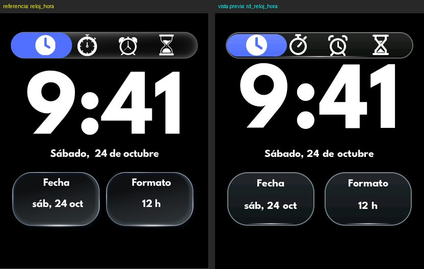 | 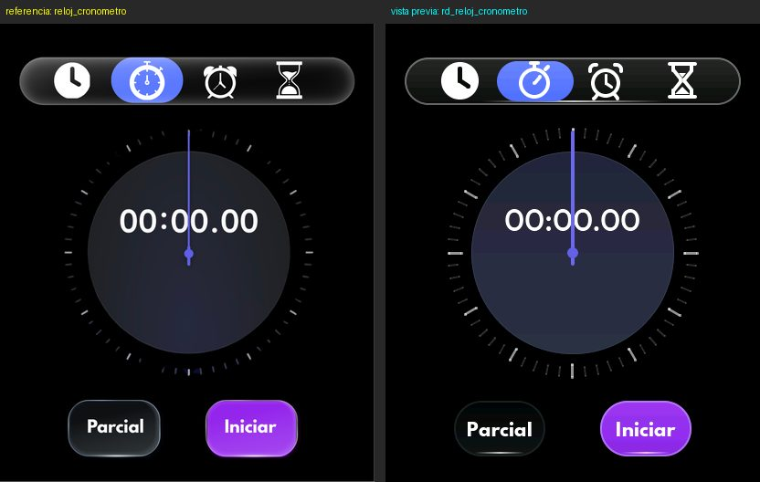 |
| 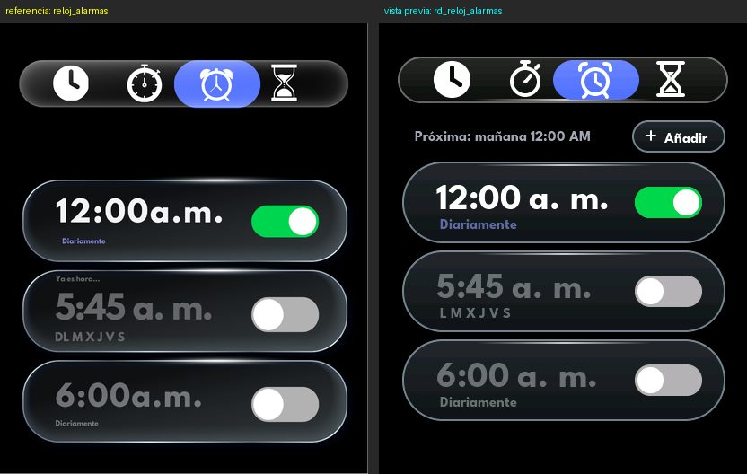 | 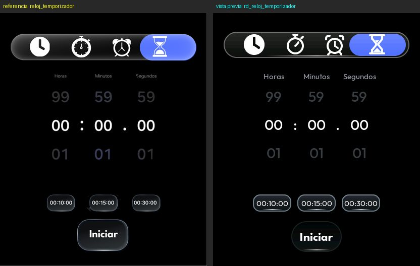 |

- Barra de pestañas de vidrio con el resaltado azul que se desliza (180 ms) y los iconos nuevos; una sola vista viva a
  la vez (se crea al elegir la pestaña y se borra al dejarla).
- **Hora:** la hora real, la fecha y dos tarjetas: Fecha (abre Fecha y hora) y Formato (cambia 12/24 h y se guarda).
- **Cronómetro:** esfera con 60 marcas, aguja con cola, tiempo y parciales (el mejor y el peor en color), Parcial e
  Iniciar/Parar. 33 ms solo en marcha.
- **Alarmas:** las alarmas reales con su interruptor (se guarda al tocarlo), "Próxima: …" calculada de verdad y
  "+ Añadir"; el editor de siempre.
- **Temporizador:** rodillos infinitos de horas, minutos y segundos, atajos 00:10:00, 00:15:00 y 00:30:00; en marcha,
  anillo de progreso, Pausa/Seguir y Cancelar. Iniciar no se puede pulsar con 0.
- Diferencias con la referencia: textos en español y la hora de 12 h con "a. m."/"p. m.".

## 4. Almacenamiento

| | |
|---|---|
| 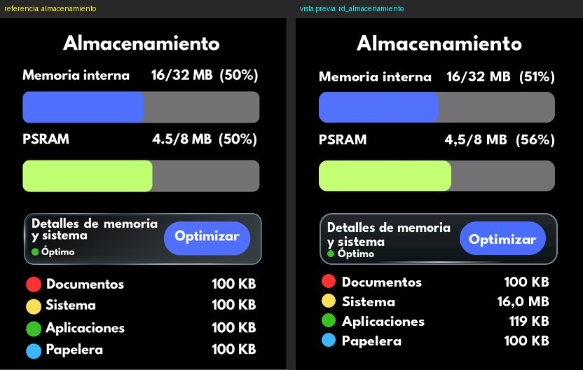 | 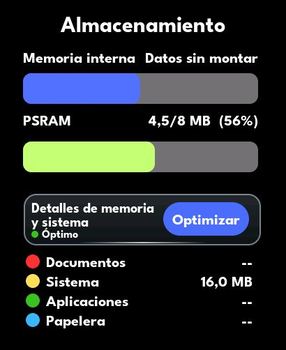 |

- Memoria interna = la flash física (de la sonda de arranque) y PSRAM con lo ocupado y el porcentaje reales.
- Categorías medidas, no estimadas: Documentos (`/Documentos`, `/Notas`, `/Paint`, `/Imagenes`) y Papelera se suman
  recorriendo los archivos **una vez por apertura**, en la tarea del almacenamiento y con un tope de 4000 archivos
  (`stg_usage.c`); Aplicaciones es el resto de lo usado en LittleFS; Sistema, lo que no es la partición de datos. Sin
  LittleFS montado dice "Datos sin montar" y "--".
- "Optimizar" suelta lo que se puede volver a generar (fondo desenfocado del cajón, el de las vistas previas, apps
  suspendidas) y dice cuánto liberó. **Nunca borra ni formatea datos.**
- "Detalles de memoria y sistema" abre la página anterior (estado, pruebas y formateo con doble confirmación). Tocar
  Documentos o Papelera abre el explorador en esa carpeta.

## 5. Esferas nuevas

| | | |
|---|---|---|
| 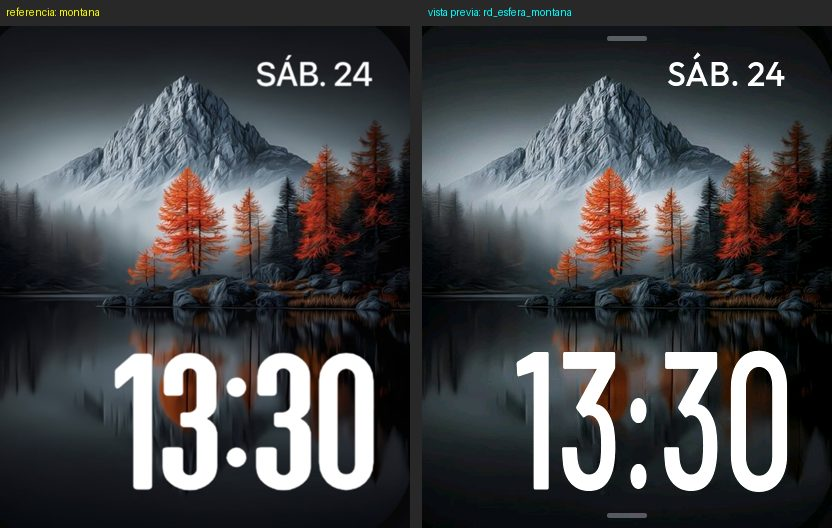 | 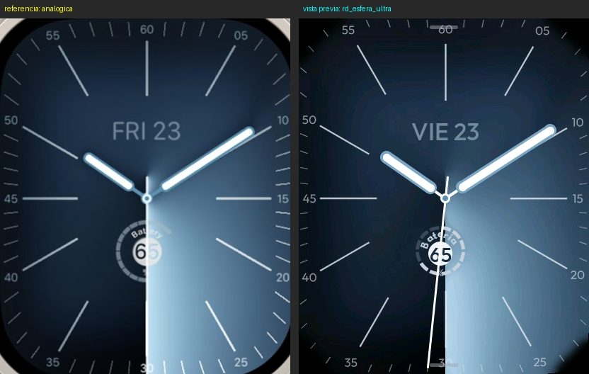 | 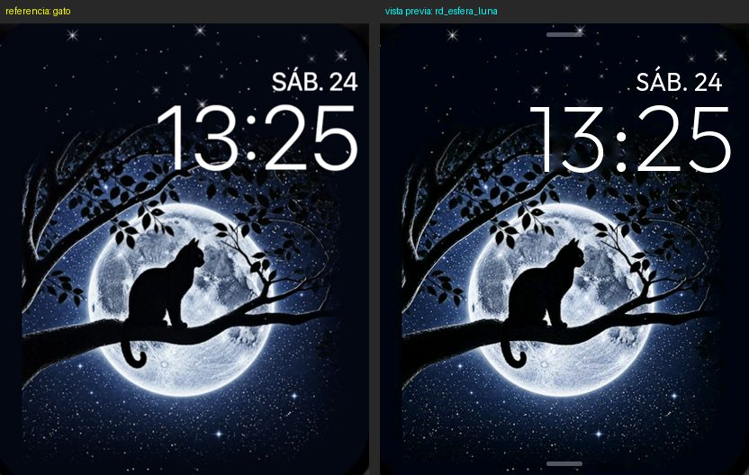 |
| 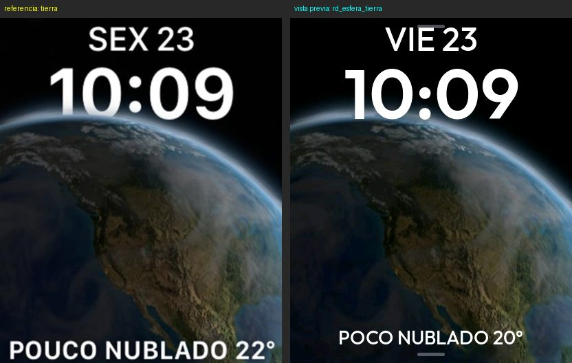 | 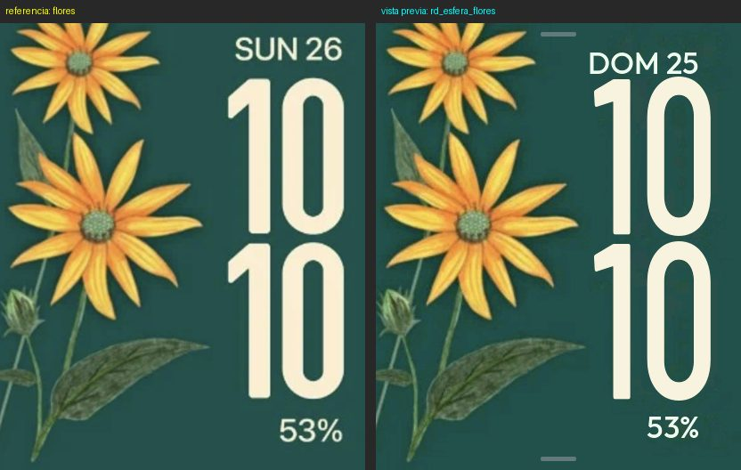 | 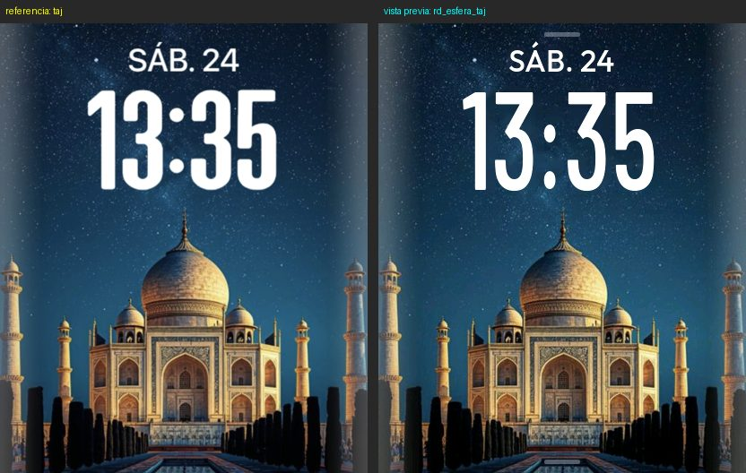 |

- Los fondos salen de las capturas del usuario con `tools/faces/gen_faces.py` (recorte a 410x502, textos borrados con
  el relleno de OpenCV, JPEG en flash de 24-54 KB). En "Ultra" el script redibuja las marcas y los números.
- Hora, fecha, batería y clima se dibujan con LVGL con los datos reales: el clima de "Tierra" sale de la caché de
  `watch_weather` y **se oculta sin datos**; la batería de "Flores" y "Ultra", de `ui_system`.
- Se ajustaron las posiciones de la referencia donde las esquinas redondeadas del panel cortarían el texto (fecha de
  Montaña, Luna y Flores; batería de Flores; el clima de Tierra sube y usa una letra menor y el ancho visible real).
- "Ultra" tiene segundero (la referencia no lo muestra) y su rótulo curvo es "Batería".
- Fechas en español ("SÁB. 24", "VIE 23"); las referencias venían en inglés o portugués.
- La esfera elegida se guarda en NVS (`watch_settings`) y se recupera al reiniciar.

## 6. Selector de esferas

| | | |
|---|---|---|
| 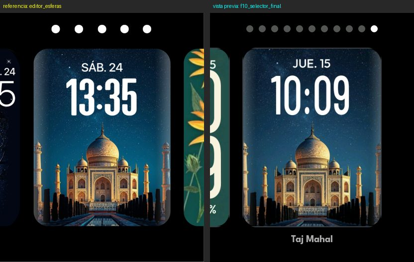 | 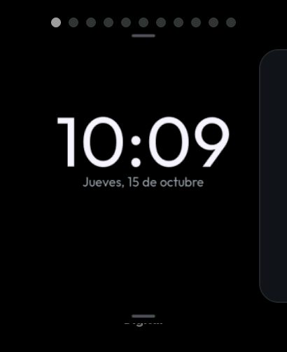 | 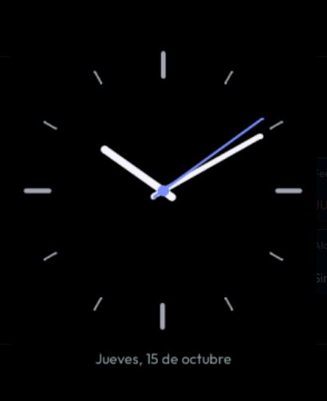 |

- Carrusel de tarjetas de 276x358 con las vecinas asomando, una fila de puntos y el nombre debajo.
- **Mantener pulsada la esfera sin moverse**: la esfera se aleja hasta su tarjeta (260 ms). Si el dedo se mueve más de
  14 px, no se abre. Desde Ajustes > Pantalla > Esfera entra deslizando.
- Tocar la tarjeta centrada la aplica: crece hasta llenar la pantalla y se vuelve a la esfera. Tocar una vecina la
  centra. El borde derecho sale sin cambiar nada.
- Vistas previas reales (la esfera de verdad, capturada y reducida con media de área sin deformarla).
- Ciclo de vida y memoria (corrigen las causas del reinicio del 2026-10-20 y una nueva):
  - ninguna captura dentro de un evento táctil: también la de la pulsación larga sale de un temporizador;
  - nada se genera durante una animación, un gesto o el desplazamiento del carrusel;
  - **ventana deslizante**: solo la centrada y dos a cada lado (5 × 193 KB como mucho, comprobado al recorrer las 11);
  - **arreglo**: antes, la vista previa de una esfera con otro fondo reescribía el fondo de la esfera activa; ahora las
    esferas temporales usan un búfer aparte (`watch_theme_preview_*`), comprobado en `sim_faces.c`;
  - la raíz se rehace fuera del evento táctil, al terminar el zoom; sin PSRAM para capturar, el selector funciona con
    tarjetas grises.

## 7. Flex Compass

| | |
|---|---|
| 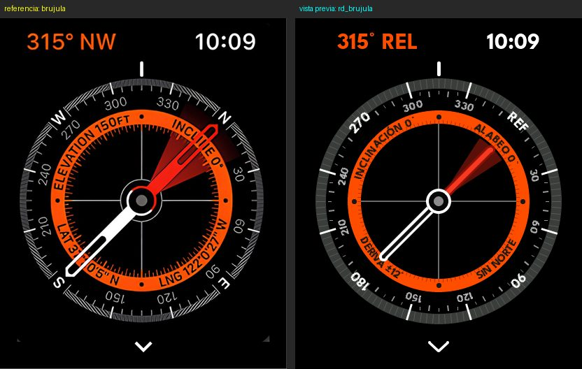 | 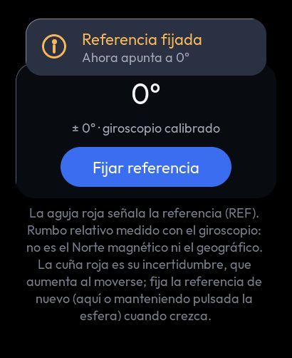 |

El reloj **no tiene magnetómetro, barómetro ni GPS**: no puede saber dónde está el Norte, ni la altitud, ni las
coordenadas, y no se inventan. La pantalla conserva el aspecto de la referencia con lo que sí se mide:

- "90° REL": rumbo **relativo** del giroscopio respecto a una referencia (al abrir la app o manteniendo pulsada la
  esfera; también con "Fijar referencia" en los detalles). En el bisel, "REF" está donde la referencia pondría "N".
- La cuña roja es la **incertidumbre** (± la deriva estimada, que crece al moverse).
- Anillo naranja: inclinación y alabeo reales del acelerómetro, la deriva y "SIN NORTE", en lugar de elevación,
  latitud y longitud. Sin datos del IMU: "--" y sin aguja (`img/rediseno/brujula_sin_imu.jpg`).
- La esfera es un único objeto que dibuja las marcas y las letras ya giradas: sin capturas, sin búferes grandes y sin
  renderizar nada en el evento que abre la app. Solo se redibuja cuando cambia el grado entero mostrado (con
  histéresis), la deriva o un texto; quieto, nada (`sim_redraw.c`).
- El chevrón abre los detalles: el requisito del magnetómetro y el estado real de cada sensor ("No presente" para
  magnetómetro, barómetro y GPS).

## 8. Panel rápido

| | |
|---|---|
| 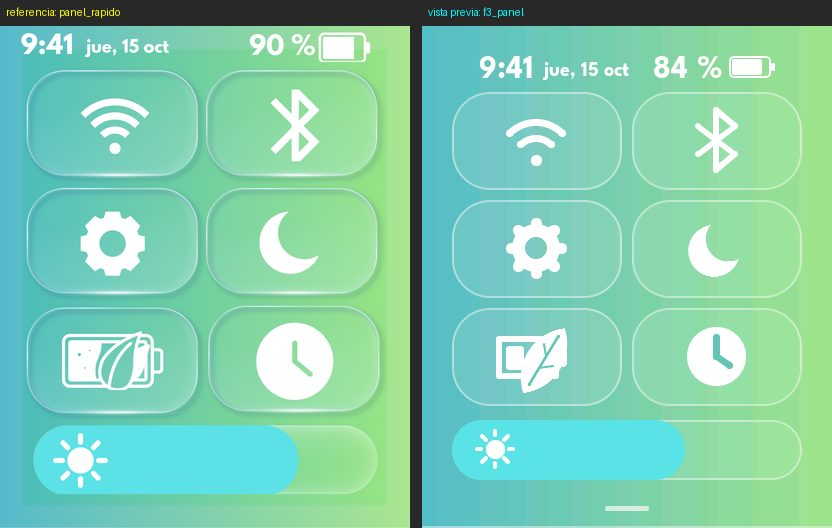 | 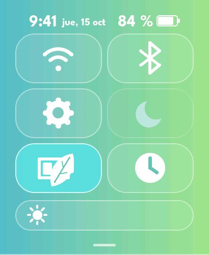 |

- Degradado turquesa-verde opaco (LVGL no dibuja la esfera debajo), cabecera con hora, fecha, % y batería en blanco
  (con su rayo o enchufe), seis mosaicos de vidrio claro y el brillo con relleno cian.
- Cada mosaico tiene función y **estado real**: Wi-Fi y Bluetooth (encender/apagar), Ajustes, AOD (luna; no disponible
  con el ahorro), Ahorro (batería con hoja) y Reloj (abre la app). Activo = cian; no disponible = más transparente.
- La batería de la cabecera abre Ajustes > Batería (el mosaico de batería anterior ya no está).
- Diferencias con la referencia: la cabecera está más abajo, donde las esquinas redondeadas dejan verla entera; los
  mosaicos no llevan subtítulo (como en el diseño), así que el nombre de la red o del teléfono se ve en Ajustes.

## 9. Memoria, ciclo de vida y otros arreglos

- **Fuga en `lv_arclabel` (LVGL 9.5.0):** el widget no tiene destructor y nunca libera la copia del texto que hace
  `lv_arclabel_set_text`. Cada esfera "Ultra" perdía un bloque. Se usa texto estático (`ui_face.c`).
- Las carpetas fijas (`/Notas`, `/Documentos`, `/Paint`, `/Papelera`) se creaban una vez por arranque: tras formatear
  desde Detalles no volvían hasta reiniciar. Ahora se comprueba al abrir (`ui_files.c`).
- Estilos del vidrio inicializados con el tema (antes, una reserva única la primera vez parecía una fuga).
- Iconos: "detener" con un rectángulo (con dos triángulos se veía la diagonal), luna maciza y hoja rellenas fila a fila
  (los triángulos dejaban costuras), reloj de arena redibujado; ninguno se sale de su caja (`sim_theme.c`).
- `lv_draw_arc` no admite ángulos negativos (dibujaba el círculo entero): la cuña de la brújula se normaliza.
- `LV_USE_ARCLABEL=1` se fija en `CMakeLists.txt` y `sdkconfig.defaults`, como `LV_USE_SNAPSHOT`.
- Navegación: `ui_nav_push_instant`, `ui_nav_back_instant` y `ui_nav_home_instant` para las páginas que animan su propia
  entrada o salida (el zoom del selector).

## 10. Fuentes

`tools/gen_fonts.sh` (lv_font_conv 1.5.3) regenera todas. Nuevas: League Spartan Bold (16-40 px y 188 px para la hora
del Reloj), una condensada derivada de Barlow Condensed (`FlexCondensed-Medium`, 156/196/248 px para las esferas) y
Outfit ExtraLight/Medium/SemiBold. Licencias en `Flex OS Ultra Watch/THIRD_PARTY_NOTICES.md` (OFL 1.1).

## 11. Pruebas hechas (en el PC)

| Prueba | Orden | Resultado |
|---|---|---|
| Pruebas de lógica con ASan y UBSan | `cd tests/host && IDF_PATH=… make` | 129 811 comprobaciones, 0 fallos |
| Vista previa LVGL, todas las baterías | `make -C tools/sim LVGL_DIR=… IDF_PATH=…` y `tools/sim/build/sim DIR` | TODO OK (0 fallos) |
| La misma con ASan y UBSan | `make -C tools/sim … SAN=1` y `tools/sim/build-san/sim DIR` | TODO OK (0 fallos), sin errores de memoria |
| Toques aleatorios ("mono") con ASan | `SIM_ONLY=mono SIM_SEED=n` con n = 1, 7, 42, 1234, 98765 | OK las cinco |
| Compilación del firmware (ESP-IDF 5.5.5, esp32s3) | `FLEX_DEPS_DIR=… tools/offline/build_offline.sh build` | **OK, 0 avisos** (§12) |

Baterías nuevas: `rejilla` (cajón), `rediseno` (Reloj, Almacenamiento, esferas y brújula con las escenas de las
referencias). Adaptadas al rediseño: `esferas`, `memoria`, `panel`, `ajustes`, `wifi`, `telefono`, `energia`,
`apps`, `reposo`. El revisor visual (`sim_lint.c`) comprueba en todas las capturas que nada quede cortado por las
esquinas, truncado o solapado; su regla de superficies ya no juzga el lado por el que asoma una tarjeta de carrusel
(las vecinas del selector), que el borde ya corta por diseño.

## 12. Compilación del firmware

Compilado con ESP-IDF v5.5.5 (xtensa-esp-elf 14.2.0) para esp32s3, con las mismas versiones de dependencias que
`B1-ARRANQUE.md` §2 tomadas de sus repositorios (`tools/offline/build_offline.sh`; el entorno no llega al Registro de
Componentes). **0 avisos** en todo el proyecto (los avisos de formato son errores en la compilación de ESP-IDF). Con la
misma compilación, la versión de partida (c391825) y la del rediseño:

| | c391825 | rediseño |
|---|---|---|
| Imagen | 2 656 959 B | 3 357 183 B (+700 KB: fuentes grandes y los 6 fondos JPEG, ~218 KB) |
| Ranura de 6 MB libre | 58 % | 47 % |
| RAM interna estática (DIRAM) | 170 403 B | 170 779 B (+376 B) |

La tabla de pesos de las miniaturas (6 KB) se reserva en PSRAM solo mientras se generan, en lugar de quedarse fija en la
RAM interna, que necesitan Wi-Fi y BLE.

En este entorno el script de activación de ESP-IDF no funciona (pide un archivo que se descarga de dl.espressif.com):
se usó `IDF_PYTHON_CHECK_CONSTRAINTS=no` (opción de `idf_tools.py`) y el `PATH` de `idf_tools.py export`. En tu PC no
hace falta. En un PC con acceso al Registro de Componentes:

```bash
cd "Flex OS Ultra Watch"
idf.py set-target esp32s3      # solo la primera vez
idf.py build
idf.py -p PUERTO flash monitor  # nunca idf.py erase-flash
```

## 13. Pendiente

- Todas las pruebas físicas (T167-T184): fidelidad en el panel, fluidez del cajón y del zoom, tiempos de las vistas
  previas, consumo.
- Medir en el reloj el coste de dibujar la brújula al girar y del zoom del selector (la vista previa no mide tiempos
  del ESP32-S3).
- Confirmar que las fotografías de las esferas se pueden distribuir.
